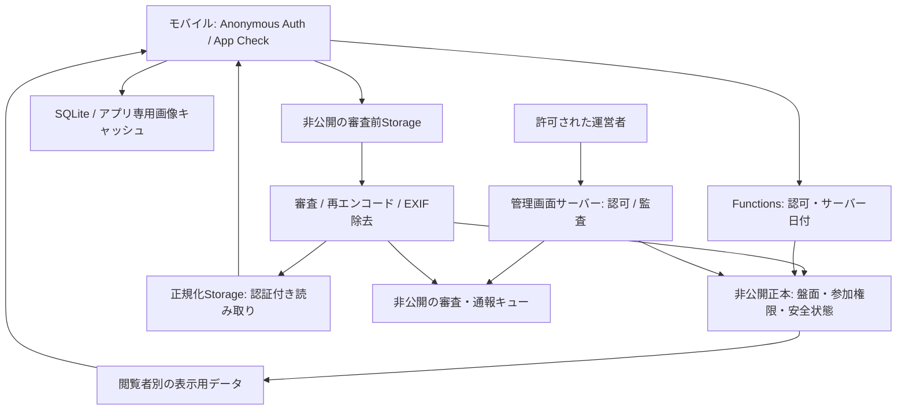

# 対面型パズルSNS 実装計画

作成日・調査日：2026年10月10日（日本時間）

対象仕様：[PRODUCT_SPEC.md](PRODUCT_SPEC.md) v1.0（全1,027行）

状態：2026年10月10日、ユーザーの承認・着手指示によりPhase 1とPhase 2のローカル実装・検証が完了。Phase 2の実3プロジェクト作成・外部設定は、ユーザーの「未作成・まずローカルで進める」に従い未実施。Phase 3のローカル実装を追加し、実機・実サービス・法務ゲートは未通過。実施結果・残作業は第14〜16節を参照。

## 1. 今回の範囲と進行ルール

Phase 0の計画書作成時の成果物は本書だけとした。仕様書・AGENTS.md・実装コード・依存パッケージ・Git構成・開発環境・外部サービス設定はその時点では変更しなかった。計画書を作成する指示だけをPhase 1開始の承認として扱わず、その後のユーザーの承認・着手指示を受けてPhase 1を実施した。

仕様の原本はPRODUCT_SPEC.mdとする。第3節のD-01〜D-13は、会話でユーザーが一問ずつ承認した明文化・追加事項である。D-09はPhase 2、D-10〜D-13はPhase 3の実装中に確認した。原本を無断で書き換えず、該当箇所と承認記録を併読する。今後の別の仕様変更は、衝突点を説明して一問ずつ確認する。

各Phaseは前Phaseの完了確認後に一つずつ進める。編集前に範囲・前提・完了条件を述べ、検査結果・最終差分・実機または手動で未確認の内容を報告する。実機試験や運営体制が未確認の段階で「公開可能」と判断しない。

2026年10月30日、ユーザーの指示により、各実装の推奨AIモデルと、完了報告の最後に次の実装・推奨モデル・理由を案内する運用を追加した。第6.1節と[モデル選択・引き継ぎの共通文書](AI_IMPLEMENTATION_GUIDE.md)に従う。製品仕様と既存の完了条件は維持する。

Phase 0の今回の完了条件は、全要件の追跡、承認事項の記録、環境確認、リポジトリ設計、脅威分析、Phase別の完了条件・テスト・手動作業・外部依存、Phase 1の作業分解を本書に揃えることである。Phase 0全体の仕様凍結が完了したという意味ではない。

仕様§27のPhase 0成果物のうち、アプリ名・ビジュアル・画面ワイヤー・実際の形状シミュレーション・利用規約等の初稿・正式なモデレーション運用手順は未作成である。本書に作成時期と必須ゲートを記載し、今回の依頼を越えて制作・実装しない。形状シミュレーションの実行はPhase 1の開発用CLIで扱う。

## 2. 開発環境の読み取り結果

以下はPhase 0の読み取り調査結果（2026年10月10日）。調査時点ではインストール、更新、ログイン、ライセンス同意、環境変数の書き換えは実行していない。PATHで見つからないことは、Mac全域で未導入であることを意味しない。Phase 1で用意したローカルNode・pnpmは第14節に記録する。

| 項目 | 確認結果 | 必要な対応と時期 |
| --- | --- | --- |
| Mac | macOS 26.6.2、arm64 | 開発対象として使用 |
| Node.js / npm | 24.3.0 / 11.7.0 | Phase 1でNode 22系の対応パッチ版へ統一し固定 |
| pnpm | PATH上にない | Phase 1で導入しpackageManagerとlockfileで固定 |
| Corepack | 0.33.0 | Phase 1でpnpm導入方法とバージョン固定を確認 |
| Xcode | 15.0.1、選択先はXcode本体 | Phase 3前に採用Expo SDKの必要版へ更新 |
| Android Studio | 2022.2、同梱JBR 17.0.6 | Phase 3前に採用SDK対応版へ更新 |
| Android SDK | platforms 33・34・35、build-tools 34.0.0・36.0.0 | compile SDK 36を追加。build-toolsの存在とplatformの存在は別に確認 |
| Java | PATH上は21.0.2、Studio同梱17.0.6。java_homeは24・11・8も列挙 | AndroidビルドはJDK 17、Emulator SuiteはJDK 21をタスクごとに明示して混在を防止 |
| Firebase CLI | 14.23.0を検出、更新確認エラーで終了コード2 | Phase 2前に正常終了・必要な権限を確認。今回sudoや権限変更はしない |
| EAS CLI | PATH上にない | Phase 3前に導入・固定 |
| CocoaPods / Ruby | 1.16.2 / 2.6.10 | 更新後のXcode・ネイティブ依存との動作を確認 |
| Expo CLI | 旧グローバル版6.3.12が存在 | プロジェクト側のExpo CLIを使用 |
| adb | Android SDK内に34.0.3が存在、PATH上にない | ANDROID_HOMEと必要なPATHを設定し実機接続を確認 |
| Android環境変数 | ANDROID_HOME、ANDROID_SDK_ROOTとも未設定 | Phase 3前に採用ビルド手順に合わせて設定 |
| Maestro / Watchman / GitHub CLI | PATH上にない | MaestroはPhase 7前に導入。他は必要性を確認して導入 |
| iOS Simulator | CoreSimulatorService接続失敗によりruntime列挙不可 | 通常のMac操作環境で再確認。今回の制限と実際の環境不良を区別 |
| Android Emulator | 32.1.13を検出 | Phase 3前に更新・起動確認。今回起動していない |
| ディスク | 空き約25GiB、使用率95% | Xcode・SDK更新前に必要な空き容量を確保 |
| Git | 2.39.3。親の /Users/k23106kk/src が管理ルート | D-07に従いPhase 1で専用リポジトリを作成 |

Firebase・EAS・Apple・Google・GitHubのログイン状態、契約、課金、既存プロジェクト、署名情報は調査していない。秘密情報を読み出さず、各Phaseの手動設定として確認する。

## 3. 仕様の整合性と承認記録

| 判断ID | 原本の箇所・問題 | 承認済みの扱い | 反映・検証 |
| --- | --- | --- | --- |
| D-01 | §3.1・§26の4時以降変更禁止と§14・§17の後日の安全処理 | 形状・配置・参加構成は固定。本人削除・運営削除・安全ブロックによる無地化は過去作品にも反映 | Phase 2・4・6。V-TIME、V-SAFETY、V-GALLERY |
| D-02 | AGENTS.mdのクライアントへの安全ID・削除キー露出禁止と§11.3・§19.3の匿名Auth・端末保持 | 本人の認証情報・本人用削除キーだけ本人端末で保持可。他人の安全ID、秘密鍵、内部対応表、私的通報情報は一般利用者へ渡さない | Phase 2・4・6。V-ACCESS、V-PRIVACY |
| D-03 | §5.2の相対配置探索と§22.1の既存ピースの位置不変 | 各盤面内の相対位置・向きを固定。統合時だけ盤面全体の整数平行移動を許可。個々の再配置・回転は禁止 | Phase 1・2。V-ENGINE |
| D-04 | §9.2のRanging APIと§19.1のAndroid 12以上 | Android 12〜15はBLE。16以降は端末・相手の互換性確認時にUWB。旧OS用の別UWB方式をMVPへ追加しない | Phase 5。V-NATIVE |
| D-05 | §11.3・§18.2の日次公開ID破棄とGallery・削除同期 | 日次主体IDを4時に失効。作品のピースID・盤面IDと非公開権限対応は保持。人物関係や分析には転用しない | Phase 2・6。V-TIME、V-PRIVACY |
| D-06 | §14の個別写真削除だけでは利用終了・本人データ削除が未定義 | MVPに利用終了、本人写真の一括無地化、認証主体等の削除、端末紛失時の問い合わせ経路を追加。安全記録の保管例外は法務確認 | Phase 4・6・7。V-SAFETY、V-LEGAL |
| D-07 | 現在は親Git管理下 | Phase 1でpuzzle-snsを独立したGit・GitHubリポジトリとして管理。親・兄弟プロジェクトを変更しない | Phase 1。V-TOOLING |
| D-08 | §12・§24の再インストール後復元不可とiOS Keychain残存 | バックアップ対象外のインストール印を使い、再インストール時に残存する本人用鍵・認証情報を引き継がない。通常のアプリ更新は保持 | Phase 3・4・6。V-PRIVACY、実機試験 |
| D-09 | §3.1・§10の4時境界と、Firestoreの保存完了時刻を事前保証できない点 | FITの確定時点はトランザクション内の書き込み直前の最後のサーバー時刻判定とする。4時以降の判定・再試行は不成立。最後の判定が4時前なら保存完了が4時を越えても前日分として確定 | Phase 2でユーザー承認・境界試験済み。Phase 5・6にも適用。V-TIME、§15 |

| D-10 | §27・§28のアプリ名 | Phase 3は仮称「puzzle-sns」で進める。2026年10月31日、ユーザーが正式名称を「Meetile」に決定（[記録](UI_REDESIGN.md#アプリ名とロゴ2026年10月31日)） | P3承認済／Meetile決定済／§16 |
| D-11 | §16・§28の表示方針 | 生成り・墨色・珊瑚色、OS標準日本語フォント。短いピース化演出と動きを減らす設定への対応 | P3承認済／実機の画面確認は未実施／§16 |
| D-12 | §11・§18・§28の入力・画像仕様 | 署名20文字、キャプション140文字、空欄・重複可。正方形1024px・JPEG品質80%。サーバーでも入力制限・再処理 | P3承認済／文字・サーバー画像処理検証／§16 |
| D-13 | §17.1・§28のしきい値と保留UX | SafeSearchの成人・性的示唆・暴力はLIKELY以上拒否、POSSIBLE保留。テキスト0.8以上拒否・0.5以上保留。連絡先・禁止語拒否、不明・障害時未公開、保留は確認中 | P3承認済／人工分岐検証／実精度・運営評価は公開前必須／§16 |

全参加者で一致させるのは最終盤面の正本の形状・配置・参加構成・版本である。安全処理による閲覧者別の無地化はD-01に従い適用する。外部書き出しやスクリーンショットの回収は保証しない。

FIT事前確認の一枚表示は§9.3で既に認められた例外として扱う。相互検知・期限・資格を満たすセッションに限り、相手本人のピースだけを渡す。失敗時に盤面全体を公開しない。ブロック・削除・停止状態はこの経路にも適用する。

### 3.1 技術的な成立性

指定のpnpm・TypeScript・React Native・Expo Development Build・Firebase構成は設計可能。ただし依存のネイティブ互換性、近接精度、投稿審査品質、運営体制の成立は未検証である。

- 調査時点のExpo公式資料ではSDK 57はiOS 16.4以上、Xcode 26.4以上、Node 22.13系以上、compile/target SDK 36。対応OSの仕様とは整合するが、ローカルXcode・Android platformは不足する。モバイル着手時に現行安定版を再確認し、関連依存の互換性を検証してlockfileを固定する。[Expo SDK](https://docs.expo.dev/versions/latest/)
- Node 22系はExpoとFunctionsの共通候補。今回検出したNode 24をそのままFunctionsランタイムと仮定しない。[Functionsランタイム](https://firebase.google.com/docs/functions/manage-functions)
- Ranging APIはAndroid 16以降。iOSとのUWBには対応したOOBプロトコル交換が必要。対応チップがあるだけで利用可能と判定せず、能力検出と組み合わせ試験を必須にする。[Android Ranging](https://developer.android.com/develop/connectivity/ranging)
- moderateTextは日本語に対応するが、短いキャプション、署名、隠語、表記揺れ、連絡先掲載の検出性能は別途評価する。[Natural Language対応言語](https://docs.cloud.google.com/natural-language/docs/languages)
- Storage RulesからFirestoreを参照できるが1評価最大2文書。参加権限・閲覧制限をその範囲で判定できる構造をEmulatorとstagingで検証する。[Storage Rules](https://firebase.google.com/docs/storage/security/rules-conditions)
- iOSのSecureStoreは削除後も残ることがあるため、D-08の新規インストール判定が必要。OSバックアップによるGallery・鍵・認証情報の偶発的な復元も実機で検証する。[SecureStore](https://docs.expo.dev/versions/latest/sdk/securestore/)
- 匿名Authの自動クリーンアップは無効にする。30日後の自動削除を、無期限の写真閲覧権限・削除権限に適用しない。[匿名Auth](https://firebase.google.com/docs/auth/android/anonymous-auth)

### 3.2 法務・安全運用上の不足

16歳以上の自己申告、法定代理人の関与、未成年者との契約、第三者の肖像・著作権、外国でのデータ処理、削除請求、保存期間、重大事案の証拠保全・報告は専門家確認を必須とする。2026年の改正法は公布と施行を区別し、公開時点の適用法を確認する。[個人情報保護委員会](https://www.ppc.go.jp/news/press/2026/260717/)

UGCのフィルタリング・通報・ブロック・連絡窓口・迅速な対応を実運用可能にする。児童安全基準への適合はKidsカテゴリに出さないことや年齢制限だけで代替できない。[Apple UGC規定](https://developer.apple.com/app-store/review/guidelines/)、[Google Play UGC規定](https://support.google.com/googleplay/android-developer/answer/9876937)、[Google Play児童安全規定](https://support.google.com/googleplay/android-developer/answer/14747720)

匿名認証に対するアカウント削除規定の適用は法務・ストア申請時に確認する。D-06の利用終了とアプリを再導入せずに削除を請求できる外部窓口を整備する。安全上・法律上必要な保管例外は目的と期限を公開文書で説明する。[Google Play削除規定](https://support.google.com/googleplay/android-developer/answer/13327111)

SafeSearchをCSAMの完全な検出器として扱わない。実際の違法画像を開発・検証へ持ち込まない。人工的な無害素材とテキストケース、審査結果のテストダブルを使う。保留案件は非公開にし、重大事案の閲覧・保管・外部報告は専門家確認済み手順で扱う。

## 4. リポジトリとインターフェース

以下は全Phaseを通した予定構成。Phase 0では生成せず、Phase 1で追加したディレクトリ・設定は第14節に記録する。

```text
puzzle-sns/
├── AGENTS.md
├── docs/
│   ├── PRODUCT_SPEC.md
│   └── IMPLEMENTATION_PLAN.md
├── apps/
│   ├── mobile/
│   │   ├── app/                 # Expo Router
│   │   ├── src/                 # 機能・描画・保存・通信
│   │   ├── modules/proximity/   # Swift / Kotlinローカルモジュール
│   │   └── maestro/
│   ├── functions/
│   │   ├── src/
│   │   │   ├── domain/
│   │   │   ├── services/
│   │   │   ├── repositories/
│   │   │   └── entrypoints/
│   │   └── tests/
│   └── admin/
│       ├── app/
│       └── src/server/
├── packages/
│   ├── puzzle-engine/
│   ├── contracts/
│   └── design/
├── firebase/                   # Rules、indexes、Emulator設定
├── tests/emulators/
├── tools/puzzle-simulator/      # 開発用CLI、JSON / SVG出力
└── .github/workflows/
```

ルートにpnpm workspace、共通strict設定、整形・Lint・検査設定、lockfileを置く。各パッケージは担当Phaseで追加する。MVPではTurborepoを追加しない。

| 所属 | 責務・依存境界 | 導入時期 |
| --- | --- | --- |
| puzzle-engine | 外部状態なしの純粋な幾何型・生成・判定・統合。React Native・Firebaseに依存しない | Phase 1 |
| contracts | 幾何型・クライアント向けAPI型・Zod検証。型の循環依存を作らない | Phase 1は幾何型、Phase 2以降にAPI |
| design | 表示用トークン・共通形状定義。エンジンへUI依存を逆流させない | Phase 3 |
| functions | 非公開の安全ID対応・正本・認可・日付・生成・審査・FIT・安全処理・通知 | Phase 2以降 |
| mobile | 表示、権限案内、撮影、端末保存、購読、認証付きAPI要求。正本を直接変更しない | Phase 3以降 |
| admin | Next.js、サーバー側Admin SDK、Googleログイン、許可リスト、運営操作と監査 | Phase 4 |
| puzzle-simulator | 人工ピースだけを扱うCLI。ソーシャル機能や利用者向けWebアプリにしない | Phase 1 |

Functionsの配備物には共有パッケージを組み込み、workspace外の参照が配備先で欠けないようにする。Phase 2で配備物からの起動を検証する。秘密鍵、サービスアカウント、署名情報、.env、本番設定はGitへ保存しない。

### 4.1 型・APIの最小境界

- 幾何型：四辺種別、整数グリッド座標、ピース形状、盤面形状、相対配置、統合成功／不成立の結果。エンジン入力へ写真・署名・安全IDを含めない。
- 参加重複：エンジンには安全IDではない不透明な参加キーを渡す。公開DTOへ含めず、サーバーでは安全IDとの非公開対応も照合する。クライアントの判定は表示予測に限定する。
- 公開盤面DTO：§19.6のピースID・座標・四辺・許可された写真参照・署名・キャプション・削除／非表示状態・版本に限定する。所有者対応、ブロック関係、通報原本、審査内部情報はFunctionsの非公開型に置く。
- 日付API：サーバー時刻と現在の日付状態を取得。撮影・FIT・確定API自身でも日付を検証する。
- 撮影API：日付固定セッションを作り、非公開アップロード・審査・承認後の一日一個生成へ進める。署名・キャプションはピース確定時に固定する。
- FIT API：短期トークン、相互検知、本人一枚プレビュー、双方確認、最新版本での統合、離脱・期限切れを扱う。クライアントからの候補配置は確定根拠にしない。
- 安全API：対象ピースIDから権限を解決し、通報・安全ブロック・本人削除・利用終了を処理する。他人の安全IDを要求パラメータにしない。
- Gallery同期：最終盤面と削除・非表示状態を取得し、ローカル作品・画像キャッシュ・派生画像を更新する。成長と安全処理の版本を区別し、過去の形状を再配置しない。

### 4.2 データフローと閲覧制限



表示用データは閲覧者ごとに許可された内容だけを生成し、リアルタイム購読させる。写真・名前・キャプションを共通文書から取得した後にUIだけで隠す方式にはしない。Storageにも同じ制限を適用し、直接パス指定・一覧取得・再取得を試験する。

審査前画像を公開せず、処理完了後に削除する。画像処理・Functions・Storageをまたぐ処理は状態遷移と再試行可能なジョブで扱い、Firestoreトランザクションだけで画像削除まで原子的に完了したとは判断しない。孤立ファイル・失敗した削除ジョブも回収対象にする。

正規化画像は公開URL・恒久ダウンロードトークンを発行せず、認証付き取得でアプリ専用領域へ保存する。閲覧資格、ブロック、削除・停止を確認する非公開情報はStorage Rulesの参照上限内へ整理する。ブロック変更時は旧画像取得権限を先に閉じ、表示用データの更新完了まで内容を返さない。

FITプレビューはセッション参加者・相手本人一枚・期限に限定する。失敗後の表示はその画面を離れるまでに限定し、Galleryへ保存しない。トークン・セッションの失効は各APIで判定し、TTL削除の遅延に依存しない。

管理画面はサーバー側でGoogleログイン・許可リストを検証する。Admin SDKがRulesを迂回することを前提に各操作を認可し、監査ログを残す。運営画面への許可された審査表示を一般利用者の閲覧APIと分離する。

日次集計には個人別行動履歴・FIT相手の組み合わせ・位置を残さない。安全ID、写真、キャプション、認証情報、削除キー、近接トークンを通常ログやCrashlyticsへ入れない。監査・通報等の私的な安全記録は集計と別領域・別権限・別保存期間で扱う。

## 5. 脅威分析と安全運用の設計項目

| 脅威・不足 | 必須対策 | 検証・期限 |
| --- | --- | --- |
| 未参加者による盤面・写真取得 | 認証・参加権限・閲覧者別データ・Storage認可。推測したIDでも拒否 | V-ACCESS、Phase 2 |
| ブロック相手の生データ取得 | DTOと画像取得で内容を返さない。双方に適用し変更直後も閉じる | V-SAFETY、Phase 2・4・6 |
| 審査前公開・画像偽装・メタデータ漏えい | 非公開アップロード、サイズ・実形式・デコード検証、再エンコード、EXIF除去、審査障害時は非公開 | V-MODERATION、Phase 3 |
| 書き込み改ざん・写真の重複生成 | 正本直接書込を拒否、Auth・App Check・日付・一日一個制約、処理の冪等性 | V-ACCESS、V-TIME、Phase 2・3 |
| 同時FIT・旧プレビュー確定 | 最新版本をトランザクションで再判定し、安全状態も読み直す | V-CONCURRENCY、Phase 2・5 |
| BLEトークン再利用・中継・誤相手 | 短い期限、相互検知、本人一枚確認、双方確認、回数制限。高度な中継攻撃の残余リスクを記載 | V-FIT、V-NATIVE、Phase 5 |
| BLE距離誤判定・3台以上 | 実機調整、候補複数時の不成立、遮蔽・混雑試験。正確な10cmを保証しない | V-NATIVE、Phase 5・7 |
| 4時処理の遅延・重複 | サーバー日付を各APIで検証。前日の構成を固定し確定ジョブを冪等化 | V-TIME、Phase 2・6 |
| 削除漏れ・オフライン再表示 | サーバー無地化・画像取得停止・再試行・キャッシュと派生画像削除。復帰時は同期後にオンライン表示 | V-SAFETY、V-GALLERY、Phase 4・6 |
| 通報の大量送信・審査保留放置 | 回数制限、重複整理、非公開キュー、優先度・担当・対応時間・再確認手順 | V-SAFETY、V-OPS、Phase 4 |
| 運営者の誤操作・不正アクセス | 許可リスト、サーバー認可、必要最小権限、監査・再確認・退任時失効 | V-OPS、Phase 4 |
| 再インストールによる安全ブロック・停止回避 | D-08の限界を運営手順へ記載し、App Check・要求回数制限等で補助。端末指紋や関係追跡を追加しない | V-PRIVACY、Phase 4・7 |
| 再インストール・バックアップによる偶発的な復元 | インストール印、残存資格情報の初期化、アプリ保存領域のバックアップ方針 | V-PRIVACY、iOS/Android実機、Phase 3・6 |
| 開発から本番へのアクセス・秘密のコミット | Firebaseプロジェクト・ID・通知・審査・管理者・CI権限を環境別に分離 | V-RELEASE、Phase 2・7 |
| 個人追跡・写真の障害ログ混入 | 日次集計限定、Analytics不導入、ログ最小化、Crashlyticsの入力監査 | V-PRIVACY、Phase 3・7 |
| 運営不在・重大事案・CSAM対応不足 | 担当・窓口・連絡先・法的報告・証拠保全・保存期限・緊急停止を専門家確認 | V-LEGAL、V-OPS、Phase 4・7 |
| 画像保存の長期化・クラウド料金増大 | 容量・処理・要求の制限、保存方針、サービス別監視と予算警告、運営の停止判断 | V-RELEASE、Phase 2・7 |

運用手順には、保留・通報受付→即時非表示→担当割当→権限を制限した確認→判断・無地化・利用停止→記録→再確認→問い合わせ対応を含める。重大事案では法的手順と専門家確認済みの保存・報告を優先する。一般ログへ画像や通報原文をコピーしない。具体的な対応時間、担当者、保存期間、連絡先はG-SAFETY・G-LEGALで確定する。

## 6. Phase別の実装・完了条件・依存

| Phase | 前提・依存 | 完了条件 | 自動検証 | 手動作業・外部設定 |
| --- | --- | --- | --- | --- |
| 0：計画整備 | 仕様とAGENTS.mdを全文確認 | 本書の追跡表・承認記録・構成・脅威分析・ゲート・Phase 1分解が揃う。完成文書の承認が次Phase入口 | 文書の構造・全要件対応・除外分類・原本不変を確認 | 今回はサービス作成なし。未作成の仕様凍結成果物を明示 |
| 1：パズルエンジン | G-PLAN通過、開発ツール固定 | 型・生成・候補列挙・干渉・最大接触・決定的選択・統合・CLIが検証可能 | V-TOOLING、V-ENGINE、独立した総当たりとの比較、fast-check | 専用Git・必要なGitHub管理、Node・pnpm固定。クラウド不要 |
| 2：バックエンド基盤 | Phase 1、E-CLOUD、G-BUDGET | 3環境、匿名Auth・App Check、非公開正本・表示用データ、Rules、日付、FITトランザクション、安全処理の権限土台 | V-ACCESS、V-TIME、V-CONCURRENCY。削除・ブロック状態を使う権限テストをこのPhaseで設置 | Firebase/GCP・課金・リージョン・IAM・API有効化・App Check・予算通知。匿名Auth自動削除を無効化 |
| 3：日次写真と盤面 | Phase 2、G-UI、E-MOBILE、審査評価準備 | オンボーディング・撮影・署名・キャプション・投稿前審査・Today・Skia・詳細・権限案内 | V-MOBILE、V-MODERATION、V-TIME。二重確定・保留・障害・EXIF除去 | Xcode/Android更新、Expo Development Build、EAS登録、環境別ID・アイコン、Crashlytics設定。人工素材のみ、外部ユーザー利用なし |
| 4：安全機能 | Phase 3、G-SAFETY、E-OPS | 通報直後の無地化・相互ブロック・写真削除・利用終了・運営審査・利用停止・監査・問い合わせが一巡 | V-SAFETY、V-OPS、V-ACCESS。停止・削除とFITの競合も確認 | App Hosting、運営Googleログイン・許可リスト、担当と窓口、審査・重大事案手順、法務確認済み保存方針 |
| 5：近接とFIT | Phase 4、E-DEVICES。G-PROXを実機試験前に通過 | BLE/UWB・短期トークン・相互検知・本人一枚・双方確認・失効・最新再判定が動作 | V-FIT、V-CONCURRENCY。開発版のみ疑似近接モード | V-NATIVEの全組み合わせ。Swift Core Bluetooth/Nearby Interaction、Kotlin Scan/Advertise/Ranging、距離と継続時間の調整 |
| 6：Gallery・通知・共有 | Phase 5、G-MEDIA、E-NOTIFY | SQLite・キャッシュ・最終盤面・4時確定・削除同期・オフラインGallery・書き出し・通知3種が完成 | V-GALLERY、V-TIME、V-NOTIFY、V-PRIVACY | Scheduler・FCM・APNs・端末通知許可。昼通知は12〜13時内の固定時刻。長期未接続・バックアップ・ストレージ不足を実機確認 |
| 7：安定化 | Phase 6、G-LEGAL、E-RELEASE | §26の18件をすべて合格。法務・運営・監視・配布準備が完了 | 全検査、Maestro、負荷、不正要求、審査精度、配備物・更新・復旧確認 | 実機全組み合わせ、ストア・日本限定配布・プライバシー申告・児童安全担当。productionはタグと手動承認 |
| 8：クローズドベータ | Phase 7全件合格、G-BETA | 承認人数・場所で運営でき、通報対応・停止判断・評価が実施できる | V-BETA。個人を日をまたいで追跡しない集計を確認 | 小規模高校生・大学生グループ。専門家確認済みの参加同意。定性調査は任意で個人追跡しない |

安全機能はPhase 4だけの関心事にしない。Phase 2で権限・削除／ブロック状態・停止判定を設計・検証し、Phase 3で公開前審査を完成させる。Phase 7が完了するまで外部ベータへ進まない。

GitHub Actionsの検査はPhase 1から段階的に追加する。staging自動配備は対象サービスの準備後に設置し、main反映後に実行する。production配備はバージョンタグと手動承認を必須とする。EAS previewは開発・運営内部だけ、TestFlight/Playテストへの外部参加は安全ゲート通過後に限る。EAS Updateはstagingで検証しproductionへ段階公開する。runtime versionはfingerprint方式、ネイティブ変更は新しいストアビルドとする。

### 6.1 残り6項目の推奨AIモデル

2026年10月30日時点の残作業を6区分で整理する。番号はPhase番号ではなく、着手順・依存・実環境のゲートは第6節の表に従う。通常設定と重点レビューの使い分け、切り替えを提案する条件、各項目の検証範囲、次回案内の書式は[共通文書](AI_IMPLEMENTATION_GUIDE.md)を参照する。Claudeは通常実装にEffort Medium、設計・重点レビューにEffort Highを明記する。

| 実装区分 | 対応Phase | 通常実装（Claude Code／Codex） | 設計・重点レビュー（Claude Code／Codex） | 重点対象 |
| --- | --- | --- | --- | --- |
| [1. 安全機能の仕上げ](AI_IMPLEMENTATION_GUIDE.md#task-1) | 4 | Sonnet 5.5・Effort Medium／GPT-6.1 Sol・Medium | Opus 5.5・Effort High／GPT-6.1 Sol・High | 利用終了、一括削除、認可、競合、監査 |
| [2. 対面FIT](AI_IMPLEMENTATION_GUIDE.md#task-2) | 5 | Sonnet 5.5・Effort Medium／GPT-6.1 Sol・Medium | Opus 5.5・Effort High／GPT-6.1 Sol・High | BLE/UWB、Swift/Kotlin、相互検知、失効 |
| [3. Gallery](AI_IMPLEMENTATION_GUIDE.md#task-3) | 6 | Sonnet 5.5・Effort Medium／GPT-6.1 Sol・Medium | Opus 5.5・Effort High／GPT-6.1 Sol・High | 4時確定、全参加者の一致、削除同期、保存障害 |
| [4. 通知・共有](AI_IMPLEMENTATION_GUIDE.md#task-4) | 6 | Sonnet 5.5・Effort Medium／GPT-6.1 Sol・Medium | Opus 5.5・Effort High／GPT-6.1 Sol・High | 通知対象と重複、FCM/APNs、共有前の非表示反映 |
| [5. 実クラウドへの接続](AI_IMPLEMENTATION_GUIDE.md#task-5) | 2〜7の外部設定 | Sonnet 5.5・Effort Medium／GPT-6.1 Sol・Medium | Opus 5.5・Effort High／GPT-6.1 Sol・High | App Check、Rules、IAM、環境分離、実審査 |
| [6. 公開前の仕上げ](AI_IMPLEMENTATION_GUIDE.md#task-6) | 7 | Sonnet 5.5・Effort Medium／GPT-6.1 Sol・Medium | Opus 5.5・Effort High／GPT-6.1 Sol・High | 不正要求、負荷、監視、受け入れ条件 |

十分な情報と検証でも解決できない難所ではFable 5.1・Effort High／GPT-6 Astraを追加候補として提案する。モデル指定を、実機・専門家確認の代替や、自動切替・並列エージェント・新規課金の許可にしない。予算0円の制約を維持する。

次の実装単位と推奨モデル・理由は、共通文書の[現在の次の実装](AI_IMPLEMENTATION_GUIDE.md#next-task)を最新の案内とする。各単位の完了後にその欄を更新し、完了報告の最後にも示す。

## 7. Phase 1の検証可能な作業単位

Phase 1の各単位で差分レビューと必要な検証を行い、失敗したまま次へ進まない。名称や画面の未決事項はエンジンへ持ち込まない。

| 単位 | 実施内容 | 完了を証明する検証 | 依存 |
| --- | --- | --- | --- |
| 1.1 | 専用Git、pnpm workspace、Node・pnpm固定、strict、整形・Lint・型検査・Jest・CI検査を設置 | クリーンな環境でlockfileから再現でき、検査が正常終了。対象ディレクトリ以外をstageしない | G-PLAN、E-LOCAL |
| 1.2 | 四辺・整数座標・ピース・盤面・不透明参加キー・統合成功／不成立型を定義 | 不正入力を境界で拒否。幾何型に安全ID・写真・UI・Firebase依存がない | 1.1 |
| 1.3 | 四辺を独立・均等に生成。乱数源を引数で渡す | 256種類の形状、同じ入力での再現、丸凸↔丸凹・角凸↔角凹、不一致拒否 | 1.2 |
| 1.4 | 境界セルの隣接から相対平行移動候補を列挙・重複排除 | 小盤面の独立総当たりと候補集合一致。遠い非接触位置を無限列挙しない | 1.3 |
| 1.5 | 重複参加、20人上限、セル重複、全新規接触辺、最低1接触を判定 | 部分的な噛み合い、穴、細長い盤面、複数接触、同盤面、20/21境界を確認 | 1.4 |
| 1.6 | 最大接触候補を選ぶ。候補順序を固定し渡されたseedで同率選択 | 最大接触を独立検証。列挙順・再試行で結果が変わらずseedによる選択を再現 | 1.5 |
| 1.7 | 各盤面を剛体として統合し新しい盤面を返す | 入力非変更、D-03の相対位置と向き、連結性、重複なし、不成立で変更なし | 1.6 |
| 1.8 | fast-checkで連続統合と§22.1の全不変条件を検証 | 反例を縮小しseedを記録・再実行。発見した不具合を固定ケースに追加 | 1.7 |
| 1.9 | 人工ピースのJSON/SVG・成功率・接触数・盤面分布を出すCLIを作成 | 同じseedで再現、単体接続確率約68.4%を独立計算と比較、成長盤面の不成立・上限を確認 | 1.8 |

最低1接触が必要なため、どちらかの境界セルと相手セルを隣接させる有限個の平行移動を列挙すれば有効候補を網羅できる。独立総当たりは小盤面の有限範囲を使い、実装と同じ列挙手順をテストへコピーしない。

乱数はサーバーが最終管理する。エンジン内部で端末時刻・外部状態・暗黙のMath.randomに依存しない。FITのseedは後続PhaseでセッションIDと正規順序の盤面ID・最新版本から生成する。プレビューの旧版本を使って固定しない。

Phase 1で導入する依存は共有型・検証・エンジン・開発検査に必要なものに限定する。React Native・Firebase・管理画面の依存は追加しない。パッケージの具体的パッチ版は導入時に公式の互換条件を確認し固定する。シミュレーター出力は生成物として扱い、利用者写真や本番データを入れない。

## 8. テスト・手動作業・外部依存の識別子

追跡表の検証IDは以下のケース集合を指す。ケースが実装されるまでは予定であり、合格済みの意味ではない。

| 検証ID | ケース・検証方法 |
| --- | --- |
| V-SCOPE | 全要件・MVP一覧・将来項目・永久除外を差分レビュー。人の推薦・関係履歴・数値スコア等を導入しない。背景・利用場面は設計と定性評価で確認 |
| V-TOOLING | pnpm/strict/整形/Lint/型/Jest、依存境界、クリーン導入、CI、配備物からの起動 |
| V-ENGINE | §22.1の8不変条件、全辺種別、非回転、候補網羅、最大接触、同率seed、20/21、重複・不成立、穴・細長い盤面・連続統合、独立総当たり、シミュレーション |
| V-ACCESS | EmulatorのAuth/Firestore/Storage Rules。未認証・未参加・別日・別環境・停止主体・他人の原画像・非公開文書の取得と正本直接書込を拒否。許可された本人・参加者だけ取得。App Check実サービスはstaging実機でも確認 |
| V-TIME | JST 03:59:59/04:00:00、端末時刻改ざん、撮影/FIT/審査の越境、復帰再取得、Scheduler遅延・重複、前日構成不変、日次ID失効、冪等な最終確定。安全処理例外はD-01 |
| V-CONCURRENCY | 同時FIT、同じ双方の二重確認、旧プレビュー、再試行、重複参加、20人超え、トランザクション競合、削除/ブロック/停止との競合。分裂・重複・上書きなし |
| V-MOBILE | Jest/RNTL/後続Maestro。写真作成前制限、Settings、両カメラ、ロール選択禁止、撮り直し、任意キャプション、確定後不変、権限案内、Skia/タップ/パン/ピンチ、人数表示なし、最新盤面直表示 |
| V-MODERATION | 人工素材・テストダブルとstaging実サービス。画像/署名/キャプションの許可・拒否・保留、禁止語・電話/URL/SNS、短文・表記揺れ、誤判定、審査障害、非公開保留、EXIF除去、原画像削除、孤立ファイル回収 |
| V-SAFETY | 通報時即時無地化と送信再試行、運営キュー、相互ブロック・通知なし・間接参加許可・翌日維持、本人削除・署名/キャプション削除・当日再撮影/FIT停止・他人の成長継続、利用終了、画像取得拒否、キャッシュ/派生画像削除、オフライン次回同期 |
| V-OPS | 管理Googleログイン・許可リスト・未許可拒否・サーバー認可、キュー/画像/テキスト/関連通報確認、無地化・停止・判断記録・再確認・問い合わせ、全操作監査、担当への引継ぎ・対応時間・緊急停止の手動演習 |
| V-FIT | 開発版のみ疑似近接。日付・前面・有効ピース、二者だけ、複数候補、相互検知、相手一枚だけ、違う相手から離脱、両者確認、片側未確認・タイムアウト、相手離脱、トークン再利用拒否、期限・回数制限、失敗で盤面未公開・履歴なし、旧盤面再判定 |
| V-NATIVE | 実機iPhone同士、Android同士、iPhone–Android、UWB対応/非対応、Android 12〜15 BLEと16以降の能力検出、3台以上、混雑、手/ポケットの遮蔽、権限/無線OFF・前面離脱・アプリ復帰。誤接続/不成立/距離継続を測定。疑似近接で代替しない |
| V-GALLERY | SQLiteと画像の再現、日付一覧/詳細/各ピース、全参加者の正本一致、無期限方針、長期未接続・途中終了・ストレージ不足、オフラインGalleryだけ、次回接続削除、現行/最終盤面書き出し、アプリ名/日付のみ、単独書き出し・作品個別削除なし |
| V-NOTIFY | Emulatorで対象選択・重複防止、staging実機で配信。7時未作成、12〜13時作成済みかつ資格あり、別人FITの遠隔更新。名前/人数なし、完成/削除/操作済みの不要通知なし、設定/許可拒否、期限切れトークン処理 |
| V-PRIVACY | 安全ID用途・非公開対応、分析SDK不導入、日次集計の許可項目だけ、Crashlytics/ログに個人内容なし、鍵と認証の保管境界、再インストール/バックアップ/通常更新、復元不可表示、TTLと元画像削除、公開URLなし |
| V-LEGAL | 専門家の年齢/契約/同意/削除請求/肖像/越境/重大事案/保管例外確認。規約/プライバシー/ガイドライン、16歳未満の拒否、中立申告、児童安全連絡先・CSAM手順、外部削除請求、日本限定/Kids除外の手動確認 |
| V-RELEASE | 3環境・ID・アイコン・Auth/Storage/通知/管理/審査分離、秘密不混入、GitHub Actions、staging自動配備、productionタグ/手動承認、EAS Build/Submit/Update・fingerprint、新ネイティブ版、段階公開・復旧、負荷/料金/Logging/Monitoring |
| V-BETA | 小規模・承認場所/人数・参加同意、FIT成功/誤接続/不成立・審査誤判定・通報対応時間・盤面分布、任意定性調査、個人の跨日追跡なし、運営の停止判断 |

| 外部・手動依存ID | 必要な作業・責任範囲 |
| --- | --- |
| E-LOCAL | Macのツール固定・更新・容量確保、専用Git/GitHub、検査。インストールや親Gitへの変更は今回実施しない |
| E-CLOUD | 独立したdevelopment/staging/productionのFirebase/GCP、課金、Auth/Firestore/Storage/Functions/App Check/審査API、IAM、利用可能サービスはasia-northeast1、予算と権限の確認 |
| E-MOBILE | Expo/EAS登録、環境別Bundle/Application ID・アイコン、Xcode/Android/JDK/署名、Dev Build、Skia等の互換確認、Crashlytics・シンボル送信 |
| E-OPS | App Hosting、Googleログイン、許可リスト、運営者・窓口・児童安全担当、審査キュー・監査・緊急停止・問い合わせの手動演習 |
| E-DEVICES | 実機iPhone/AndroidのOS・UWB能力別組み合わせ、3台以上、遮蔽・混雑、試験場所と測定手順 |
| E-NOTIFY | FCM/APNs・署名資格情報、Scheduler、環境別通知、実機許可・配信確認 |
| E-LEGAL | 日本法の専門家、公開文書、年齢・同意・削除請求・保存・越境処理・重大事案の確認 |
| E-RELEASE | GitHub Actionsの環境別権限、ストアアカウント、日本限定配布、EAS Build/Submit/Update、App Hosting、プライバシー申告、監視・料金・手動本番承認 |
| E-BETA | 承認人数・場所・必要な参加同意、運営可能時間、評価・問い合わせ・停止責任者 |

## 9. 未決事項と必須ゲート

具体値が未確定のまま該当機能を実装・公開しない。今回は値を推測して固定しない。既に承認されたコアの不自由さを成功率向上のために変更しない。

| ゲートID | 確定事項・通過条件 | 期限 |
| --- | --- | --- |
| G-PLAN | 完成した本書のユーザー承認とPhase 1着手の明示。仕様原本とD-01〜D-08を確認 | Phase 1前 |
| G-UI | アプリ名、ロゴ・色・タイポグラフィ、画面ワイヤー、ピース化演出、入力制限、正規化画像解像度/圧縮率、審査しきい値・保留UX。人工テストデータで評価 | Phase 3の該当実装前 |
| G-SAFETY | 通報分類・担当・対応時間・利用停止/再確認、利用終了の詳細、窓口、規約等初稿、保存期間、重大事案/CSAMの連絡・保管・報告手順を専門家確認 | Phase 4の該当実装前 |
| G-PROX | BLE受信強度・継続時間、近接トークン/FITセッション期限、接触演出/触覚、端末組み合わせ、距離/誤接続/不成立の合格基準 | Phase 5実機試験前。結果が満たさなければ公開停止 |
| G-MEDIA | 書き出し最大解像度、昼通知の固定時刻、端末保存・長期未接続・同期/削除の検証基準 | Phase 6の該当実装前 |
| G-LEGAL | 16歳以上の申告で十分か、未成年者の同意、肖像・越境・削除・保管、規約/プライバシー/ガイドライン・重大事案手順の最終専門家確認 | 外部利用前、Phase 7完了条件 |
| G-BUDGET | Firebase/Vision/Natural Language/EAS等の月額上限・警告先・停止判断、保存と処理上限 | 課金サービスの開発利用前、ベータ前に再確認 |
| G-BETA | 人数・場所・参加手順・運営責任者、§26の18件全合格、安全機能/管理画面/専門家確認/本番Rules/App Check/環境分離の証跡 | Phase 8開始前 |

## 10. 今回の検証と今後の検査

今回の文書変更では、全文の要件追跡、ID・仕様行の対応、Markdownの構造・表・改行、承認8件、MVP/将来/永久除外の分類、受け入れ18件、Phase 1分解、原本文書の不変、変更対象が本書だけであることを検証する。

pnpmもルートのpackage.json・検査スクリプトもまだないため、今回pnpm lint/typecheck/test/test:emulatorsやパッケージ導入を行わない。検査用の実装・依存を追加してPhase 1へ進まない。文書検証に一時的なツールを使ってもリポジトリへ検証スクリプトは追加しない。

Phase 1以降は整形検査、pnpm lint、pnpm typecheck、pnpm test、最終差分レビューを実行する。pnpm test:emulatorsはPhase 2で実試験を設置し、設置前は未適用と報告する。空の成功スクリプトで合格扱いにしない。モバイル着手後はJest/RNTL、後続でMaestroを追加する。実機・法務・運営・実サービス試験は自動テスト結果と区別する。

Phase 7では§26の18件を一件ずつ実施し、試験結果・ビルド・端末/OS・手動確認者・未解決事項を記録する。いずれか未達なら外部ベータを開始しない。

## 11. 要件追跡表の読み方

以下に仕様の各箇条書き、番号付き条件、表の各データ行、本文の説明・条件を個別に追跡する。背景説明は機能追加に変換せず設計レビューで確認する。IDはPS-節番号-項番、§26の番号付き条件はAC-01〜AC-18で受け入れ番号に対応する。仕様行番号はv1.0の参照位置であり、原本更新時にはIDを維持して対応を更新する。

「予定」は未実装・未検証を意味する。D-xx付きは承認済みの明文化に従う。ゲート付きは決定まで該当作業を止める。§27のPhase 0制作物には今回未作成であることを記載する。

§25の将来機能はMVP作業を割り当てず、永久除外は全Phaseの差分レビューだけに割り当てる。利用終了による本人写真の一括無地化はD-06の安全処理であり、禁止されているGallery作品単位の削除機能を追加するものではない。

### 11.0 仕様§0：冒頭

| ID | 仕様位置 | 要件・条件・説明 | 担当Phase | 検証 | 手動・外部依存／ゲート | 状態・承認 |
| --- | --- | --- | --- | --- | --- | --- |
| PS-00-001 | §0 / L3 | バージョン：1.0 更新日：2026年10月10日 状態：実装前・承認待ち 初期提供地域：日本 対象年齢：16歳以上 | P0 | V-SCOPE | G-PLAN | 計画・着手承認済／原本未変更／§14 |

### 11.1 仕様§1：プロダクトの目的

| ID | 仕様位置 | 要件・条件・説明 | 担当Phase | 検証 | 手動・外部依存／ゲート | 状態・承認 |
| --- | --- | --- | --- | --- | --- | --- |
| PS-01-001 | §1 / L13 | 既存SNSの多くは、すでに知っている人との交流か、アルゴリズムによる未知の人の推薦に偏っている。 | P0・P3・P8 | V-SCOPE、V-BETA | G-UI、E-BETA | 予定 |
| PS-01-002 | §1 / L15 | 本プロダクトは、現実の交友関係の延長上にいる「話したことのない同級生」「別クラスや他校の人」「友達の地元の友達」など、本来なら出会わなかったかもしれない人の存在を、対面での共同体験を通じて見せる。 | P0・P3・P8 | V-SCOPE、V-BETA | G-UI、E-BETA | 予定 |
| PS-01-003 | §1 / L17 | ただし、アプリ内で関係を完成させることは目的にしない。相手の存在を知り、現実で話すためのきっかけだけを提供する。 | P0・P3・P8 | V-SCOPE、V-BETA | G-UI、E-BETA | 予定 |
| PS-01-004 | §1 / L21 | > 会った人のピースだけが、偶然と不自由さを伴って一枚のアートにつながり、その先にいた人の存在が見える、対面起点の日替わりSNS。 | P0・P3・P8 | V-SCOPE、V-BETA | G-UI、E-BETA | 予定 |
| PS-01-005 | §1 / L25 | 推薦ではなく、現実の対面から始まる | P0・P3・P8 | V-SCOPE、V-BETA | G-UI、E-BETA | 予定 |
| PS-01-006 | §1 / L26 | 知らない人がオンライン上から突然介入しない | P0・P3・P8 | V-SCOPE、V-BETA | G-UI、E-BETA | 予定 |
| PS-01-007 | §1 / L27 | 便利すぎる関係管理機能を持たない | P0・P3・P8 | V-SCOPE、V-BETA | G-UI、E-BETA | 予定 |
| PS-01-008 | §1 / L28 | パズルの不自由さと偶然性を残す | P0・P3・P8 | V-SCOPE、V-BETA | G-UI、E-BETA | 予定 |
| PS-01-009 | §1 / L29 | SNS内で関係を完結させない | P0・P3・P8 | V-SCOPE、V-BETA | G-UI、E-BETA | 予定 |
| PS-01-010 | §1 / L30 | 人ではなく、その日に生まれたアートを記録する | P0・P3・P8 | V-SCOPE、V-BETA | G-UI、E-BETA | 予定 |

### 11.2 仕様§2：想定ユーザーと利用場面

| ID | 仕様位置 | 要件・条件・説明 | 担当Phase | 検証 | 手動・外部依存／ゲート | 状態・承認 |
| --- | --- | --- | --- | --- | --- | --- |
| PS-02-001 | §2 / L36 | 日本国内の16歳以上の高校生 | P0・P3・P8 | V-SCOPE、V-LEGAL、V-BETA | E-LEGAL、E-BETA | 予定 |
| PS-02-002 | §2 / L37 | 次の対象として大学生 | P0・P3・P8 | V-SCOPE、V-LEGAL、V-BETA | E-LEGAL、E-BETA | 予定 |
| PS-02-003 | §2 / L41 | 昼休みや放課後 | P0・P3・P8 | V-SCOPE、V-LEGAL、V-BETA | E-LEGAL、E-BETA | 予定 |
| PS-02-004 | §2 / L42 | 部活動、委員会、文化祭 | P0・P3・P8 | V-SCOPE、V-LEGAL、V-BETA | E-LEGAL、E-BETA | 予定 |
| PS-02-005 | §2 / L43 | 塾や習い事 | P0・P3・P8 | V-SCOPE、V-LEGAL、V-BETA | E-LEGAL、E-BETA | 予定 |
| PS-02-006 | §2 / L44 | 他クラスとの合同授業 | P0・P3・P8 | V-SCOPE、V-LEGAL、V-BETA | E-LEGAL、E-BETA | 予定 |
| PS-02-007 | §2 / L45 | 他校との大会やイベント | P0・P3・P8 | V-SCOPE、V-LEGAL、V-BETA | E-LEGAL、E-BETA | 予定 |
| PS-02-008 | §2 / L46 | 大学の授業、サークル、学園祭 | P0・P3・P8 | V-SCOPE、V-LEGAL、V-BETA | E-LEGAL、E-BETA | 予定 |
| PS-02-009 | §2 / L50 | 話したことのない同級生へ声をかける | P0・P3・P8 | V-SCOPE、V-LEGAL、V-BETA | E-LEGAL、E-BETA | 予定 |
| PS-02-010 | §2 / L51 | 別クラスや他校に知り合いが増える | P0・P3・P8 | V-SCOPE、V-LEGAL、V-BETA | E-LEGAL、E-BETA | 予定 |
| PS-02-011 | §2 / L52 | 友達を介して、自分の交友関係の外側にいる人を知る | P0・P3・P8 | V-SCOPE、V-LEGAL、V-BETA | E-LEGAL、E-BETA | 予定 |
| PS-02-012 | §2 / L53 | 同じ人たちと過ごしても、毎日異なる共同作品が生まれる | P0・P3・P8 | V-SCOPE、V-LEGAL、V-BETA | E-LEGAL、E-BETA | 予定 |
| PS-02-013 | §2 / L55 | マッチングアプリやランダムチャットにはしない。相手は必ず、現実の対面と既存の人間関係の連鎖を通じて現れる。 | P0・P3・P8 | V-SCOPE、V-LEGAL、V-BETA | E-LEGAL、E-BETA | 予定 |

### 11.3 仕様§3：一日の基本体験

| ID | 仕様位置 | 要件・条件・説明 | 担当Phase | 検証 | 手動・外部依存／ゲート | 状態・承認 |
| --- | --- | --- | --- | --- | --- | --- |
| PS-03-001 | §3.1 / L61 | 1日の境界は日本時間の午前4時 | P2・P6 | V-TIME | E-CLOUD | P2日付判定検証済／P6最終保存未実装／D-01・D-09／§15 |
| PS-03-002 | §3.1 / L62 | 判定には端末時計を使わず、サーバー時刻を使う | P2・P6 | V-TIME | E-CLOUD | P2日付判定検証済／P6最終保存未実装／D-01・D-09／§15 |
| PS-03-003 | §3.1 / L63 | 日付キーは「日本時間のサーバー時刻を4時間戻した日付」とする | P2・P6 | V-TIME | E-CLOUD | P2日付判定検証済／P6最終保存未実装／D-01・D-09／§15 |
| PS-03-004 | §3.1 / L64 | 4時以降、前日の盤面は一切変更できない | P2・P6 | V-TIME | E-CLOUD | P2日付判定検証済／P6最終保存未実装／D-01・D-09／§15 |
| PS-03-005 | §3.2 / L68 | その日の初回起動時は、まずピース用写真の作成を求める。 | P3 | V-MOBILE、V-MODERATION、V-TIME | G-UI、E-MOBILE | P3画面・投稿制約のローカル実装／実機未検証／§16 |
| PS-03-006 | §3.2 / L70 | TodayやFITなど、その日の機能は写真作成まで利用できない | P3 | V-MOBILE、V-MODERATION、V-TIME | G-UI、E-MOBILE | P3画面・投稿制約のローカル実装／実機未検証／§16 |
| PS-03-007 | §3.2 / L71 | Settingsには移動できる | P3 | V-MOBILE、V-MODERATION、V-TIME | G-UI、E-MOBILE | P3画面・投稿制約のローカル実装／実機未検証／§16 |
| PS-03-008 | §3.2 / L72 | カメラロールからの選択はできない | P3 | V-MOBILE、V-MODERATION、V-TIME | G-UI、E-MOBILE | P3画面・投稿制約のローカル実装／実機未検証／§16 |
| PS-03-009 | §3.2 / L73 | 前面・背面カメラの両方を利用できる | P3 | V-MOBILE、V-MODERATION、V-TIME | G-UI、E-MOBILE | P3画面・投稿制約のローカル実装／実機未検証／§16 |
| PS-03-010 | §3.2 / L74 | 撮影中の撮り直しは可能 | P3 | V-MOBILE、V-MODERATION、V-TIME | G-UI、E-MOBILE | P3画面・投稿制約のローカル実装／実機未検証／§16 |
| PS-03-011 | §3.2 / L75 | 写真確定前に任意のキャプションを入力できる | P3 | V-MOBILE、V-MODERATION、V-TIME | G-UI、E-MOBILE | P3画面・投稿制約のローカル実装／実機未検証／§16 |
| PS-03-012 | §3.2 / L76 | 自動審査を通過すると、写真がピースになる演出を行う | P3 | V-MOBILE、V-MODERATION、V-TIME | G-UI、E-MOBILE | P3画面・投稿制約のローカル実装／実機未検証／§16 |
| PS-03-013 | §3.2 / L77 | ピース化後は写真、キャプション、その日の署名を変更できない | P3 | V-MOBILE、V-MODERATION、V-TIME | G-UI、E-MOBILE | P3画面・投稿制約のローカル実装／実機未検証／§16 |
| PS-03-014 | §3.2 / L79 | 審査で拒否された写真はピースになっていないため、再撮影できる。 | P3 | V-MOBILE、V-MODERATION、V-TIME | G-UI、E-MOBILE | P3画面・投稿制約のローカル実装／実機未検証／§16 |
| PS-03-015 | §3.3 / L83 | 対面した相手とFITを試す | P3・P5・P6 | V-MOBILE、V-FIT、V-NOTIFY | E-MOBILE、E-NOTIFY | 予定 |
| PS-03-016 | §3.3 / L84 | 接続できない場合もある | P3・P5・P6 | V-MOBILE、V-FIT、V-NOTIFY | E-MOBILE、E-NOTIFY | 予定 |
| PS-03-017 | §3.3 / L85 | 他の人とのFITによって盤面が成長すると、最新の完成状態へ更新される | P3・P5・P6 | V-MOBILE、V-FIT、V-NOTIFY | E-MOBILE、E-NOTIFY | P3最新ポインター再取得・表示状態試験／実機・P5・6未完了／§16 |
| PS-03-018 | §3.3 / L86 | 遠隔で盤面が更新された場合は、汎用的な通知を送る | P3・P5・P6 | V-MOBILE、V-FIT、V-NOTIFY | E-MOBILE、E-NOTIFY | 予定 |
| PS-03-019 | §3.3 / L87 | アプリを開いたときは再生演出を挟まず、最新状態を表示する | P3・P5・P6 | V-MOBILE、V-FIT、V-NOTIFY | E-MOBILE、E-NOTIFY | P3再表示時の演出抑制コード／実機未検証／§16 |
| PS-03-020 | §3.4 / L91 | 午前4時の状態を、その日の完成アートとして確定する。 | P6 | V-TIME、V-GALLERY、V-PRIVACY | E-CLOUD、E-MOBILE | 予定／D-01 |
| PS-03-021 | §3.4 / L93 | 同じパズルの全参加者に、同一の最終盤面を保存する | P6 | V-TIME、V-GALLERY、V-PRIVACY | E-CLOUD、E-MOBILE | 予定／D-01 |
| PS-03-022 | §3.4 / L94 | ギャラリーから無期限に見返せる | P6 | V-TIME、V-GALLERY、V-PRIVACY | E-CLOUD、E-MOBILE | 予定／D-01 |
| PS-03-023 | §3.4 / L95 | 後日のユーザー同士の紐付けや、「以前も一緒だった人」という表示は行わない | P6 | V-TIME、V-GALLERY、V-PRIVACY | E-CLOUD、E-MOBILE | 予定／D-01 |

### 11.4 仕様§4：ピース生成ルール

| ID | 仕様位置 | 要件・条件・説明 | 担当Phase | 検証 | 手動・外部依存／ゲート | 状態・承認 |
| --- | --- | --- | --- | --- | --- | --- |
| PS-04-001 | §4.1 / L101 | 各ユーザーには、毎日1個のピースが与えられる。 | P1・P2 | V-ENGINE、V-ACCESS | E-LOCAL、E-CLOUD | 予定 |
| PS-04-002 | §4.1 / L103 | ピースの四辺は、それぞれ独立して次のいずれかになる。 | P1・P2 | V-ENGINE、V-ACCESS | E-LOCAL、E-CLOUD | P1生成・形状試験済／P2発行未実装／§14 |
| PS-04-003 | §4.1 / L105 | 丸い凸 | P1・P2 | V-ENGINE、V-ACCESS | E-LOCAL、E-CLOUD | P1生成・形状試験済／P2発行未実装／§14 |
| PS-04-004 | §4.1 / L106 | 丸い凹 | P1・P2 | V-ENGINE、V-ACCESS | E-LOCAL、E-CLOUD | P1生成・形状試験済／P2発行未実装／§14 |
| PS-04-005 | §4.1 / L107 | 角ばった凸 | P1・P2 | V-ENGINE、V-ACCESS | E-LOCAL、E-CLOUD | P1生成・形状試験済／P2発行未実装／§14 |
| PS-04-006 | §4.1 / L108 | 角ばった凹 | P1・P2 | V-ENGINE、V-ACCESS | E-LOCAL、E-CLOUD | P1生成・形状試験済／P2発行未実装／§14 |
| PS-04-007 | §4.1 / L110 | すべての辺が接続候補になる。四辺すべてが同じ種類になることも許可する。 | P1・P2 | V-ENGINE、V-ACCESS | E-LOCAL、E-CLOUD | P1生成・形状試験済／P2発行未実装／§14 |
| PS-04-008 | §4.2 / L114 | 接続可能な組み合わせは、形状と凹凸の両方が一致する場合だけである。 | P1 | V-ENGINE | E-LOCAL | P1実装・検証済／§14 |
| PS-04-009 | §4.2 / L116 | 丸凸 ↔ 丸凹 | P1 | V-ENGINE | E-LOCAL | P1実装・検証済／§14 |
| PS-04-010 | §4.2 / L117 | 角凸 ↔ 角凹 | P1 | V-ENGINE | E-LOCAL | P1実装・検証済／§14 |
| PS-04-011 | §4.2 / L119 | 丸と角は接続できない。凸同士、凹同士も接続できない。 | P1 | V-ENGINE | E-LOCAL | P1実装・検証済／§14 |
| PS-04-012 | §4.3 / L123 | ピースと完成済み盤面は回転できない | P1・P2・P3 | V-ENGINE、V-MOBILE | E-LOCAL、E-CLOUD | P1幾何検証済／P2・P3未実装／D-03／§14 |
| PS-04-013 | §4.3 / L124 | 生成された上下左右の向きを維持する | P1・P2・P3 | V-ENGINE、V-MOBILE | E-LOCAL、E-CLOUD | P1幾何検証済／P2・P3未実装／D-03／§14 |
| PS-04-014 | §4.3 / L125 | ユーザーが移動・回転・再配置する操作は存在しない | P1・P2・P3 | V-ENGINE、V-MOBILE | E-LOCAL、E-CLOUD | P1幾何検証済／P2・P3未実装／D-03／§14 |
| PS-04-015 | §4.3 / L127 | 形状はサーバー側でランダム生成し、写真確定前にはユーザーへ見せない。 | P1・P2・P3 | V-ENGINE、V-MOBILE | E-LOCAL、E-CLOUD | P1幾何検証済／P2・P3未実装／D-03／§14 |

### 11.5 仕様§5：パズル統合ルール

| ID | 仕様位置 | 要件・条件・説明 | 担当Phase | 検証 | 手動・外部依存／ゲート | 状態・承認 |
| --- | --- | --- | --- | --- | --- | --- |
| PS-05-001 | §5.1 / L133 | 各ユーザーが保有するのは、その時点の共有パズル全体である。 | P1・P2・P5 | V-ENGINE、V-FIT | E-CLOUD | 予定 |
| PS-05-002 | §5.1 / L135 | 二人がFITするときは、本人同士のピースだけを接続するとは限らない。それぞれが保有する盤面同士を、任意の境界ピースで統合できる。 | P1・P2・P5 | V-ENGINE、V-FIT | E-CLOUD | P1幾何検証済／サーバー・FIT未実装／§14 |
| PS-05-003 | §5.1 / L137 | これにより、直接会っていない人でも、共有盤面のどこかが噛み合えば同じパズルへ入る。 | P1・P2・P5 | V-ENGINE、V-FIT | E-CLOUD | P1幾何検証済／サーバー・FIT未実装／§14 |
| PS-05-004 | §5.2 / L141 | 盤面Aと盤面Bについて、向きを固定したまま、整数グリッド上のすべての相対位置を探索する。 | P1・P2 | V-ENGINE | E-LOCAL、E-CLOUD | P1幾何検証済／サーバー・FIT未実装／§14 |
| PS-05-005 | §5.2 / L143 | 候補が有効になる条件は次のすべてを満たすことである。 | P1・P2 | V-ENGINE | E-LOCAL、E-CLOUD | P1幾何検証済／サーバー・FIT未実装／§14 |
| PS-05-006 | §5.2 / L145 | 両盤面の参加者が重複していない | P1・P2 | V-ENGINE | E-LOCAL、E-CLOUD | P1幾何検証済／サーバー・FIT未実装／§14 |
| PS-05-007 | §5.2 / L146 | 統合後の人数が20人以下 | P1・P2 | V-ENGINE | E-LOCAL、E-CLOUD | P1幾何検証済／サーバー・FIT未実装／§14 |
| PS-05-008 | §5.2 / L147 | ピースの占有セルが重ならない | P1・P2 | V-ENGINE | E-LOCAL、E-CLOUD | P1幾何検証済／サーバー・FIT未実装／§14 |
| PS-05-009 | §5.2 / L148 | 新しく隣接するすべての辺が噛み合う | P1・P2 | V-ENGINE | E-LOCAL、E-CLOUD | P1幾何検証済／サーバー・FIT未実装／§14 |
| PS-05-010 | §5.2 / L149 | 両盤面の間に最低1辺の新しい接触がある | P1・P2 | V-ENGINE | E-LOCAL、E-CLOUD | P1幾何検証済／サーバー・FIT未実装／§14 |
| PS-05-011 | §5.2 / L151 | 一部だけが噛み合っていても、別の接触箇所が不一致なら、その配置全体を無効とする。 | P1・P2 | V-ENGINE | E-LOCAL、E-CLOUD | P1幾何検証済／サーバー・FIT未実装／§14 |
| PS-05-012 | §5.3 / L155 | 有効な配置のうち、両盤面間で新しく接する辺の数が最も多い配置を採用する。 | P1・P2 | V-ENGINE、V-CONCURRENCY | E-LOCAL、E-CLOUD | P1幾何検証済／サーバー・FIT未実装／§14 |
| PS-05-013 | §5.3 / L157 | 最大接触数が同じ候補が複数ある場合はランダムに選ぶ。ただしサーバー処理の再試行で結果が変化しないよう、FITセッションIDと最新盤面の版番号から決定的な乱数seedを作る。 | P1・P2 | V-ENGINE、V-CONCURRENCY | E-LOCAL、E-CLOUD | P1幾何検証済／サーバー・FIT未実装／§14 |
| PS-05-014 | §5.4 / L161 | 有効な配置が存在しない場合は接続しない。 | P2・P5 | V-FIT、V-PRIVACY | E-CLOUD | P1幾何検証済／後続の製品実装は予定／§14 |
| PS-05-015 | §5.4 / L163 | 盤面は変化しない | P2・P5 | V-FIT、V-PRIVACY | E-CLOUD | P1幾何検証済／後続の製品実装は予定／§14 |
| PS-05-016 | §5.4 / L164 | FIT履歴は残さない | P2・P5 | V-FIT、V-PRIVACY | E-CLOUD | 予定 |
| PS-05-017 | §5.4 / L165 | 相手の盤面全体は開示しない | P2・P5 | V-FIT、V-PRIVACY | E-CLOUD | 予定 |
| PS-05-018 | §5.4 / L166 | 事前確認で表示された相手本人のピースだけは、その画面を離れるまで見えてよい | P2・P5 | V-FIT、V-PRIVACY | E-CLOUD | 予定 |
| PS-05-019 | §5.4 / L167 | どちらかの盤面が別のFITで変化した後、再試行できる | P2・P5 | V-FIT、V-PRIVACY | E-CLOUD | 予定 |
| PS-05-020 | §5.4 / L169 | 接続できないことは不具合ではなく、意図した不自由さである。 | P2・P5 | V-FIT、V-PRIVACY | E-CLOUD | 予定 |
| PS-05-021 | §5.5 / L173 | 1パズルは最大20ピース | P1・P2・P3・P5 | V-ENGINE、V-MOBILE、V-FIT | E-CLOUD | P1幾何検証済／後続の製品実装は予定／§14 |
| PS-05-022 | §5.5 / L174 | 参加人数を数値では表示しない | P1・P2・P3・P5 | V-ENGINE、V-MOBILE、V-FIT | E-CLOUD | 予定 |
| PS-05-023 | §5.5 / L175 | 20ピースに達した盤面は「完成」となり、それ以上FITできない | P1・P2・P3・P5 | V-ENGINE、V-MOBILE、V-FIT | E-CLOUD | P1幾何検証済／後続の製品実装は予定／§14 |

### 11.6 仕様§6：同期と同時FIT

| ID | 仕様位置 | 要件・条件・説明 | 担当Phase | 検証 | 手動・外部依存／ゲート | 状態・承認 |
| --- | --- | --- | --- | --- | --- | --- |
| PS-06-001 | §6 / L179 | 盤面の正本はサーバーに置く。端末上の状態を正本にはしない。 | P2・P5 | V-CONCURRENCY | E-CLOUD | P2サーバー統合検証済／P5端末接続未実装／§15 |
| PS-06-002 | §6 / L181 | 複数のFITが同じ盤面へ同時に行われた場合は、 | P2・P5 | V-CONCURRENCY | E-CLOUD | P2サーバー統合検証済／P5端末接続未実装／§15 |
| PS-06-003 | §6 / L183 | 先に確定したFITを反映する | P2・P5 | V-CONCURRENCY | E-CLOUD | P2サーバー統合検証済／P5端末接続未実装／§15 |
| PS-06-004 | §6 / L184 | 後のFITは、更新後の最新盤面を取得する | P2・P5 | V-CONCURRENCY | E-CLOUD | P2サーバー統合検証済／P5端末接続未実装／§15 |
| PS-06-005 | §6 / L185 | 最新盤面同士でもう一度、重複・人数・干渉・噛み合わせを判定する | P2・P5 | V-CONCURRENCY | E-CLOUD | P2サーバー統合検証済／P5端末接続未実装／§15 |
| PS-06-006 | §6 / L186 | 成立すれば接続し、成立しなければ失敗として返す | P2・P5 | V-CONCURRENCY | E-CLOUD | P2サーバー統合検証済／P5端末接続未実装／§15 |
| PS-06-007 | §6 / L188 | ユーザーが見ていた古いプレビューを、そのまま強制確定してはならない。 | P2・P5 | V-CONCURRENCY | E-CLOUD | P2サーバー統合検証済／P5端末接続未実装／§15 |
| PS-06-008 | §6 / L190 | Firestoreトランザクションと盤面の版番号を使い、二重参加、盤面分裂、上書きを防止する。 | P2・P5 | V-CONCURRENCY | E-CLOUD | P2サーバー統合検証済／P5端末接続未実装／§15 |

### 11.7 仕様§7：投稿と公開範囲

| ID | 仕様位置 | 要件・条件・説明 | 担当Phase | 検証 | 手動・外部依存／ゲート | 状態・承認 |
| --- | --- | --- | --- | --- | --- | --- |
| PS-07-001 | §7.1 / L196 | 独立した投稿やフィードは存在しない。写真は必ずパズルのピースとしてのみ表示される。 | P3・P6 | V-SCOPE、V-MOBILE、V-GALLERY | E-MOBILE | 予定 |
| PS-07-002 | §7.2 / L200 | 同じパズルに属する全員が、そのパズル内のすべてのピースを閲覧できる。 | P2・P4 | V-ACCESS、V-SAFETY | E-CLOUD | P2表示・画像認可検証済／P4安全操作未実装／§15 |
| PS-07-003 | §7.2 / L202 | パズル外のユーザーは閲覧できない。 | P2・P4 | V-ACCESS、V-SAFETY | E-CLOUD | P2表示・画像認可検証済／P4安全操作未実装／§15 |
| PS-07-004 | §7.2 / L204 | 盤面が統合されるたび、両方の参加者全員へ新しいピースが見える。これが「友達の友達が段階的に見える」体験に相当する。 | P2・P4 | V-ACCESS、V-SAFETY | E-CLOUD | P2表示・画像認可検証済／P4安全操作未実装／§15 |
| PS-07-005 | §7.3 / L208 | ピースをタップすると、その写真だけを拡大表示する。 | P3・P4・P6 | V-MOBILE、V-SAFETY | E-MOBILE、E-OPS | 予定 |
| PS-07-006 | §7.3 / L210 | 拡大時にのみ、次の情報を表示する。 | P3・P4・P6 | V-MOBILE、V-SAFETY | E-MOBILE、E-OPS | 予定 |
| PS-07-007 | §7.3 / L212 | その日のユーザーネーム | P3・P4・P6 | V-MOBILE、V-SAFETY | E-MOBILE、E-OPS | 予定 |
| PS-07-008 | §7.3 / L213 | キャプション | P3・P4・P6 | V-MOBILE、V-SAFETY | E-MOBILE、E-OPS | 予定 |
| PS-07-009 | §7.3 / L214 | 通報・安全上のブロック操作 | P3・P4・P6 | V-MOBILE、V-SAFETY | E-MOBILE、E-OPS | 予定 |
| PS-07-010 | §7.3 / L215 | 自分のピースの場合は写真削除操作 | P3・P4・P6 | V-MOBILE、V-SAFETY | E-MOBILE、E-OPS | 予定 |
| PS-07-011 | §7.3 / L217 | プロフィールや過去投稿へ移動する導線は存在しない。 | P3・P4・P6 | V-MOBILE、V-SAFETY | E-MOBILE、E-OPS | 予定 |

### 11.8 仕様§8：人間関係の扱い

| ID | 仕様位置 | 要件・条件・説明 | 担当Phase | 検証 | 手動・外部依存／ゲート | 状態・承認 |
| --- | --- | --- | --- | --- | --- | --- |
| PS-08-001 | §8 / L223 | 友達 → データとして存在しない | 全Phase | V-SCOPE、V-PRIVACY | — | 予定 |
| PS-08-002 | §8 / L224 | フレンド申請 → 存在しない | 全Phase | V-SCOPE、V-PRIVACY | — | 予定 |
| PS-08-003 | §8 / L225 | フォロー → 存在しない | 全Phase | V-SCOPE、V-PRIVACY | — | 予定 |
| PS-08-004 | §8 / L226 | 直接会った人 → FIT成立のため一時的に確認するが、関係履歴として保存・表示しない | 全Phase | V-SCOPE、V-PRIVACY | — | 予定 |
| PS-08-005 | §8 / L227 | 友達の友達 → 盤面統合によって間接的に同じパズルへ入った人として現れるが、ラベル付けしない | 全Phase | V-SCOPE、V-PRIVACY | — | 予定 |
| PS-08-006 | §8 / L228 | 同じパズルの人 → その日の写真を相互に見られる一時的な共同体 | 全Phase | V-SCOPE、V-PRIVACY | — | 予定 |
| PS-08-007 | §8 / L229 | 過去に一緒だった人 → 一切表示・紐付けしない | 全Phase | V-SCOPE、V-PRIVACY | — | 予定 |
| PS-08-008 | §8 / L231 | 誰が誰と直接FITしたかも表示しない。 | 全Phase | V-SCOPE、V-PRIVACY | — | 予定 |

### 11.9 仕様§9：対面確認とFIT

| ID | 仕様位置 | 要件・条件・説明 | 担当Phase | 検証 | 手動・外部依存／ゲート | 状態・承認 |
| --- | --- | --- | --- | --- | --- | --- |
| PS-09-001 | §9.1 / L237 | 両者が同じ日の有効なピースを持っている | P2・P5 | V-FIT、V-NATIVE、V-ACCESS | E-CLOUD、E-DEVICES、G-PROX | 予定 |
| PS-09-002 | §9.1 / L238 | 両者がFIT画面を開いている | P2・P5 | V-FIT、V-NATIVE、V-ACCESS | E-CLOUD、E-DEVICES、G-PROX | 予定 |
| PS-09-003 | §9.1 / L239 | アプリが前面にある | P2・P5 | V-FIT、V-NATIVE、V-ACCESS | E-CLOUD、E-DEVICES、G-PROX | 予定 |
| PS-09-004 | §9.1 / L240 | 端末同士が約10cm以内にある | P2・P5 | V-FIT、V-NATIVE、V-ACCESS | E-CLOUD、E-DEVICES、G-PROX | 予定 |
| PS-09-005 | §9.1 / L241 | 周辺の候補が実質的に二人だけである | P2・P5 | V-FIT、V-NATIVE、V-ACCESS | E-CLOUD、E-DEVICES、G-PROX | 予定 |
| PS-09-006 | §9.1 / L243 | 3台以上が近くにある場合は開始しない。ユーザーへ少し離れてやり直すよう案内する。 | P2・P5 | V-FIT、V-NATIVE、V-ACCESS | E-CLOUD、E-DEVICES、G-PROX | 予定 |
| PS-09-007 | §9.2 / L247 | 全端末でBLEを利用 | P2・P5 | V-FIT、V-NATIVE、V-ACCESS | E-CLOUD、E-DEVICES、G-PROX | 予定 |
| PS-09-008 | §9.2 / L248 | 対応端末ではUWBを精度向上に利用 | P2・P5 | V-FIT、V-NATIVE、V-ACCESS | E-CLOUD、E-DEVICES、G-PROX | 予定 |
| PS-09-009 | §9.2 / L249 | iPhoneではCore Bluetooth＋Nearby Interaction | P2・P5 | V-FIT、V-NATIVE、V-ACCESS | E-CLOUD、E-DEVICES、G-PROX | 予定 |
| PS-09-010 | §9.2 / L250 | AndroidではBLE Scan／Advertise＋Ranging API | P2・P5 | V-FIT、V-NATIVE、V-ACCESS | E-CLOUD、E-DEVICES、G-PROX | 予定／D-04 |
| PS-09-011 | §9.2 / L251 | UWB非対応端末では、双方のBLE受信強度を一定時間確認して近接を推定 | P2・P5 | V-FIT、V-NATIVE、V-ACCESS | E-CLOUD、E-DEVICES、G-PROX | 予定 |
| PS-09-012 | §9.2 / L252 | GPSや位置履歴は利用しない | P2・P5 | V-FIT、V-NATIVE、V-ACCESS | E-CLOUD、E-DEVICES、G-PROX | 予定 |
| PS-09-013 | §9.2 / L254 | 約10cmはUX上の目標であり、BLEだけで物理的な距離を厳密に保証するものではない。実機ごとの調整をリリース条件とする。 | P2・P5 | V-FIT、V-NATIVE、V-ACCESS | E-CLOUD、E-DEVICES、G-PROX | 予定 |
| PS-09-014 | §9.3 / L258 | 両者がFIT画面を開く | P2・P5 | V-FIT、V-NATIVE、V-ACCESS | E-CLOUD、E-DEVICES、G-PROX | 予定 |
| PS-09-015 | §9.3 / L259 | 端末が短時間だけ有効なランダムトークンを発信する | P2・P5 | V-FIT、V-NATIVE、V-ACCESS | E-CLOUD、E-DEVICES、G-PROX | 予定 |
| PS-09-016 | §9.3 / L260 | 双方が相手のトークンを検知したことをサーバーへ送る | P2・P5 | V-FIT、V-NATIVE、V-ACCESS | E-CLOUD、E-DEVICES、G-PROX | 予定 |
| PS-09-017 | §9.3 / L261 | サーバーが相互検知と日付、参加資格を確認する | P2・P5 | V-FIT、V-NATIVE、V-ACCESS | E-CLOUD、E-DEVICES、G-PROX | 予定 |
| PS-09-018 | §9.3 / L262 | 相手本人のその日のピースだけを表示する | P2・P5 | V-FIT、V-NATIVE、V-ACCESS | E-CLOUD、E-DEVICES、G-PROX | 予定 |
| PS-09-019 | §9.3 / L263 | 違う相手なら離脱できる | P2・P5 | V-FIT、V-NATIVE、V-ACCESS | E-CLOUD、E-DEVICES、G-PROX | 予定 |
| PS-09-020 | §9.3 / L264 | 両者が最終確認ボタンを押す | P2・P5 | V-FIT、V-NATIVE、V-ACCESS | E-CLOUD、E-DEVICES、G-PROX | 予定 |
| PS-09-021 | §9.3 / L265 | サーバーが最新盤面で接続判定を行う | P2・P5 | V-FIT、V-NATIVE、V-ACCESS | E-CLOUD、E-DEVICES、G-PROX | 予定 |
| PS-09-022 | §9.3 / L266 | 成功時のみ盤面を確定する | P2・P5 | V-FIT、V-NATIVE、V-ACCESS | E-CLOUD、E-DEVICES、G-PROX | 予定 |
| PS-09-023 | §9.3 / L268 | BLEトークンに写真、名前、安全IDを含めない。トークンは短時間で失効させ、再利用や遠隔送信を困難にする。 | P2・P5 | V-FIT、V-NATIVE、V-ACCESS | E-CLOUD、E-DEVICES、G-PROX | 予定 |
| PS-09-024 | §9.3 / L270 | この方式は高度な中継攻撃を完全に防ぐ本人確認ではない。MVPでは、相互検知、双方確認、App Check、短い有効期限、回数制限を組み合わせる。 | P2・P5 | V-FIT、V-NATIVE、V-ACCESS | E-CLOUD、E-DEVICES、G-PROX | 予定 |

### 11.10 仕様§10：4時をまたぐ処理

| ID | 仕様位置 | 要件・条件・説明 | 担当Phase | 検証 | 手動・外部依存／ゲート | 状態・承認 |
| --- | --- | --- | --- | --- | --- | --- |
| PS-10-001 | §10 / L274 | 4時前に開始した撮影を4時以降に確定した場合、仮写真を破棄して新しい日の写真を撮り直す | P2・P3・P5・P6 | V-TIME | E-CLOUD、E-NOTIFY | P2 API日付境界検証済／P3・5・6残作業あり／D-09／§15 |
| PS-10-002 | §10 / L275 | 4時前に開始したFITを4時以降に確定した場合、不成立にする | P2・P3・P5・P6 | V-TIME | E-CLOUD、E-NOTIFY | P2 API日付境界検証済／P3・5・6残作業あり／D-09／§15 |
| PS-10-003 | §10 / L276 | FITセッションと撮影セッションは日付キーに固定する | P2・P3・P5・P6 | V-TIME | E-CLOUD、E-NOTIFY | P2 API日付境界検証済／P3・5・6残作業あり／D-09／§15 |
| PS-10-004 | §10 / L277 | アプリ復帰時には必ずサーバーから現在の日付状態を再取得する | P2・P3・P5・P6 | V-TIME | E-CLOUD、E-NOTIFY | P2 API日付境界検証済／P3・5・6残作業あり／D-09／§15 |
| PS-10-005 | §10 / L278 | Cloud Schedulerの遅延にかかわらず、各API自身が日付を検証する | P2・P3・P5・P6 | V-TIME | E-CLOUD、E-NOTIFY | P2 API日付境界検証済／P3・5・6残作業あり／D-09／§15 |
| PS-10-006 | §10 / L279 | 4時の確定処理は、重複実行されても結果が変わらないようにする | P2・P3・P5・P6 | V-TIME | E-CLOUD、E-NOTIFY | 予定 |

### 11.11 仕様§11：ユーザーネームと識別子

| ID | 仕様位置 | 要件・条件・説明 | 担当Phase | 検証 | 手動・外部依存／ゲート | 状態・承認 |
| --- | --- | --- | --- | --- | --- | --- |
| PS-11-001 | §11.1 / L285 | 初回起動時に入力欄を表示する | P3 | V-MOBILE、V-MODERATION | G-UI | P3署名・匿名認証コード／入力・凍結試験済／実機未検証／D-12／§16 |
| PS-11-002 | §11.1 / L286 | 空欄を許可する | P3 | V-MOBILE、V-MODERATION | G-UI | P3署名・匿名認証コード／入力・凍結試験済／実機未検証／D-12／§16 |
| PS-11-003 | §11.1 / L287 | 重複を許可する | P3 | V-MOBILE、V-MODERATION | G-UI | P3署名・匿名認証コード／入力・凍結試験済／実機未検証／D-12／§16 |
| PS-11-004 | §11.1 / L288 | 検索には使えない | P3 | V-MOBILE、V-MODERATION | G-UI | P3署名・匿名認証コード／入力・凍結試験済／実機未検証／D-12／§16 |
| PS-11-005 | §11.1 / L289 | 本人確認には使えない | P3 | V-MOBILE、V-MODERATION | G-UI | P3署名・匿名認証コード／入力・凍結試験済／実機未検証／D-12／§16 |
| PS-11-006 | §11.1 / L290 | 変更は次に作るピースから反映する | P3 | V-MOBILE、V-MODERATION | G-UI | P3署名・匿名認証コード／入力・凍結試験済／実機未検証／D-12／§16 |
| PS-11-007 | §11.1 / L291 | 過去のピースは、その日に保存された署名を維持する | P3 | V-MOBILE、V-MODERATION | G-UI | P3署名・匿名認証コード／入力・凍結試験済／実機未検証／D-12／§16 |
| PS-11-008 | §11.2 / L295 | メールアドレス、電話番号、パスワードを使うユーザー向けアカウントは作らない。 | P2・P3 | V-SCOPE、V-PRIVACY | E-CLOUD | P3署名・匿名認証コード／入力・凍結試験済／実機未検証／D-12／§16 |
| PS-11-009 | §11.3 / L299 | 運営上はFirebase Anonymous Authによる非公開の安全IDを持つ。 | P2・P4・P6 | V-ACCESS、V-PRIVACY、V-TIME | E-CLOUD | 予定／D-02 |
| PS-11-010 | §11.3 / L301 | 用途を次に限定する。 | P2・P4・P6 | V-ACCESS、V-PRIVACY、V-TIME | E-CLOUD | 予定／D-02 |
| PS-11-011 | §11.3 / L303 | アクセス権限 | P2・P4・P6 | V-ACCESS、V-PRIVACY、V-TIME | E-CLOUD | 予定／D-02 |
| PS-11-012 | §11.3 / L304 | 自分の写真削除 | P2・P4・P6 | V-ACCESS、V-PRIVACY、V-TIME | E-CLOUD | 予定／D-02 |
| PS-11-013 | §11.3 / L305 | 通報対応 | P2・P4・P6 | V-ACCESS、V-PRIVACY、V-TIME | E-CLOUD | 予定／D-02 |
| PS-11-014 | §11.3 / L306 | 利用停止 | P2・P4・P6 | V-ACCESS、V-PRIVACY、V-TIME | E-CLOUD | 予定／D-02 |
| PS-11-015 | §11.3 / L307 | 安全上のブロック | P2・P4・P6 | V-ACCESS、V-PRIVACY、V-TIME | E-CLOUD | 予定／D-02 |
| PS-11-016 | §11.3 / L308 | 不正利用防止 | P2・P4・P6 | V-ACCESS、V-PRIVACY、V-TIME | E-CLOUD | 予定／D-02 |
| PS-11-017 | §11.3 / L310 | 検索、推薦、プロフィール、再会表示、行動分析には利用しない。 | P2・P4・P6 | V-ACCESS、V-PRIVACY、V-TIME | E-CLOUD | 予定／D-02 |
| PS-11-018 | §11.3 / L312 | 公開用の日次識別子は午前4時に破棄する。ギャラリー・削除・権限維持に必要な非公開情報は、別領域で保持する。 | P2・P4・P6 | V-ACCESS、V-PRIVACY、V-TIME | E-CLOUD | 予定／D-02・D-05 |

### 11.12 仕様§12：ギャラリー

| ID | 仕様位置 | 要件・条件・説明 | 担当Phase | 検証 | 手動・外部依存／ゲート | 状態・承認 |
| --- | --- | --- | --- | --- | --- | --- |
| PS-12-001 | §12 / L316 | 日付ごとのパズルアートを一覧表示する | P6 | V-GALLERY、V-PRIVACY | E-MOBILE、G-MEDIA | 予定／D-01 |
| PS-12-002 | §12 / L317 | 端末内へ保存し、オフラインでも閲覧できる | P6 | V-GALLERY、V-PRIVACY | E-MOBILE、G-MEDIA | 予定／D-01 |
| PS-12-003 | §12 / L318 | 盤面を開いて各ピースをタップできる | P6 | V-GALLERY、V-PRIVACY | E-MOBILE、G-MEDIA | 予定／D-01 |
| PS-12-004 | §12 / L319 | 全参加者に同一の最終盤面を保存する | P6 | V-GALLERY、V-PRIVACY | E-MOBILE、G-MEDIA | 予定／D-01 |
| PS-12-005 | §12 / L320 | 成長途中の盤面も画像として書き出せる | P6 | V-GALLERY、V-PRIVACY | E-MOBILE、G-MEDIA | 予定／D-01 |
| PS-12-006 | §12 / L321 | ギャラリー内の作品全体を個別削除する機能は設けない | P6 | V-GALLERY、V-PRIVACY | E-MOBILE、G-MEDIA | 予定／D-01 |
| PS-12-007 | §12 / L322 | 保存期間は無期限 | P6 | V-GALLERY、V-PRIVACY | E-MOBILE、G-MEDIA | 予定／D-01 |
| PS-12-008 | §12 / L324 | アプリ削除、機種変更、端末紛失時には、MVPでは復元できないことをオンボーディングとSettingsに明記する。 | P6 | V-GALLERY、V-PRIVACY | E-MOBILE、G-MEDIA | 予定／D-01・D-08 |

### 11.13 仕様§13：書き出しと共有

| ID | 仕様位置 | 要件・条件・説明 | 担当Phase | 検証 | 手動・外部依存／ゲート | 状態・承認 |
| --- | --- | --- | --- | --- | --- | --- |
| PS-13-001 | §13 / L328 | 現在の盤面と完成済み盤面は、端末へ保存・外部共有できる。 | P6 | V-GALLERY、V-LEGAL | E-MOBILE、G-MEDIA、E-LEGAL | 予定 |
| PS-13-002 | §13 / L330 | 書き出し画像には、 | P6 | V-GALLERY、V-LEGAL | E-MOBILE、G-MEDIA、E-LEGAL | 予定 |
| PS-13-003 | §13 / L332 | パズル領域外に小さくアプリ名 | P6 | V-GALLERY、V-LEGAL | E-MOBILE、G-MEDIA、E-LEGAL | 予定 |
| PS-13-004 | §13 / L333 | 日付 | P6 | V-GALLERY、V-LEGAL | E-MOBILE、G-MEDIA、E-LEGAL | 予定 |
| PS-13-005 | §13 / L335 | を入れる。 | P6 | V-GALLERY、V-LEGAL | E-MOBILE、G-MEDIA、E-LEGAL | 予定 |
| PS-13-006 | §13 / L337 | 次の情報は画像へ入れない。 | P6 | V-GALLERY、V-LEGAL | E-MOBILE、G-MEDIA、E-LEGAL | 予定 |
| PS-13-007 | §13 / L339 | ユーザーネーム | P6 | V-GALLERY、V-LEGAL | E-MOBILE、G-MEDIA、E-LEGAL | 予定 |
| PS-13-008 | §13 / L340 | キャプション | P6 | V-GALLERY、V-LEGAL | E-MOBILE、G-MEDIA、E-LEGAL | 予定 |
| PS-13-009 | §13 / L341 | 内部識別子 | P6 | V-GALLERY、V-LEGAL | E-MOBILE、G-MEDIA、E-LEGAL | 予定 |
| PS-13-010 | §13 / L343 | アプリ内から単独ピースを書き出す機能は設けない。ただしスクリーンショットは防止できないため、利用規約と投稿前説明で二次保存・共有の可能性を明示する。 | P6 | V-GALLERY、V-LEGAL | E-MOBILE、G-MEDIA、E-LEGAL | 予定 |

### 11.14 仕様§14：写真削除

| ID | 仕様位置 | 要件・条件・説明 | 担当Phase | 検証 | 手動・外部依存／ゲート | 状態・承認 |
| --- | --- | --- | --- | --- | --- | --- |
| PS-14-001 | §14 / L347 | 本人は、自分が撮影した写真を後から削除できる。 | P2・P4・P6 | V-SAFETY、V-GALLERY | E-CLOUD、E-OPS | P2削除・認可失効の内部基盤検証済／P4・6未完了／D-01／§15 |
| PS-14-002 | §14 / L349 | 削除すると、 | P2・P4・P6 | V-SAFETY、V-GALLERY | E-CLOUD、E-OPS | P2削除・認可失効の内部基盤検証済／P4・6未完了／D-01／§15 |
| PS-14-003 | §14 / L351 | 写真を全参加者の現在盤面とギャラリーから削除 | P2・P4・P6 | V-SAFETY、V-GALLERY | E-CLOUD、E-OPS | P2削除・認可失効の内部基盤検証済／P4・6未完了／D-01／§15 |
| PS-14-004 | §14 / L352 | ユーザーネームとキャプションも削除 | P2・P4・P6 | V-SAFETY、V-GALLERY | E-CLOUD、E-OPS | P2削除・認可失効の内部基盤検証済／P4・6未完了／D-01／§15 |
| PS-14-005 | §14 / L353 | ピースの形と配置は無地のまま残す | P2・P4・P6 | V-SAFETY、V-GALLERY | E-CLOUD、E-OPS | P2削除・認可失効の内部基盤検証済／P4・6未完了／D-01／§15 |
| PS-14-006 | §14 / L354 | 当日は本人のFITを無効化 | P2・P4・P6 | V-SAFETY、V-GALLERY | E-CLOUD、E-OPS | P2削除・認可失効の内部基盤検証済／P4・6未完了／D-01／§15 |
| PS-14-007 | §14 / L355 | 当日の再撮影は不可 | P2・P4・P6 | V-SAFETY、V-GALLERY | E-CLOUD、E-OPS | P2削除・認可失効の内部基盤検証済／P4・6未完了／D-01／§15 |
| PS-14-008 | §14 / L356 | 他の参加者による盤面の成長は継続可能 | P2・P4・P6 | V-SAFETY、V-GALLERY | E-CLOUD、E-OPS | P2削除・認可失効の内部基盤検証済／P4・6未完了／D-01／§15 |
| PS-14-009 | §14 / L358 | 削除はサーバー上の画像、端末キャッシュ、検索可能なメタデータへ反映する。オフライン端末では、次回接続時に削除する。 | P2・P4・P6 | V-SAFETY、V-GALLERY | E-CLOUD、E-OPS | P2削除・認可失効の内部基盤検証済／P4・6未完了／D-01／§15 |
| PS-14-010 | §14 / L360 | すでに外部へ書き出された画像は回収できない。 | P2・P4・P6 | V-SAFETY、V-GALLERY | E-CLOUD、E-OPS | P2削除・認可失効の内部基盤検証済／P4・6未完了／D-01／§15 |

### 11.15 仕様§15：通知

| ID | 仕様位置 | 要件・条件・説明 | 担当Phase | 検証 | 手動・外部依存／ゲート | 状態・承認 |
| --- | --- | --- | --- | --- | --- | --- |
| PS-15-001 | §15 / L364 | MVPで実装する通知は次の3種類に限定する。 | P2・P6 | V-NOTIFY | E-NOTIFY、G-MEDIA | 予定 |
| PS-15-002 | §15 / L366 | 午前7時：その日の写真が未作成の場合のみ撮影を促す | P2・P6 | V-NOTIFY | E-NOTIFY、G-MEDIA | 予定 |
| PS-15-003 | §15 / L367 | 12時〜13時：ピース作成済みでFIT可能な場合のみFITを促す | P2・P6 | V-NOTIFY | E-NOTIFY、G-MEDIA | 予定 |
| PS-15-004 | §15 / L368 | 遠隔更新：別の人のFITによって自分の盤面が更新された場合 | P2・P6 | V-NOTIFY | E-NOTIFY、G-MEDIA | 予定 |
| PS-15-005 | §15 / L370 | 遠隔更新通知には、相手の名前や人数を含めない。 | P2・P6 | V-NOTIFY | E-NOTIFY、G-MEDIA | 予定 |
| PS-15-006 | §15 / L372 | 例： | P2・P6 | V-NOTIFY | E-NOTIFY、G-MEDIA | 予定 |
| PS-15-007 | §15 / L374 | > 今日のパズルが更新されました | P2・P6 | V-NOTIFY | E-NOTIFY、G-MEDIA | 予定 |
| PS-15-008 | §15 / L376 | 完成済み、削除済み、必要な操作を終えたユーザーへ不要な通知を送らない。 | P2・P6 | V-NOTIFY | E-NOTIFY、G-MEDIA | 予定 |

### 11.16 仕様§16：主要画面

| ID | 仕様位置 | 要件・条件・説明 | 担当Phase | 検証 | 手動・外部依存／ゲート | 状態・承認 |
| --- | --- | --- | --- | --- | --- | --- |
| PS-16-001 | §16.1 / L382 | コンセプト説明 | P3 | V-MOBILE、V-LEGAL | G-UI、G-LEGAL | P3初回UI・同意ガード実装／実文書・法務・実機未完了／§16 |
| PS-16-002 | §16.1 / L383 | 16歳以上であることの申告 | P3 | V-MOBILE、V-LEGAL | G-UI、G-LEGAL | P3初回UI・同意ガード実装／実文書・法務・実機未完了／§16 |
| PS-16-003 | §16.1 / L384 | 利用規約、プライバシーポリシー、コミュニティガイドラインへの同意 | P3 | V-MOBILE、V-LEGAL | G-UI、G-LEGAL | P3初回UI・同意ガード実装／実文書・法務・実機未完了／§16 |
| PS-16-004 | §16.1 / L385 | ユーザーネーム入力。空欄可 | P3 | V-MOBILE、V-LEGAL | G-UI、G-LEGAL | P3初回UI・同意ガード実装／実文書・法務・実機未完了／§16 |
| PS-16-005 | §16.1 / L386 | カメラ、Bluetooth、通知権限の説明 | P3 | V-MOBILE、V-LEGAL | G-UI、G-LEGAL | P3初回UI・同意ガード実装／実文書・法務・実機未完了／§16 |
| PS-16-006 | §16.2 / L390 | 最新の共有盤面 | P3・P5・P6 | V-MOBILE、V-GALLERY | E-MOBILE | P3購読・Skia画面コード／実機操作・描画未検証／P5・6残作業／§16 |
| PS-16-007 | §16.2 / L391 | FITボタン | P3・P5・P6 | V-MOBILE、V-GALLERY | E-MOBILE | 予定 |
| PS-16-008 | §16.2 / L392 | 盤面の拡大・縮小・移動 | P3・P5・P6 | V-MOBILE、V-GALLERY | E-MOBILE | P3購読・Skia画面コード／実機操作・描画未検証／P5・6残作業／§16 |
| PS-16-009 | §16.2 / L393 | ピースのタップ | P3・P5・P6 | V-MOBILE、V-GALLERY | E-MOBILE | P3購読・Skia画面コード／実機操作・描画未検証／P5・6残作業／§16 |
| PS-16-010 | §16.2 / L394 | 盤面全体の保存・共有 | P3・P5・P6 | V-MOBILE、V-GALLERY | E-MOBILE | 予定 |
| PS-16-011 | §16.2 / L395 | 完成状態の表示 | P3・P5・P6 | V-MOBILE、V-GALLERY | E-MOBILE | P3購読・Skia画面コード／実機操作・描画未検証／P5・6残作業／§16 |
| PS-16-012 | §16.2 / L397 | 人数は表示しない。 | P3・P5・P6 | V-MOBILE、V-GALLERY | E-MOBILE | P3購読・Skia画面コード／実機操作・描画未検証／P5・6残作業／§16 |
| PS-16-013 | §16.3 / L401 | カメラ | P3 | V-MOBILE、V-MODERATION | G-UI | P3撮影・確認・審査画面実装／実機・実審査未検証／§16 |
| PS-16-014 | §16.3 / L402 | 撮り直し | P3 | V-MOBILE、V-MODERATION | G-UI | P3撮影・確認・審査画面実装／実機・実審査未検証／§16 |
| PS-16-015 | §16.3 / L403 | キャプション入力 | P3 | V-MOBILE、V-MODERATION | G-UI | P3撮影・確認・審査画面実装／実機・実審査未検証／§16 |
| PS-16-016 | §16.3 / L404 | 最終確認 | P3 | V-MOBILE、V-MODERATION | G-UI | P3撮影・確認・審査画面実装／実機・実審査未検証／§16 |
| PS-16-017 | §16.3 / L405 | 審査中 | P3 | V-MOBILE、V-MODERATION | G-UI | P3撮影・確認・審査画面実装／実機・実審査未検証／§16 |
| PS-16-018 | §16.3 / L406 | ピース化演出 | P3 | V-MOBILE、V-MODERATION | G-UI | P3撮影・確認・審査画面実装／実機・実審査未検証／§16 |
| PS-16-019 | §16.3 / L407 | 審査拒否時の再撮影 | P3 | V-MOBILE、V-MODERATION | G-UI | P3撮影・確認・審査画面実装／実機・実審査未検証／§16 |
| PS-16-020 | §16.4 / L411 | 探索中 | P5 | V-FIT、V-NATIVE | G-PROX、E-DEVICES | 予定 |
| PS-16-021 | §16.4 / L412 | 複数端末検出 | P5 | V-FIT、V-NATIVE | G-PROX、E-DEVICES | 予定 |
| PS-16-022 | §16.4 / L413 | 相手本人のピース確認 | P5 | V-FIT、V-NATIVE | G-PROX、E-DEVICES | 予定 |
| PS-16-023 | §16.4 / L414 | 最終確認 | P5 | V-FIT、V-NATIVE | G-PROX、E-DEVICES | 予定 |
| PS-16-024 | §16.4 / L415 | 相手の確認待ち | P5 | V-FIT、V-NATIVE | G-PROX、E-DEVICES | 予定 |
| PS-16-025 | §16.4 / L416 | 接続成功 | P5 | V-FIT、V-NATIVE | G-PROX、E-DEVICES | 予定 |
| PS-16-026 | §16.4 / L417 | 接続不可 | P5 | V-FIT、V-NATIVE | G-PROX、E-DEVICES | 予定 |
| PS-16-027 | §16.4 / L418 | 盤面更新による再判定失敗 | P5 | V-FIT、V-NATIVE | G-PROX、E-DEVICES | 予定 |
| PS-16-028 | §16.4 / L419 | 日付切り替わり | P5 | V-FIT、V-NATIVE | G-PROX、E-DEVICES | 予定 |
| PS-16-029 | §16.5 / L423 | 日付ごとのアート一覧 | P6 | V-GALLERY | G-MEDIA | 予定 |
| PS-16-030 | §16.5 / L424 | 盤面詳細 | P6 | V-GALLERY | G-MEDIA | 予定 |
| PS-16-031 | §16.5 / L425 | ピース詳細 | P6 | V-GALLERY | G-MEDIA | 予定 |
| PS-16-032 | §16.5 / L426 | 保存・共有 | P6 | V-GALLERY | G-MEDIA | 予定 |
| PS-16-033 | §16.6 / L430 | 次回以降のユーザーネーム | P3・P4・P6 | V-MOBILE、V-PRIVACY、V-LEGAL | G-UI、G-LEGAL | P3設定コード／実文書・全権限・実機未完了／D-08／§16 |
| PS-16-034 | §16.6 / L431 | 通知設定 | P3・P4・P6 | V-MOBILE、V-PRIVACY、V-LEGAL | G-UI、G-LEGAL | 予定 |
| PS-16-035 | §16.6 / L432 | 権限状態 | P3・P4・P6 | V-MOBILE、V-PRIVACY、V-LEGAL | G-UI、G-LEGAL | P3設定コード／実文書・全権限・実機未完了／D-08／§16 |
| PS-16-036 | §16.6 / L433 | 利用規約 | P3・P4・P6 | V-MOBILE、V-PRIVACY、V-LEGAL | G-UI、G-LEGAL | P3設定コード／実文書・全権限・実機未完了／D-08／§16 |
| PS-16-037 | §16.6 / L434 | プライバシーポリシー | P3・P4・P6 | V-MOBILE、V-PRIVACY、V-LEGAL | G-UI、G-LEGAL | P3設定コード／実文書・全権限・実機未完了／D-08／§16 |
| PS-16-038 | §16.6 / L435 | コミュニティガイドライン | P3・P4・P6 | V-MOBILE、V-PRIVACY、V-LEGAL | G-UI、G-LEGAL | P3設定コード／実文書・全権限・実機未完了／D-08／§16 |
| PS-16-039 | §16.6 / L436 | 問い合わせ先 | P3・P4・P6 | V-MOBILE、V-PRIVACY、V-LEGAL | G-UI、G-LEGAL | 予定 |
| PS-16-040 | §16.6 / L437 | アプリバージョン | P3・P4・P6 | V-MOBILE、V-PRIVACY、V-LEGAL | G-UI、G-LEGAL | P3設定コード／実文書・全権限・実機未完了／D-08／§16 |
| PS-16-041 | §16.6 / L438 | 復元不可の説明 | P3・P4・P6 | V-MOBILE、V-PRIVACY、V-LEGAL | G-UI、G-LEGAL | P3設定コード／実文書・全権限・実機未完了／D-08／§16 |

### 11.17 仕様§17：安全性とモデレーション

| ID | 仕様位置 | 要件・条件・説明 | 担当Phase | 検証 | 手動・外部依存／ゲート | 状態・承認 |
| --- | --- | --- | --- | --- | --- | --- |
| PS-17-001 | §17.1 / L444 | 写真： | P3・P4 | V-MODERATION、V-OPS | G-UI、G-SAFETY | P3審査分岐・画像処理・非公開キュー検証／実精度・禁止語本番リスト・P4人の運営未完了／D-13／§16 |
| PS-17-002 | §17.1 / L446 | Google Cloud Vision SafeSearch | P3・P4 | V-MODERATION、V-OPS | G-UI、G-SAFETY | P3審査分岐・画像処理・非公開キュー検証／実精度・禁止語本番リスト・P4人の運営未完了／D-13／§16 |
| PS-17-003 | §17.1 / L447 | 成人向け、性的示唆、暴力などを判定 | P3・P4 | V-MODERATION、V-OPS | G-UI、G-SAFETY | P3審査分岐・画像処理・非公開キュー検証／実精度・禁止語本番リスト・P4人の運営未完了／D-13／§16 |
| PS-17-004 | §17.1 / L448 | サーバーで画像を再エンコードし、EXIFを除去 | P3・P4 | V-MODERATION、V-OPS | G-UI、G-SAFETY | P3審査分岐・画像処理・非公開キュー検証／実精度・禁止語本番リスト・P4人の運営未完了／D-13／§16 |
| PS-17-005 | §17.1 / L450 | テキスト： | P3・P4 | V-MODERATION、V-OPS | G-UI、G-SAFETY | P3審査分岐・画像処理・非公開キュー検証／実精度・禁止語本番リスト・P4人の運営未完了／D-13／§16 |
| PS-17-006 | §17.1 / L452 | Google Cloud Natural Language `moderateText` | P3・P4 | V-MODERATION、V-OPS | G-UI、G-SAFETY | P3審査分岐・画像処理・非公開キュー検証／実精度・禁止語本番リスト・P4人の運営未完了／D-13／§16 |
| PS-17-007 | §17.1 / L453 | 独自の禁止語チェック | P3・P4 | V-MODERATION、V-OPS | G-UI、G-SAFETY | P3審査分岐・画像処理・非公開キュー検証／実精度・禁止語本番リスト・P4人の運営未完了／D-13／§16 |
| PS-17-008 | §17.1 / L454 | 電話番号、URL、SNSアカウントなどの連絡先掲載チェック | P3・P4 | V-MODERATION、V-OPS | G-UI、G-SAFETY | P3審査分岐・画像処理・非公開キュー検証／実精度・禁止語本番リスト・P4人の運営未完了／D-13／§16 |
| PS-17-009 | §17.1 / L456 | 明確に危険な内容は公開しない。判断困難な内容は人の確認対象にする。しきい値と保留時のUXは実装前にテストデータで調整する。 | P3・P4 | V-MODERATION、V-OPS | G-UI、G-SAFETY | P3審査分岐・画像処理・非公開キュー検証／実精度・禁止語本番リスト・P4人の運営未完了／D-13／§16 |
| PS-17-010 | §17.2 / L460 | ピース詳細から通報できる。 | P4 | V-SAFETY、V-OPS | E-OPS、G-SAFETY | 予定 |
| PS-17-011 | §17.2 / L462 | 通報後は、 | P4 | V-SAFETY、V-OPS | E-OPS、G-SAFETY | 予定 |
| PS-17-012 | §17.2 / L464 | 通報者の端末で即座に対象を無地表示 | P4 | V-SAFETY、V-OPS | E-OPS、G-SAFETY | 予定 |
| PS-17-013 | §17.2 / L465 | 運営の審査キューへ追加 | P4 | V-SAFETY、V-OPS | E-OPS、G-SAFETY | 予定 |
| PS-17-014 | §17.2 / L466 | 運営が画像、キャプション、関連する通報を確認 | P4 | V-SAFETY、V-OPS | E-OPS、G-SAFETY | 予定 |
| PS-17-015 | §17.2 / L467 | 必要に応じて全体削除・利用停止 | P4 | V-SAFETY、V-OPS | E-OPS、G-SAFETY | 予定 |
| PS-17-016 | §17.2 / L468 | 重大事案は定めた法的手順に従う | P4 | V-SAFETY、V-OPS | E-OPS、G-SAFETY | 予定 |
| PS-17-017 | §17.3 / L472 | 通常のSNS的なブロック一覧や関係管理は設けない。ただしストア規約対応として、非公開の安全ブロックを実装する。 | P2・P4・P6 | V-SAFETY、V-ACCESS | E-CLOUD、G-SAFETY | P2相互無地化・非公開認可検証済／P4・6未完了／D-01／§15 |
| PS-17-018 | §17.3 / L474 | ブロックした組み合わせでは互いの写真、名前、キャプションを無地表示 | P2・P4・P6 | V-SAFETY、V-ACCESS | E-CLOUD、G-SAFETY | P2相互無地化・非公開認可検証済／P4・6未完了／D-01／§15 |
| PS-17-019 | §17.3 / L475 | ブロック状態は相手へ通知しない | P2・P4・P6 | V-SAFETY、V-ACCESS | E-CLOUD、G-SAFETY | P2相互無地化・非公開認可検証済／P4・6未完了／D-01／§15 |
| PS-17-020 | §17.3 / L476 | 間接的に同じ盤面へ入ること自体は妨げない | P2・P4・P6 | V-SAFETY、V-ACCESS | E-CLOUD、G-SAFETY | P2相互無地化・非公開認可検証済／P4・6未完了／D-01／§15 |
| PS-17-021 | §17.3 / L477 | FITやパズルの履歴としては表示しない | P2・P4・P6 | V-SAFETY、V-ACCESS | E-CLOUD、G-SAFETY | P2相互無地化・非公開認可検証済／P4・6未完了／D-01／§15 |
| PS-17-022 | §17.3 / L478 | 安全IDを使って日をまたいで維持する | P2・P4・P6 | V-SAFETY、V-ACCESS | E-CLOUD、G-SAFETY | P2相互無地化・非公開認可検証済／P4・6未完了／D-01／§15 |
| PS-17-023 | §17.3 / L479 | 推薦や再会機能には転用しない | P2・P4・P6 | V-SAFETY、V-ACCESS | E-CLOUD、G-SAFETY | P2相互無地化・非公開認可検証済／P4・6未完了／D-01／§15 |
| PS-17-024 | §17.3 / L481 | AppleとGoogleは、UGCアプリにフィルタリング、通報、迅速な対応、ユーザーブロックなどを求めている。[Apple App Review Guideline 1.2](https://developer.apple.com/app-store/review/guidelines/)・[Google Play UGC Policy](https://support.google.com/googleplay/android-developer/answer/9876937) | P2・P4・P6 | V-SAFETY、V-ACCESS | E-CLOUD、G-SAFETY | 予定／D-01 |
| PS-17-025 | §17.4 / L485 | 日本限定 | P0・P3・P4・P7 | V-LEGAL、V-OPS | G-SAFETY、G-LEGAL | 予定 |
| PS-17-026 | §17.4 / L486 | 16歳以上 | P0・P3・P4・P7 | V-LEGAL、V-OPS | G-SAFETY、G-LEGAL | P3年齢申告UI・サーバー同意ガード／最終法務判断はP7ゲート／§16 |
| PS-17-027 | §17.4 / L487 | Kidsカテゴリには出さない | P0・P3・P4・P7 | V-LEGAL、V-OPS | G-SAFETY、G-LEGAL | 予定 |
| PS-17-028 | §17.4 / L488 | 年齢は中立的な文言で自己申告させる | P0・P3・P4・P7 | V-LEGAL、V-OPS | G-SAFETY、G-LEGAL | P3年齢申告UI・サーバー同意ガード／最終法務判断はP7ゲート／§16 |
| PS-17-029 | §17.4 / L489 | 児童の性的搾取、嫌がらせ、脅迫、違法行為を利用規約で明確に禁止する | P0・P3・P4・P7 | V-LEGAL、V-OPS | G-SAFETY、G-LEGAL | 予定 |
| PS-17-030 | §17.4 / L490 | 通報窓口と児童安全担当の連絡先を用意する | P0・P3・P4・P7 | V-LEGAL、V-OPS | G-SAFETY、G-LEGAL | 予定 |
| PS-17-031 | §17.4 / L491 | 外部ベータ前に重大事案・CSAM対応手順を文書化する | P0・P3・P4・P7 | V-LEGAL、V-OPS | G-SAFETY、G-LEGAL | 予定 |
| PS-17-032 | §17.4 / L493 | 個人情報保護委員会の従来Q&Aでは、一般的に12〜15歳以下について法定代理人等の同意が必要になるとされている。また、2026年公布の改正個人情報保護法は、16歳未満の同意・通知等を法定代理人の対象とする規定と、本人の最善の利益を優先する責務を設けている。[個人情報保護法Q&A Q1-62](https://www.ppc.go.jp/files/pdf/250617_APPI_QA.pdf)・[2026年改正法概要](https://www.ppc.go.jp/files/pdf/260717_kaiseihounitsuite.pdf) | P0・P3・P4・P7 | V-LEGAL、V-OPS | G-SAFETY、G-LEGAL | 予定 |
| PS-17-033 | §17.4 / L495 | 公開前に、日本法に詳しい専門家による利用規約、個人情報の取扱い、年齢確認方法、削除請求、重大事案対応の確認を必須とする。本仕様は法的助言そのものではない。 | P0・P3・P4・P7 | V-LEGAL、V-OPS | G-SAFETY、G-LEGAL | 予定 |

### 11.18 仕様§18：データ保存とプライバシー

| ID | 仕様位置 | 要件・条件・説明 | 担当Phase | 検証 | 手動・外部依存／ゲート | 状態・承認 |
| --- | --- | --- | --- | --- | --- | --- |
| PS-18-001 | §18.1 / L501 | 端末上で縮小して通信量を抑える | P2・P3 | V-ACCESS、V-MODERATION | E-CLOUD | P3画像処理・私的保存・認証経路コード／Emulator検証／実機・実クラウド未検証／§16 |
| PS-18-002 | §18.1 / L502 | 非公開の審査用Storageへ送る | P2・P3 | V-ACCESS、V-MODERATION | E-CLOUD | P3画像処理・私的保存・認証経路コード／Emulator検証／実機・実クラウド未検証／§16 |
| PS-18-003 | §18.1 / L503 | サーバーで審査・再エンコード・メタデータ除去 | P2・P3 | V-ACCESS、V-MODERATION | E-CLOUD | P3画像処理・私的保存・認証経路コード／Emulator検証／実機・実クラウド未検証／§16 |
| PS-18-004 | §18.1 / L504 | 合格した正規化画像だけを本保存 | P2・P3 | V-ACCESS、V-MODERATION | E-CLOUD | P3画像処理・私的保存・認証経路コード／Emulator検証／実機・実クラウド未検証／§16 |
| PS-18-005 | §18.1 / L505 | 審査用元画像を削除 | P2・P3 | V-ACCESS、V-MODERATION | E-CLOUD | P3画像処理・私的保存・認証経路コード／Emulator検証／実機・実クラウド未検証／§16 |
| PS-18-006 | §18.1 / L506 | 参加者端末へ暗号化通信で配信 | P2・P3 | V-ACCESS、V-MODERATION | E-CLOUD | P3画像処理・私的保存・認証経路コード／Emulator検証／実機・実クラウド未検証／§16 |
| PS-18-007 | §18.1 / L507 | アプリ専用領域へキャッシュ | P2・P3 | V-ACCESS、V-MODERATION | E-CLOUD | P3画像処理・私的保存・認証経路コード／Emulator検証／実機・実クラウド未検証／§16 |
| PS-18-008 | §18.1 / L509 | 公開URLは発行しない。 | P2・P3 | V-ACCESS、V-MODERATION | E-CLOUD | P3画像処理・私的保存・認証経路コード／Emulator検証／実機・実クラウド未検証／§16 |
| PS-18-009 | §18.1 / L511 | Storage Security RulesからFirestore上の非公開参加者情報を参照し、そのピースを共有する安全IDだけに読み取りを許可する。[Firebase Storage Security Rules](https://firebase.google.com/docs/storage/security/rules-conditions) | P2・P3 | V-ACCESS、V-MODERATION | E-CLOUD | P3画像処理・私的保存・認証経路コード／Emulator検証／実機・実クラウド未検証／§16 |
| PS-18-010 | §18.2 / L515 | 正規化写真と盤面：本人削除まで無期限 | P2・P4・P6・P7 | V-PRIVACY、V-SAFETY | G-SAFETY、G-LEGAL | 予定 |
| PS-18-011 | §18.2 / L516 | 端末ギャラリー：無期限 | P2・P4・P6・P7 | V-PRIVACY、V-SAFETY | G-SAFETY、G-LEGAL | 予定 |
| PS-18-012 | §18.2 / L517 | 審査用元画像：処理完了後に削除 | P2・P4・P6・P7 | V-PRIVACY、V-SAFETY | G-SAFETY、G-LEGAL | P3元画像削除・再試行・期限切れ掃除検証／実クラウド・法務保存期間未確定／§16 |
| PS-18-013 | §18.2 / L518 | FIT用近接トークン：短時間で失効 | P2・P4・P6・P7 | V-PRIVACY、V-SAFETY | G-SAFETY、G-LEGAL | 予定 |
| PS-18-014 | §18.2 / L519 | FITセッション：短期間でTTL削除 | P2・P4・P6・P7 | V-PRIVACY、V-SAFETY | G-SAFETY、G-LEGAL | P2 API失効・TTL設定済／実TTL配備未実施／§15 |
| PS-18-015 | §18.2 / L520 | 日次公開ID：午前4時に破棄 | P2・P4・P6・P7 | V-PRIVACY、V-SAFETY | G-SAFETY、G-LEGAL | P2日付資格失効検証済／P6最終保存・整理未実装／D-05／§15 |
| PS-18-016 | §18.2 / L521 | 通報・利用停止記録：安全運用と法的義務に必要な期間 | P2・P4・P6・P7 | V-PRIVACY、V-SAFETY | G-SAFETY、G-LEGAL | 予定 |
| PS-18-017 | §18.2 / L522 | 外部書き出し画像：アプリの管理外 | P2・P4・P6・P7 | V-PRIVACY、V-SAFETY | G-SAFETY、G-LEGAL | 予定 |
| PS-18-018 | §18.2 / L524 | 詳細な保存期間表は、公開前の法務確認後にプライバシーポリシーへ記載する。 | P2・P4・P6・P7 | V-PRIVACY、V-SAFETY | G-SAFETY、G-LEGAL | 予定 |
| PS-18-019 | §18.3 / L528 | Firebase Analyticsなどの行動追跡SDKは導入しない。 | P2・P3・P7・P8 | V-PRIVACY、V-BETA | E-CLOUD | P2個人分析・追跡SDKなし／後続Phaseも継続遵守／§15 |
| PS-18-020 | §18.3 / L530 | 日単位で次の集計値だけを作る。 | P2・P3・P7・P8 | V-PRIVACY、V-BETA | E-CLOUD | 予定 |
| PS-18-021 | §18.3 / L532 | ピース作成数 | P2・P3・P7・P8 | V-PRIVACY、V-BETA | E-CLOUD | 予定 |
| PS-18-022 | §18.3 / L533 | FIT開始・確認・成功・失敗理由の件数 | P2・P3・P7・P8 | V-PRIVACY、V-BETA | E-CLOUD | 予定 |
| PS-18-023 | §18.3 / L534 | 最終パズルサイズ分布 | P2・P3・P7・P8 | V-PRIVACY、V-BETA | E-CLOUD | 予定 |
| PS-18-024 | §18.3 / L535 | 通報・削除件数 | P2・P3・P7・P8 | V-PRIVACY、V-BETA | E-CLOUD | 予定 |
| PS-18-025 | §18.3 / L536 | OS／アプリバージョン別の障害件数 | P2・P3・P7・P8 | V-PRIVACY、V-BETA | E-CLOUD | 予定 |
| PS-18-026 | §18.3 / L538 | 個人別行動履歴、日をまたぐ継続率、FIT相手の組み合わせ、位置履歴は分析しない。 | P2・P3・P7・P8 | V-PRIVACY、V-BETA | E-CLOUD | P2個人分析・追跡SDKなし／後続Phaseも継続遵守／§15 |

### 11.19 仕様§19：技術構成

| ID | 仕様位置 | 要件・条件・説明 | 担当Phase | 検証 | 手動・外部依存／ゲート | 状態・承認 |
| --- | --- | --- | --- | --- | --- | --- |
| PS-19-001 | §19.1 / L544 | iOS 16.4以上 | P3・P5 | V-MOBILE、V-NATIVE | E-MOBILE | P3対応コード・依存固定／型・JSビルド検証／native・実サービス未検証／§16 |
| PS-19-002 | §19.1 / L545 | Android 12以上 | P3・P5 | V-MOBILE、V-NATIVE | E-MOBILE | P3対応コード・依存固定／型・JSビルド検証／native・実サービス未検証／§16 |
| PS-19-003 | §19.1 / L547 | Android 12以上に限定することで、BLE利用のために位置情報権限を求めず、「付近のデバイス」権限を利用する。 | P3・P5 | V-MOBILE、V-NATIVE | E-MOBILE | P3位置情報権限を要求しない設定／付近のデバイスはP5で実装・実機検証／§16 |
| PS-19-004 | §19.2 / L551 | React Native | P3・P5 | V-TOOLING、V-MOBILE、V-NATIVE | E-MOBILE | P3対応コード・依存固定／型・JSビルド検証／native・実サービス未検証／§16 |
| PS-19-005 | §19.2 / L552 | Expo Development Build | P3・P5 | V-TOOLING、V-MOBILE、V-NATIVE | E-MOBILE | P3対応コード・依存固定／型・JSビルド検証／native・実サービス未検証／§16 |
| PS-19-006 | §19.2 / L553 | TypeScript strict | P3・P5 | V-TOOLING、V-MOBILE、V-NATIVE | E-MOBILE | P3対応コード・依存固定／型・JSビルド検証／native・実サービス未検証／§16 |
| PS-19-007 | §19.2 / L554 | Expo Router | P3・P5 | V-TOOLING、V-MOBILE、V-NATIVE | E-MOBILE | P3対応コード・依存固定／型・JSビルド検証／native・実サービス未検証／§16 |
| PS-19-008 | §19.2 / L555 | 現行の安定版Expo SDKを使用し、lockfileで固定 | P3・P5 | V-TOOLING、V-MOBILE、V-NATIVE | E-MOBILE | 安定版SDK57.0.27を固定／JSビルド検証／§16 |
| PS-19-009 | §19.2 / L556 | Expo Goは使用しない | P3・P5 | V-TOOLING、V-MOBILE、V-NATIVE | E-MOBILE | Development Build専用／Expo Go不可／§16 |
| PS-19-010 | §19.2 / L558 | 近接機能はExpo Modules APIを使い、Swift／Kotlinの独自ローカルモジュールとして実装する。[Expo custom native code](https://docs.expo.dev/workflow/customizing/)・[Expo Development Builds](https://docs.expo.dev/develop/development-builds/introduction/) | P3・P5 | V-TOOLING、V-MOBILE、V-NATIVE | E-MOBILE | P5近接モジュール未実装／P3installationモジュールは別用途／§16 |
| PS-19-011 | §19.3 / L562 | React Native Skia：盤面、ピース形状、画像切り抜き、書き出し | P1・P3・P6 | V-TOOLING、V-MOBILE、V-GALLERY | E-MOBILE | P3輪郭・写真クリップコード／native描画未検証／書き出しはP6／§16 |
| PS-19-012 | §19.3 / L563 | React Native Gesture Handler：タップ、パン、ピンチ | P1・P3・P6 | V-TOOLING、V-MOBILE、V-GALLERY | E-MOBILE | P3対応コード・依存固定／型・JSビルド検証／native・実サービス未検証／§16 |
| PS-19-013 | §19.3 / L564 | Reanimated：拡大縮小と画面演出 | P1・P3・P6 | V-TOOLING、V-MOBILE、V-GALLERY | E-MOBILE | P3対応コード・依存固定／型・JSビルド検証／native・実サービス未検証／§16 |
| PS-19-014 | §19.3 / L565 | expo-sqlite：ギャラリーと盤面メタデータ | P1・P3・P6 | V-TOOLING、V-MOBILE、V-GALLERY | E-MOBILE | SQLite・GalleryはP6／P3未導入／§16 |
| PS-19-015 | §19.3 / L566 | expo-file-system：画像キャッシュと書き出し | P1・P3・P6 | V-TOOLING、V-MOBILE、V-GALLERY | E-MOBILE | P3専用画像キャッシュコード／実機未検証／書き出しはP6／§16 |
| PS-19-016 | §19.3 / L567 | expo-secure-store：削除キー、認証情報 | P1・P3・P6 | V-TOOLING、V-MOBILE、V-GALLERY | E-MOBILE | P3本人設定と残存鍵の消去コード／削除キー発行はP4／OS実機未検証／§16 |
| PS-19-017 | §19.3 / L568 | Zod：クライアントとサーバー間データの実行時検証 | P1・P3・P6 | V-TOOLING、V-MOBILE、V-GALLERY | E-MOBILE | P3対応コード・依存固定／型・JSビルド検証／native・実サービス未検証／§16 |
| PS-19-018 | §19.4 / L572 | Firebase Anonymous Auth：非公開の安全主体 | P2・P3・P6・P7 | V-ACCESS、V-MODERATION、V-NOTIFY、V-RELEASE | E-CLOUD、E-NOTIFY | 予定 |
| PS-19-019 | §19.4 / L573 | Cloud Firestore：日次状態、盤面、ピース、FITセッション | P2・P3・P6・P7 | V-ACCESS、V-MODERATION、V-NOTIFY、V-RELEASE | E-CLOUD、E-NOTIFY | 予定 |
| PS-19-020 | §19.4 / L574 | Cloud Storage：審査前画像、正規化画像 | P2・P3・P6・P7 | V-ACCESS、V-MODERATION、V-NOTIFY、V-RELEASE | E-CLOUD、E-NOTIFY | 予定 |
| PS-19-021 | §19.4 / L575 | Cloud Functions 2nd gen＋TypeScript：FIT、統合、削除、通報、通知 | P2・P3・P6・P7 | V-ACCESS、V-MODERATION、V-NOTIFY、V-RELEASE | E-CLOUD、E-NOTIFY | 予定 |
| PS-19-022 | §19.4 / L576 | Firebase Cloud Messaging：プッシュ通知 | P2・P3・P6・P7 | V-ACCESS、V-MODERATION、V-NOTIFY、V-RELEASE | E-CLOUD、E-NOTIFY | 予定 |
| PS-19-023 | §19.4 / L577 | Firebase App Check：正規アプリからの要求確認 | P2・P3・P6・P7 | V-ACCESS、V-MODERATION、V-NOTIFY、V-RELEASE | E-CLOUD、E-NOTIFY | 予定 |
| PS-19-024 | §19.4 / L578 | Cloud Scheduler：4時処理、7時・昼の通知 | P2・P3・P6・P7 | V-ACCESS、V-MODERATION、V-NOTIFY、V-RELEASE | E-CLOUD、E-NOTIFY | 予定 |
| PS-19-025 | §19.4 / L579 | Cloud Vision SafeSearch：画像審査 | P2・P3・P6・P7 | V-ACCESS、V-MODERATION、V-NOTIFY、V-RELEASE | E-CLOUD、E-NOTIFY | P3対応コード・依存固定／型・JSビルド検証／native・実サービス未検証／§16 |
| PS-19-026 | §19.4 / L580 | Cloud Natural Language：日本語テキスト審査 | P2・P3・P6・P7 | V-ACCESS、V-MODERATION、V-NOTIFY、V-RELEASE | E-CLOUD、E-NOTIFY | P3対応コード・依存固定／型・JSビルド検証／native・実サービス未検証／§16 |
| PS-19-027 | §19.4 / L581 | Cloud Logging／Monitoring：障害、遅延、料金監視 | P2・P3・P6・P7 | V-ACCESS、V-MODERATION、V-NOTIFY、V-RELEASE | E-CLOUD、E-NOTIFY | 予定 |
| PS-19-028 | §19.4 / L582 | Firebase Crashlytics：iOS／Androidのクラッシュ監視 | P2・P3・P6・P7 | V-ACCESS、V-MODERATION、V-NOTIFY、V-RELEASE | E-CLOUD、E-NOTIFY | 予定 |
| PS-19-029 | §19.4 / L584 | 東京リージョンを利用できるサービスは、原則として`asia-northeast1`へ配置する。 | P2・P3・P6・P7 | V-ACCESS、V-MODERATION、V-NOTIFY、V-RELEASE | E-CLOUD、E-NOTIFY | 予定 |
| PS-19-030 | §19.5 / L588 | `@react-native-firebase/*`へ統一する。 | P3 | V-TOOLING、V-ACCESS、V-MOBILE | E-MOBILE | P3対応コード・依存固定／型・JSビルド検証／native・実サービス未検証／§16 |
| PS-19-031 | §19.5 / L590 | 主なモジュール： | P3 | V-TOOLING、V-ACCESS、V-MOBILE | E-MOBILE | P3 app/auth/firestore/storage/functions/app-check／messagingはP6、crashlyticsはP7／§16 |
| PS-19-032 | §19.5 / L592 | app | P3 | V-TOOLING、V-ACCESS、V-MOBILE | E-MOBILE | P3対応コード・依存固定／型・JSビルド検証／native・実サービス未検証／§16 |
| PS-19-033 | §19.5 / L593 | auth | P3 | V-TOOLING、V-ACCESS、V-MOBILE | E-MOBILE | P3対応コード・依存固定／型・JSビルド検証／native・実サービス未検証／§16 |
| PS-19-034 | §19.5 / L594 | firestore | P3 | V-TOOLING、V-ACCESS、V-MOBILE | E-MOBILE | P3対応コード・依存固定／型・JSビルド検証／native・実サービス未検証／§16 |
| PS-19-035 | §19.5 / L595 | storage | P3 | V-TOOLING、V-ACCESS、V-MOBILE | E-MOBILE | P3対応コード・依存固定／型・JSビルド検証／native・実サービス未検証／§16 |
| PS-19-036 | §19.5 / L596 | functions | P3 | V-TOOLING、V-ACCESS、V-MOBILE | E-MOBILE | P3対応コード・依存固定／型・JSビルド検証／native・実サービス未検証／§16 |
| PS-19-037 | §19.5 / L597 | messaging | P3 | V-TOOLING、V-ACCESS、V-MOBILE | E-MOBILE | messagingはP6通知で導入／P3未導入／§16 |
| PS-19-038 | §19.5 / L598 | app-check | P3 | V-TOOLING、V-ACCESS、V-MOBILE | E-MOBILE | P3対応コード・依存固定／型・JSビルド検証／native・実サービス未検証／§16 |
| PS-19-039 | §19.5 / L599 | crashlytics | P3 | V-TOOLING、V-ACCESS、V-MOBILE | E-MOBILE | CrashlyticsはP7監視設定で導入／P3未導入／§16 |
| PS-19-040 | §19.5 / L601 | 盤面の読み取りはリアルタイム購読できるが、FITや削除など重要な書き込みは必ずCloud Functionsを経由する。[Expo Firebase guide](https://docs.expo.dev/guides/using-firebase/)・[React Native Firebase](https://rnfirebase.io/) | P3 | V-TOOLING、V-ACCESS、V-MOBILE | E-MOBILE | P3対応コード・依存固定／型・JSビルド検証／native・実サービス未検証／§16 |
| PS-19-041 | §19.6 / L605 | クライアントへ返す盤面データと、安全IDを含む権限データを別の文書・コレクションへ分ける。 | P2 | V-ACCESS、V-PRIVACY | E-CLOUD | 予定／D-02 |
| PS-19-042 | §19.6 / L607 | クライアント向け盤面には次だけを含める。 | P2 | V-ACCESS、V-PRIVACY | E-CLOUD | 予定／D-02 |
| PS-19-043 | §19.6 / L609 | ピースID | P2 | V-ACCESS、V-PRIVACY | E-CLOUD | 予定／D-02 |
| PS-19-044 | §19.6 / L610 | グリッド座標 | P2 | V-ACCESS、V-PRIVACY | E-CLOUD | 予定／D-02 |
| PS-19-045 | §19.6 / L611 | 四辺形状 | P2 | V-ACCESS、V-PRIVACY | E-CLOUD | 予定／D-02 |
| PS-19-046 | §19.6 / L612 | 写真参照 | P2 | V-ACCESS、V-PRIVACY | E-CLOUD | 予定／D-02 |
| PS-19-047 | §19.6 / L613 | ユーザーネーム | P2 | V-ACCESS、V-PRIVACY | E-CLOUD | 予定／D-02 |
| PS-19-048 | §19.6 / L614 | キャプション | P2 | V-ACCESS、V-PRIVACY | E-CLOUD | 予定／D-02 |
| PS-19-049 | §19.6 / L615 | 削除・非表示状態 | P2 | V-ACCESS、V-PRIVACY | E-CLOUD | 予定／D-02 |
| PS-19-050 | §19.6 / L616 | 盤面版番号 | P2 | V-ACCESS、V-PRIVACY | E-CLOUD | 予定／D-02 |
| PS-19-051 | §19.6 / L618 | 安全ID、ブロック関係、通報者、所有者の内部対応表はクライアント向け盤面へ含めない。 | P2 | V-ACCESS、V-PRIVACY | E-CLOUD | 予定／D-02 |
| PS-19-052 | §19.7 / L622 | Next.js | P4 | V-OPS | E-OPS | 予定 |
| PS-19-053 | §19.7 / L623 | TypeScript | P4 | V-OPS | E-OPS | 予定 |
| PS-19-054 | §19.7 / L624 | Firebase Admin SDK | P4 | V-OPS | E-OPS | 予定 |
| PS-19-055 | §19.7 / L625 | Firebase App Hosting | P4 | V-OPS | E-OPS | 予定 |
| PS-19-056 | §19.7 / L626 | 運営者のGoogleログイン | P4 | V-OPS | E-OPS | 予定 |
| PS-19-057 | §19.7 / L627 | 許可リストによるアクセス制限 | P4 | V-OPS | E-OPS | 予定 |
| PS-19-058 | §19.7 / L628 | すべての操作を監査ログへ記録 | P4 | V-OPS | E-OPS | 予定 |
| PS-19-059 | §19.7 / L630 | 管理機能： | P4 | V-OPS | E-OPS | 予定 |
| PS-19-060 | §19.7 / L632 | 通報キュー | P4 | V-OPS | E-OPS | 予定 |
| PS-19-061 | §19.7 / L633 | 対象写真・テキスト確認 | P4 | V-OPS | E-OPS | 予定 |
| PS-19-062 | §19.7 / L634 | 無地化 | P4 | V-OPS | E-OPS | 予定 |
| PS-19-063 | §19.7 / L635 | 利用停止 | P4 | V-OPS | E-OPS | 予定 |
| PS-19-064 | §19.7 / L636 | 審査結果記録 | P4 | V-OPS | E-OPS | 予定 |
| PS-19-065 | §19.7 / L637 | 再確認 | P4 | V-OPS | E-OPS | 予定 |
| PS-19-066 | §19.7 / L638 | 問い合わせ対応 | P4 | V-OPS | E-OPS | 予定 |

### 11.20 仕様§20：リポジトリ構成

| ID | 仕様位置 | 要件・条件・説明 | 担当Phase | 検証 | 手動・外部依存／ゲート | 状態・承認 |
| --- | --- | --- | --- | --- | --- | --- |
| PS-20-001 | §20 / L642 | `pnpm workspace`による単一リポジトリとする。MVPではTurborepoを追加しない。 | P1〜P4 | V-TOOLING | E-LOCAL | P1・2のworkspace・共有型・サーバー判定検証済／後続Phaseへ継続／§15 |
| PS-20-002 | §20 / L644 | 構成例：apps/ / mobile/ / functions/ / admin/ /  / packages/ / puzzle-engine/ / contracts/ / design/ | P1〜P4 | V-TOOLING | E-LOCAL | 予定 |
| PS-20-003 | §20 / L656 | `puzzle-engine`は外部状態を持たない純粋なTypeScriptとして実装する | P1〜P4 | V-TOOLING | E-LOCAL | P1・2のworkspace・共有型・サーバー判定検証済／後続Phaseへ継続／§15 |
| PS-20-004 | §20 / L657 | サーバーが最終判定者になる | P1〜P4 | V-TOOLING | E-LOCAL | P1・2のworkspace・共有型・サーバー判定検証済／後続Phaseへ継続／§15 |
| PS-20-005 | §20 / L658 | クライアントで同じロジックを使う場合も、表示予測に限定する | P1〜P4 | V-TOOLING | E-LOCAL | 予定 |
| PS-20-006 | §20 / L659 | データ型と検証schemaは`contracts`から共有する | P1〜P4 | V-TOOLING | E-LOCAL | P1・2のworkspace・共有型・サーバー判定検証済／後続Phaseへ継続／§15 |
| PS-20-007 | §20 / L661 | [pnpm Workspace](https://pnpm.io/workspaces)・[Firebase App Hosting](https://firebase.google.com/docs/app-hosting) | P1〜P4 | V-TOOLING | E-LOCAL | 予定 |

### 11.21 仕様§21：開発・検証・本番環境

| ID | 仕様位置 | 要件・条件・説明 | 担当Phase | 検証 | 手動・外部依存／ゲート | 状態・承認 |
| --- | --- | --- | --- | --- | --- | --- |
| PS-21-001 | §21 / L665 | Firebaseプロジェクトを完全に分ける。 | P2・P3・P7 | V-RELEASE、V-ACCESS | E-CLOUD、E-MOBILE、E-RELEASE | P2分離設定の検査・demo試験済／実3環境・外部設定未実施／§15 |
| PS-21-002 | §21 / L667 | development | P2・P3・P7 | V-RELEASE、V-ACCESS | E-CLOUD、E-MOBILE、E-RELEASE | P2分離設定の検査・demo試験済／実3環境・外部設定未実施／§15 |
| PS-21-003 | §21 / L668 | staging | P2・P3・P7 | V-RELEASE、V-ACCESS | E-CLOUD、E-MOBILE、E-RELEASE | P2分離設定の検査・demo試験済／実3環境・外部設定未実施／§15 |
| PS-21-004 | §21 / L669 | production | P2・P3・P7 | V-RELEASE、V-ACCESS | E-CLOUD、E-MOBILE、E-RELEASE | P2分離設定の検査・demo試験済／実3環境・外部設定未実施／§15 |
| PS-21-005 | §21 / L671 | 各環境で次を分離する。 | P2・P3・P7 | V-RELEASE、V-ACCESS | E-CLOUD、E-MOBILE、E-RELEASE | P2分離設定の検査・demo試験済／実3環境・外部設定未実施／§15 |
| PS-21-006 | §21 / L673 | Firebase Auth | P2・P3・P7 | V-RELEASE、V-ACCESS | E-CLOUD、E-MOBILE、E-RELEASE | P2分離設定の検査・demo試験済／実3環境・外部設定未実施／§15 |
| PS-21-007 | §21 / L674 | Firestore | P2・P3・P7 | V-RELEASE、V-ACCESS | E-CLOUD、E-MOBILE、E-RELEASE | P2分離設定の検査・demo試験済／実3環境・外部設定未実施／§15 |
| PS-21-008 | §21 / L675 | Storage | P2・P3・P7 | V-RELEASE、V-ACCESS | E-CLOUD、E-MOBILE、E-RELEASE | P2分離設定の検査・demo試験済／実3環境・外部設定未実施／§15 |
| PS-21-009 | §21 / L676 | Functions | P2・P3・P7 | V-RELEASE、V-ACCESS | E-CLOUD、E-MOBILE、E-RELEASE | P2分離設定の検査・demo試験済／実3環境・外部設定未実施／§15 |
| PS-21-010 | §21 / L677 | App Check | P2・P3・P7 | V-RELEASE、V-ACCESS | E-CLOUD、E-MOBILE、E-RELEASE | P2分離設定の検査・demo試験済／実3環境・外部設定未実施／§15 |
| PS-21-011 | §21 / L678 | 通知 | P2・P3・P7 | V-RELEASE、V-ACCESS | E-CLOUD、E-MOBILE、E-RELEASE | 予定 |
| PS-21-012 | §21 / L679 | 管理画面 | P2・P3・P7 | V-RELEASE、V-ACCESS | E-CLOUD、E-MOBILE、E-RELEASE | 予定 |
| PS-21-013 | §21 / L680 | 審査データ | P2・P3・P7 | V-RELEASE、V-ACCESS | E-CLOUD、E-MOBILE、E-RELEASE | 予定 |
| PS-21-014 | §21 / L682 | アプリのBundle ID／Application IDとアイコンも分け、同一端末へ同時にインストールできるようにする。 | P2・P3・P7 | V-RELEASE、V-ACCESS | E-CLOUD、E-MOBILE、E-RELEASE | 予定 |
| PS-21-015 | §21 / L684 | Firebaseも環境ごとの別プロジェクトを推奨している。[Firebase development workflows](https://firebase.google.com/docs/projects/dev-workflows/general-best-practices) | P2・P3・P7 | V-RELEASE、V-ACCESS | E-CLOUD、E-MOBILE、E-RELEASE | 予定 |

### 11.22 仕様§22：テスト方針

| ID | 仕様位置 | 要件・条件・説明 | 担当Phase | 検証 | 手動・外部依存／ゲート | 状態・承認 |
| --- | --- | --- | --- | --- | --- | --- |
| PS-22-001 | §22.1 / L690 | Jest＋fast-checkを使う。 | P1 | V-ENGINE | E-LOCAL | P1実装・検証済／§14 |
| PS-22-002 | §22.1 / L692 | 必須不変条件： | P1 | V-ENGINE | E-LOCAL | P1実装・検証済／§14 |
| PS-22-003 | §22.1 / L694 | 既存ピースの位置が変わらない | P1 | V-ENGINE | E-LOCAL | P1実装・検証済／§14 |
| PS-22-004 | §22.1 / L695 | ピースが重ならない | P1 | V-ENGINE | E-LOCAL | P1実装・検証済／§14 |
| PS-22-005 | §22.1 / L696 | 新規接触辺がすべて噛み合う | P1 | V-ENGINE | E-LOCAL | P1実装・検証済／§14 |
| PS-22-006 | §22.1 / L697 | 最大接触数の候補が選ばれる | P1 | V-ENGINE | E-LOCAL | P1実装・検証済／§14 |
| PS-22-007 | §22.1 / L698 | 統合後も盤面が連結している | P1 | V-ENGINE | E-LOCAL | P1実装・検証済／§14 |
| PS-22-008 | §22.1 / L699 | 参加者が重複しない | P1 | V-ENGINE | E-LOCAL | P1実装・検証済／§14 |
| PS-22-009 | §22.1 / L700 | 20人を超えない | P1 | V-ENGINE | E-LOCAL | P1実装・検証済／§14 |
| PS-22-010 | §22.1 / L701 | 同じseedと入力から同じ結果が得られる | P1 | V-ENGINE | E-LOCAL | P1実装・検証済／§14 |
| PS-22-011 | §22.2 / L705 | Firebase Emulator Suiteで次を検証する。 | P2・P4・P5・P6 | V-ACCESS、V-CONCURRENCY、V-SAFETY、V-TIME、V-NOTIFY | E-CLOUD | P2基盤のEmulator検証済／P4・5・6全体試験未完了／§15 |
| PS-22-012 | §22.2 / L707 | 匿名認証 | P2・P4・P5・P6 | V-ACCESS、V-CONCURRENCY、V-SAFETY、V-TIME、V-NOTIFY | E-CLOUD | P2基盤のEmulator検証済／P4・5・6全体試験未完了／§15 |
| PS-22-013 | §22.2 / L708 | Firestoreトランザクション | P2・P4・P5・P6 | V-ACCESS、V-CONCURRENCY、V-SAFETY、V-TIME、V-NOTIFY | E-CLOUD | P2基盤のEmulator検証済／P4・5・6全体試験未完了／§15 |
| PS-22-014 | §22.2 / L709 | Storage権限 | P2・P4・P5・P6 | V-ACCESS、V-CONCURRENCY、V-SAFETY、V-TIME、V-NOTIFY | E-CLOUD | P2基盤のEmulator検証済／P4・5・6全体試験未完了／§15 |
| PS-22-015 | §22.2 / L710 | Security Rules | P2・P4・P5・P6 | V-ACCESS、V-CONCURRENCY、V-SAFETY、V-TIME、V-NOTIFY | E-CLOUD | P2基盤のEmulator検証済／P4・5・6全体試験未完了／§15 |
| PS-22-016 | §22.2 / L711 | 同時FIT | P2・P4・P5・P6 | V-ACCESS、V-CONCURRENCY、V-SAFETY、V-TIME、V-NOTIFY | E-CLOUD | P2基盤のEmulator検証済／P4・5・6全体試験未完了／§15 |
| PS-22-017 | §22.2 / L712 | 削除 | P2・P4・P5・P6 | V-ACCESS、V-CONCURRENCY、V-SAFETY、V-TIME、V-NOTIFY | E-CLOUD | P2基盤のEmulator検証済／P4・5・6全体試験未完了／§15 |
| PS-22-018 | §22.2 / L713 | ブロック | P2・P4・P5・P6 | V-ACCESS、V-CONCURRENCY、V-SAFETY、V-TIME、V-NOTIFY | E-CLOUD | P2基盤のEmulator検証済／P4・5・6全体試験未完了／§15 |
| PS-22-019 | §22.2 / L714 | 通報 | P2・P4・P5・P6 | V-ACCESS、V-CONCURRENCY、V-SAFETY、V-TIME、V-NOTIFY | E-CLOUD | P2基盤のEmulator検証済／P4・5・6全体試験未完了／§15 |
| PS-22-020 | §22.2 / L715 | 4時境界 | P2・P4・P5・P6 | V-ACCESS、V-CONCURRENCY、V-SAFETY、V-TIME、V-NOTIFY | E-CLOUD | P2基盤のEmulator検証済／P4・5・6全体試験未完了／§15 |
| PS-22-021 | §22.2 / L716 | 通知対象判定 | P2・P4・P5・P6 | V-ACCESS、V-CONCURRENCY、V-SAFETY、V-TIME、V-NOTIFY | E-CLOUD | 予定 |
| PS-22-022 | §22.3 / L720 | Jest | P3・P5・P7 | V-MOBILE、V-FIT | E-MOBILE | 予定 |
| PS-22-023 | §22.3 / L721 | React Native Testing Library | P3・P5・P7 | V-MOBILE、V-FIT | E-MOBILE | 予定 |
| PS-22-024 | §22.3 / L722 | Maestro | P3・P5・P7 | V-MOBILE、V-FIT | E-MOBILE | 予定 |
| PS-22-025 | §22.3 / L724 | 開発版だけに疑似近接モードを設け、BLEを使わずFIT画面遷移を自動テストできるようにする。 | P3・P5・P7 | V-MOBILE、V-FIT | E-MOBILE | 予定 |
| PS-22-026 | §22.4 / L728 | 最低限、次の組み合わせを確認する。 | P5・P7 | V-NATIVE | E-DEVICES | 予定 |
| PS-22-027 | §22.4 / L730 | iPhone同士 | P5・P7 | V-NATIVE | E-DEVICES | 予定 |
| PS-22-028 | §22.4 / L731 | Android同士 | P5・P7 | V-NATIVE | E-DEVICES | 予定 |
| PS-22-029 | §22.4 / L732 | iPhoneとAndroid | P5・P7 | V-NATIVE | E-DEVICES | 予定 |
| PS-22-030 | §22.4 / L733 | UWB対応同士 | P5・P7 | V-NATIVE | E-DEVICES | 予定 |
| PS-22-031 | §22.4 / L734 | UWB非対応同士 | P5・P7 | V-NATIVE | E-DEVICES | 予定 |
| PS-22-032 | §22.4 / L735 | 3台以上が近い状態 | P5・P7 | V-NATIVE | E-DEVICES | 予定 |
| PS-22-033 | §22.4 / L736 | 混雑環境 | P5・P7 | V-NATIVE | E-DEVICES | 予定 |
| PS-22-034 | §22.4 / L737 | 端末をポケットや手で遮った状態 | P5・P7 | V-NATIVE | E-DEVICES | 予定 |
| PS-22-035 | §22.4 / L739 | BLE／UWBの実距離判定は、自動テストだけで合格としない。 | P5・P7 | V-NATIVE | E-DEVICES | 予定 |

### 11.23 仕様§23：ビルドと配布

| ID | 仕様位置 | 要件・条件・説明 | 担当Phase | 検証 | 手動・外部依存／ゲート | 状態・承認 |
| --- | --- | --- | --- | --- | --- | --- |
| PS-23-001 | §23 / L743 | ソース管理：GitHub | P1〜P7 | V-RELEASE | E-RELEASE | 予定 |
| PS-23-002 | §23 / L744 | 自動検査：GitHub Actions | P1〜P7 | V-RELEASE | E-RELEASE | 予定 |
| PS-23-003 | §23 / L745 | モバイルビルド：EAS Build | P1〜P7 | V-RELEASE | E-RELEASE | 予定 |
| PS-23-004 | §23 / L746 | 内部配布：EAS preview build | P1〜P7 | V-RELEASE | E-RELEASE | 予定 |
| PS-23-005 | §23 / L747 | TestFlight／Google Play内部テスト：EAS Submit | P1〜P7 | V-RELEASE | E-RELEASE | 予定 |
| PS-23-006 | §23 / L748 | JavaScript更新：EAS Update | P1〜P7 | V-RELEASE | E-RELEASE | 予定 |
| PS-23-007 | §23 / L749 | Functions／Rules：Firebase CLI | P1〜P7 | V-RELEASE | E-RELEASE | 予定 |
| PS-23-008 | §23 / L750 | 管理画面：Firebase App Hosting | P1〜P7 | V-RELEASE | E-RELEASE | 予定 |
| PS-23-009 | §23 / L752 | 配備ルール： | P1〜P7 | V-RELEASE | E-RELEASE | 予定 |
| PS-23-010 | §23 / L754 | 変更ごとに型検査、Lint、単体・統合テスト | P1〜P7 | V-RELEASE | E-RELEASE | 予定 |
| PS-23-011 | §23 / L755 | `main`反映後にstagingへ自動配備 | P1〜P7 | V-RELEASE | E-RELEASE | 予定 |
| PS-23-012 | §23 / L756 | productionはバージョンタグと手動承認が必要 | P1〜P7 | V-RELEASE | E-RELEASE | 予定 |
| PS-23-013 | §23 / L757 | EAS Updateは必ずstagingで確認 | P1〜P7 | V-RELEASE | E-RELEASE | 予定 |
| PS-23-014 | §23 / L758 | production更新は段階公開 | P1〜P7 | V-RELEASE | E-RELEASE | 予定 |
| PS-23-015 | §23 / L759 | ネイティブコード変更時はストア版を新規作成 | P1〜P7 | V-RELEASE | E-RELEASE | 予定 |
| PS-23-016 | §23 / L760 | runtime versionはfingerprint方式 | P1〜P7 | V-RELEASE | E-RELEASE | 予定 |
| PS-23-017 | §23 / L762 | [EAS Build](https://docs.expo.dev/build/)・[Expo runtime versions](https://docs.expo.dev/eas-update/runtime-versions/) | P1〜P7 | V-RELEASE | E-RELEASE | 予定 |

### 11.24 仕様§24：想定される例外と詰み状態

| ID | 仕様位置 | 要件・条件・説明 | 担当Phase | 検証 | 手動・外部依存／ゲート | 状態・承認 |
| --- | --- | --- | --- | --- | --- | --- |
| PS-24-001 | §24 / L768 | 通信できない → TodayとFITを停止し、Galleryのみ利用可能 | P6 | V-GALLERY、V-PRIVACY | E-MOBILE | 予定 |
| PS-24-002 | §24 / L769 | カメラ権限なし → 権限案内。ピースは作れない | P3 | V-MOBILE、V-MODERATION | E-MOBILE | 予定 |
| PS-24-003 | §24 / L770 | Bluetooth権限なし → FIT不可。設定案内 | P2・P5 | V-FIT、V-CONCURRENCY、V-NATIVE | E-CLOUD、E-DEVICES | 予定 |
| PS-24-004 | §24 / L771 | 通知権限なし → アプリは利用可能 | P6 | V-NOTIFY | E-NOTIFY | 予定 |
| PS-24-005 | §24 / L772 | 写真審査で拒否 → ピース化せず再撮影 | P3 | V-MOBILE、V-MODERATION | E-MOBILE | 予定 |
| PS-24-006 | §24 / L773 | 審査保留 → 公開せず結果待ち | P3 | V-MOBILE、V-MODERATION | E-MOBILE | 予定 |
| PS-24-007 | §24 / L774 | 3台以上が近い → FITを開始しない | P2・P5 | V-FIT、V-CONCURRENCY、V-NATIVE | E-CLOUD、E-DEVICES | 予定 |
| PS-24-008 | §24 / L775 | 相手が離脱 → セッション失効 | P2・P5 | V-FIT、V-CONCURRENCY、V-NATIVE | E-CLOUD、E-DEVICES | 予定 |
| PS-24-009 | §24 / L776 | 相手が確認しない → タイムアウト | P2・P5 | V-FIT、V-CONCURRENCY、V-NATIVE | E-CLOUD、E-DEVICES | 予定 |
| PS-24-010 | §24 / L777 | 同じ盤面の二人 → 接続不要として終了 | P2・P5 | V-FIT、V-CONCURRENCY、V-NATIVE | E-CLOUD、E-DEVICES | 予定 |
| PS-24-011 | §24 / L778 | 参加者が重複 → 接続不可 | P2・P5 | V-FIT、V-CONCURRENCY、V-NATIVE | E-CLOUD、E-DEVICES | 予定 |
| PS-24-012 | §24 / L779 | 20人を超える → 接続不可 | P2・P5 | V-FIT、V-CONCURRENCY、V-NATIVE | E-CLOUD、E-DEVICES | 予定 |
| PS-24-013 | §24 / L780 | 有効配置なし → 何も変更せず終了 | P2・P5 | V-FIT、V-CONCURRENCY、V-NATIVE | E-CLOUD、E-DEVICES | 予定 |
| PS-24-014 | §24 / L781 | 別のFITが先に確定 → 最新盤面で再判定 | P2・P5 | V-FIT、V-CONCURRENCY、V-NATIVE | E-CLOUD、E-DEVICES | 予定 |
| PS-24-015 | §24 / L782 | 4時をまたいだ → セッション失効 | P2・P5 | V-TIME | E-CLOUD | 予定 |
| PS-24-016 | §24 / L783 | 自分の写真を削除 → 無地化し、当日のFIT停止 | P4・P6 | V-SAFETY | E-OPS | 予定 |
| PS-24-017 | §24 / L784 | 他人の写真が削除 → 次回同期時に無地化 | P6 | V-GALLERY、V-PRIVACY | E-MOBILE | 予定 |
| PS-24-018 | §24 / L785 | ブロック相手が同じ盤面に入る → 双方に無地表示 | P4・P6 | V-SAFETY | E-OPS | 予定 |
| PS-24-019 | §24 / L786 | 端末紛失・アプリ削除 → MVPではギャラリーと削除キーを復元できない | P6 | V-GALLERY、V-PRIVACY | E-MOBILE | 予定／D-08 |
| PS-24-020 | §24 / L787 | 20ピース完成 → その日は追加FIT不可 | P2・P5 | V-FIT、V-CONCURRENCY、V-NATIVE | E-CLOUD、E-DEVICES | 予定 |
| PS-24-021 | §24 / L788 | 接続可能な相手がいない → その日の盤面のまま完成 | P6 | V-GALLERY、V-PRIVACY | E-MOBILE | 予定 |
| PS-24-022 | §24 / L790 | 接続不能や小さい盤面は失敗ではなく、日替わりアートの一部として扱う。 | P2・P5 | V-FIT、V-CONCURRENCY、V-NATIVE | E-CLOUD、E-DEVICES | 予定 |

### 11.25 仕様§25：MVPの範囲

| ID | 仕様位置 | 要件・条件・説明 | 担当Phase | 検証 | 手動・外部依存／ゲート | 状態・承認 |
| --- | --- | --- | --- | --- | --- | --- |
| PS-25-001 | §25 / L796 | iOS／Android | P3 | V-MOBILE | G-UI、E-MOBILE | 予定 |
| PS-25-002 | §25 / L797 | 16歳以上・日本限定 | P3・P4・P7 | V-LEGAL | G-LEGAL | 予定 |
| PS-25-003 | §25 / L798 | 匿名内部認証 | P2・P3 | V-ACCESS、V-MOBILE | E-CLOUD | P2匿名Auth検証済／P3端末接続未実装／§15 |
| PS-25-004 | §25 / L799 | ユーザーネーム | P3 | V-MOBILE | G-UI、E-MOBILE | 予定 |
| PS-25-005 | §25 / L800 | 日次撮影とキャプション | P3 | V-MOBILE | G-UI、E-MOBILE | 予定 |
| PS-25-006 | §25 / L801 | ランダムピース生成 | P1・P2 | V-ENGINE | E-LOCAL | P1・2生成検証済／実審査接続はP3／§15 |
| PS-25-007 | §25 / L802 | Skiaによる盤面表示 | P3 | V-MOBILE | G-UI、E-MOBILE | 予定 |
| PS-25-008 | §25 / L803 | BLE＋対応端末のUWB | P2・P5 | V-FIT、V-NATIVE、V-CONCURRENCY | E-CLOUD、E-DEVICES | 予定 |
| PS-25-009 | §25 / L804 | 二人だけのFIT | P2・P5 | V-FIT、V-NATIVE、V-CONCURRENCY | E-CLOUD、E-DEVICES | P2二者確認基盤検証済／P5近接・端末未実装／§15 |
| PS-25-010 | §25 / L805 | サーバー側接続判定 | P2・P3・P5 | V-FIT、V-MOBILE | G-UI、E-MOBILE | P2サーバー判定検証済／P3・5接続未実装／§15 |
| PS-25-011 | §25 / L806 | 最大接触配置 | P1・P2 | V-ENGINE | E-LOCAL | P1・2最大接触検証済／§15 |
| PS-25-012 | §25 / L807 | 同時FIT再判定 | P2・P5 | V-FIT、V-NATIVE、V-CONCURRENCY | E-CLOUD、E-DEVICES | P2同時FIT検証済／P5端末接続未実装／§15 |
| PS-25-013 | §25 / L808 | 最大20ピース | P1・P2 | V-ENGINE | E-LOCAL | P1・2上限検証済／§15 |
| PS-25-014 | §25 / L809 | リアルタイム同期 | P2・P3 | V-ACCESS、V-MOBILE | E-CLOUD | P2購読・更新検証済／P3端末同期未実装／§15 |
| PS-25-015 | §25 / L810 | Gallery | P6 | V-GALLERY | G-MEDIA | 予定 |
| PS-25-016 | §25 / L811 | 盤面書き出し | P6 | V-GALLERY | G-MEDIA | 予定 |
| PS-25-017 | §25 / L812 | 写真削除と無地化 | P2・P4・P6 | V-SAFETY、V-OPS | E-OPS | P2内部削除基盤検証済／P4・6未完了／§15 |
| PS-25-018 | §25 / L813 | 通知3種類 | P6 | V-NOTIFY | E-NOTIFY | 予定 |
| PS-25-019 | §25 / L814 | 自動審査 | P3・P4 | V-MODERATION | G-UI、G-SAFETY | 予定 |
| PS-25-020 | §25 / L815 | 通報 | P2・P4・P6 | V-SAFETY、V-OPS | E-OPS | P2通報者無地化基盤検証済／P4審査・操作未実装／§15 |
| PS-25-021 | §25 / L816 | 安全ブロック | P2・P4・P6 | V-SAFETY、V-OPS | E-OPS | P2相互無地化基盤検証済／P4・6未完了／§15 |
| PS-25-022 | §25 / L817 | 管理画面 | P2・P4・P6 | V-SAFETY、V-OPS | E-OPS | 予定 |
| PS-25-023 | §25 / L818 | Crashlyticsと匿名の日次集計 | P3・P7 | V-PRIVACY、V-RELEASE | E-MOBILE | 予定 |
| PS-25-024 | §25 / L819 | 利用規約、プライバシーポリシー、コミュニティガイドライン | P3・P4・P7 | V-LEGAL | G-LEGAL | 予定 |
| PS-25-025 | §25 / L823 | Apple／Googleとの任意連携による、 | MVP作業なし | V-SCOPE | — | 将来のみ／MVP外 |
| PS-25-026 | §25 / L825 | 機種変更時のGallery復元 | MVP作業なし | V-SCOPE | — | 将来のみ／MVP外 |
| PS-25-027 | §25 / L826 | 写真削除キーの復元 | MVP作業なし | V-SCOPE | — | 将来のみ／MVP外 |
| PS-25-028 | §25 / L828 | 連携は社会的プロフィールや検索IDには使わない。 | MVP作業なし | V-SCOPE | — | 将来のみ／MVP外 |
| PS-25-029 | §25 / L832 | フレンド申請 | 実装なし（全Phaseレビューのみ） | V-SCOPE | — | 永久除外 |
| PS-25-030 | §25 / L833 | フォロー | 実装なし（全Phaseレビューのみ） | V-SCOPE | — | 永久除外 |
| PS-25-031 | §25 / L834 | プロフィール | 実装なし（全Phaseレビューのみ） | V-SCOPE | — | 永久除外 |
| PS-25-032 | §25 / L835 | ユーザー検索 | 実装なし（全Phaseレビューのみ） | V-SCOPE | — | 永久除外 |
| PS-25-033 | §25 / L836 | おすすめユーザー | 実装なし（全Phaseレビューのみ） | V-SCOPE | — | 永久除外 |
| PS-25-034 | §25 / L837 | 通常の投稿フィード | 実装なし（全Phaseレビューのみ） | V-SCOPE | — | 永久除外 |
| PS-25-035 | §25 / L838 | DM | 実装なし（全Phaseレビューのみ） | V-SCOPE | — | 永久除外 |
| PS-25-036 | §25 / L839 | コメント | 実装なし（全Phaseレビューのみ） | V-SCOPE | — | 永久除外 |
| PS-25-037 | §25 / L840 | リアクション | 実装なし（全Phaseレビューのみ） | V-SCOPE | — | 永久除外 |
| PS-25-038 | §25 / L841 | いいね | 実装なし（全Phaseレビューのみ） | V-SCOPE | — | 永久除外 |
| PS-25-039 | §25 / L842 | スコア | 実装なし（全Phaseレビューのみ） | V-SCOPE | — | 永久除外 |
| PS-25-040 | §25 / L843 | ストリーク | 実装なし（全Phaseレビューのみ） | V-SCOPE | — | 永久除外 |
| PS-25-041 | §25 / L844 | バッジ | 実装なし（全Phaseレビューのみ） | V-SCOPE | — | 永久除外 |
| PS-25-042 | §25 / L845 | ランキング | 実装なし（全Phaseレビューのみ） | V-SCOPE | — | 永久除外 |
| PS-25-043 | §25 / L846 | 過去に一緒だった人の表示 | 実装なし（全Phaseレビューのみ） | V-SCOPE | — | 永久除外 |
| PS-25-044 | §25 / L847 | 対面履歴 | 実装なし（全Phaseレビューのみ） | V-SCOPE | — | 永久除外 |
| PS-25-045 | §25 / L848 | 誰と誰がFITしたかの表示 | 実装なし（全Phaseレビューのみ） | V-SCOPE | — | 永久除外 |
| PS-25-046 | §25 / L849 | パズルの回転・再配置 | 実装なし（全Phaseレビューのみ） | V-SCOPE | — | 永久除外 |
| PS-25-047 | §25 / L850 | オフラインFIT | 実装なし（全Phaseレビューのみ） | V-SCOPE | — | 永久除外 |
| PS-25-048 | §25 / L851 | QRコード | 実装なし（全Phaseレビューのみ） | V-SCOPE | — | 永久除外 |
| PS-25-049 | §25 / L852 | 3人以上の同時FIT | 実装なし（全Phaseレビューのみ） | V-SCOPE | — | 永久除外 |
| PS-25-050 | §25 / L853 | アプリ内での単独ピース書き出し | 実装なし（全Phaseレビューのみ） | V-SCOPE | — | 永久除外 |
| PS-25-051 | §25 / L854 | ギャラリー作品単位の削除 | 実装なし（全Phaseレビューのみ） | V-SCOPE | — | 永久除外 |
| PS-25-052 | §25 / L855 | 海外展開 | 実装なし（全Phaseレビューのみ） | V-SCOPE | — | 永久除外 |

### 11.26 仕様§26：MVP受け入れ条件

| ID | 仕様位置 | 要件・条件・説明 | 担当Phase | 検証 | 手動・外部依存／ゲート | 状態・承認 |
| --- | --- | --- | --- | --- | --- | --- |
| PS-26-001 | §26 / L859 | 外部ベータへ進むには、最低限次を満たす。 | P7 | V-RELEASE | G-BETA | 予定 |
| AC-01 | §26 / L861 | 2台の実機で写真作成からFITまで完了できる | P7 | V-NATIVE、V-MOBILE、V-FIT | G-BETA、E-DEVICES | 外部ベータ必須／未検証 |
| AC-02 | §26 / L862 | 複数段階の盤面統合後も既存ピースが動かない | P7 | V-ENGINE | G-BETA | P1幾何部分検証済／外部ベータ全体は未検証／§14 |
| AC-03 | §26 / L863 | 干渉する配置を受理しない | P7 | V-ENGINE | G-BETA | P1幾何部分検証済／外部ベータ全体は未検証／§14 |
| AC-04 | §26 / L864 | 最大接触数の配置を選ぶ | P7 | V-ENGINE | G-BETA | P1幾何部分検証済／外部ベータ全体は未検証／§14 |
| AC-05 | §26 / L865 | 同時FITで盤面が分裂・重複しない | P7 | V-CONCURRENCY | G-BETA | P2同時FIT基盤検証済／外部ベータ全体は未検証／§15 |
| AC-06 | §26 / L866 | 20ピースを超えない | P7 | V-ENGINE、V-CONCURRENCY | G-BETA | P1・2幾何・同時FIT上限検証済／外部ベータ全体は未検証／§15 |
| AC-07 | §26 / L867 | 未参加者が写真や盤面を取得できない | P7 | V-ACCESS | G-BETA | P2表示・画像認可検証済／実環境・端末は未検証／§15 |
| AC-08 | §26 / L868 | 削除した写真が接続端末から無地化される | P7 | V-SAFETY、V-GALLERY | G-BETA | P2無地化・取得失効検証済／端末・Galleryは未検証／§15 |
| AC-09 | §26 / L869 | ブロック相手の内容が表示されない | P7 | V-SAFETY | G-BETA | P2相互無地化基盤検証済／端末は未検証／§15 |
| AC-10 | §26 / L870 | 4時以降に前日盤面を変更できない | P7 | V-TIME | G-BETA | P2 API日付拒否検証済／最終保存・端末は未検証／D-01・D-09／§15 |
| AC-11 | §26 / L871 | 最終盤面が全参加者で一致する | P7 | V-GALLERY | G-BETA | 外部ベータ必須／未検証 |
| AC-12 | §26 / L872 | アプリ削除時の復元不可が明示される | P7 | V-PRIVACY、V-MOBILE | G-BETA | 外部ベータ必須／未検証／D-08 |
| AC-13 | §26 / L873 | 通報から運営処理まで実行できる | P7 | V-SAFETY、V-OPS | G-BETA | 外部ベータ必須／未検証 |
| AC-14 | §26 / L874 | 写真・テキスト審査が公開前に動作する | P7 | V-MODERATION | G-BETA | 外部ベータ必須／未検証 |
| AC-15 | §26 / L875 | iPhone–Android間のFITを実機確認する | P7 | V-NATIVE | G-BETA、E-DEVICES | 外部ベータ必須／未検証 |
| AC-16 | §26 / L876 | 利用規約・プライバシー・児童安全対応の専門家確認を終える | P7 | V-LEGAL | G-BETA、G-LEGAL | 外部ベータ必須／未検証 |
| AC-17 | §26 / L877 | App Checkと本番Security Rulesを有効にする | P7 | V-ACCESS、V-RELEASE | G-BETA | P2ローカル拒否試験済／本番配備・端末証明は未検証／§15 |
| AC-18 | §26 / L878 | 本番データへ開発環境からアクセスできない | P7 | V-ACCESS、V-RELEASE | G-BETA | P2 demo分離・誤設定拒否検証済／実プロジェクトIAMは未検証／§15 |

### 11.27 仕様§27：実装前の計画

| ID | 仕様位置 | 要件・条件・説明 | 担当Phase | 検証 | 手動・外部依存／ゲート | 状態・承認 |
| --- | --- | --- | --- | --- | --- | --- |
| PS-27-001 | §27 / L884 | 本仕様の承認 | P0 | V-SCOPE | G-PLAN | ユーザー承認済／原本未変更／§14 |
| PS-27-002 | §27 / L885 | アプリ名とビジュアル方針 | P0計画・P3前制作 | V-SCOPE | G-UI | P3仮称・配色承認済／名称Meetile・ロゴ決定済（2026-10-31）／D-10・D-11／§16 |
| PS-27-003 | §27 / L886 | 画面ワイヤーフレーム | P0計画・P3前制作 | V-SCOPE | G-UI | P3初期遷移ワイヤー作成／実機ビジュアルレビュー未完了／PHASE3.md |
| PS-27-004 | §27 / L887 | パズル形状のシミュレーション | P0計画・P1実行 | V-SCOPE | E-LOCAL | P1開発用CLI実行済／§14 |
| PS-27-005 | §27 / L888 | データフロー図 | P0 | V-SCOPE | G-PLAN | 本書に作成済み／計画承認済 |
| PS-27-006 | §27 / L889 | 脅威分析 | P0 | V-SCOPE | G-PLAN | 本書に作成済み／計画承認済 |
| PS-27-007 | §27 / L890 | 利用規約等の初稿 | P0計画・P4制作 | V-SCOPE | G-SAFETY、G-LEGAL | 今回未作成／担当ゲートで確定 |
| PS-27-008 | §27 / L891 | モデレーション運用手順 | P0計画・P4制作 | V-SCOPE | G-SAFETY、G-LEGAL | 今回未作成／担当ゲートで確定 |
| PS-27-009 | §27 / L895 | 共通データ型 | P1 | V-ENGINE | E-LOCAL | P1実装・検証済／§14 |
| PS-27-010 | §27 / L896 | ピース生成 | P1 | V-ENGINE | E-LOCAL | P1実装・検証済／§14 |
| PS-27-011 | §27 / L897 | 接続候補列挙 | P1 | V-ENGINE | E-LOCAL | P1実装・検証済／§14 |
| PS-27-012 | §27 / L898 | 干渉判定 | P1 | V-ENGINE | E-LOCAL | P1実装・検証済／§14 |
| PS-27-013 | §27 / L899 | 最大接触判定 | P1 | V-ENGINE | E-LOCAL | P1実装・検証済／§14 |
| PS-27-014 | §27 / L900 | 決定的なタイブレーク | P1 | V-ENGINE | E-LOCAL | P1実装・検証済／§14 |
| PS-27-015 | §27 / L901 | property-based test | P1 | V-ENGINE | E-LOCAL | P1実装・検証済／§14 |
| PS-27-016 | §27 / L902 | 盤面シミュレーター | P1 | V-ENGINE | E-LOCAL | P1実装・検証済／§14 |
| PS-27-017 | §27 / L906 | 3環境作成 | P2 | V-ACCESS、V-CONCURRENCY、V-TIME | E-CLOUD、G-BUDGET | 実3プロジェクト未作成／ユーザー承認のローカル先行／§15 |
| PS-27-018 | §27 / L907 | Anonymous Auth | P2 | V-ACCESS、V-CONCURRENCY、V-TIME | E-CLOUD、G-BUDGET | P2実匿名Auth Emulator検証済／実サービス設定未実施／§15 |
| PS-27-019 | §27 / L908 | App Check | P2 | V-ACCESS、V-CONCURRENCY、V-TIME | E-CLOUD、G-BUDGET | P2ガード・拒否試験済／実端末証明・外部登録未実施／§15 |
| PS-27-020 | §27 / L909 | Firestore構造 | P2 | V-ACCESS、V-CONCURRENCY、V-TIME | E-CLOUD、G-BUDGET | P2ローカル実装・Emulator検証済／実配備未実施／§15 |
| PS-27-021 | §27 / L910 | Security Rules | P2 | V-ACCESS、V-CONCURRENCY、V-TIME | E-CLOUD、G-BUDGET | P2ローカル実装・Emulator検証済／実配備未実施／§15 |
| PS-27-022 | §27 / L911 | Storage Rules | P2 | V-ACCESS、V-CONCURRENCY、V-TIME | E-CLOUD、G-BUDGET | P2ローカル実装・Emulator検証済／実配備未実施／§15 |
| PS-27-023 | §27 / L912 | サーバー日付キー | P2 | V-ACCESS、V-CONCURRENCY、V-TIME | E-CLOUD、G-BUDGET | P2ローカル実装・Emulator検証済／実配備未実施／§15 |
| PS-27-024 | §27 / L913 | FITトランザクション | P2 | V-ACCESS、V-CONCURRENCY、V-TIME | E-CLOUD、G-BUDGET | P2ローカル実装・Emulator検証済／実配備未実施／§15 |
| PS-27-025 | §27 / L914 | Emulator統合テスト | P2 | V-ACCESS、V-CONCURRENCY、V-TIME | E-CLOUD、G-BUDGET | P2ローカル実装・Emulator検証済／実配備未実施／§15 |
| PS-27-026 | §27 / L918 | オンボーディング | P3 | V-MOBILE、V-MODERATION | G-UI、E-MOBILE | P3ローカルコード・自動試験／nativeビルド・実機・実審査未検証／§16 |
| PS-27-027 | §27 / L919 | 撮影 | P3 | V-MOBILE、V-MODERATION | G-UI、E-MOBILE | P3ローカルコード・自動試験／nativeビルド・実機・実審査未検証／§16 |
| PS-27-028 | §27 / L920 | キャプション | P3 | V-MOBILE、V-MODERATION | G-UI、E-MOBILE | P3ローカルコード・自動試験／nativeビルド・実機・実審査未検証／§16 |
| PS-27-029 | §27 / L921 | 審査パイプライン | P3 | V-MOBILE、V-MODERATION | G-UI、E-MOBILE | P3ローカルコード・自動試験／nativeビルド・実機・実審査未検証／§16 |
| PS-27-030 | §27 / L922 | ピース化演出 | P3 | V-MOBILE、V-MODERATION | G-UI、E-MOBILE | P3ローカルコード・自動試験／nativeビルド・実機・実審査未検証／§16 |
| PS-27-031 | §27 / L923 | Today | P3 | V-MOBILE、V-MODERATION | G-UI、E-MOBILE | P3ローカルコード・自動試験／nativeビルド・実機・実審査未検証／§16 |
| PS-27-032 | §27 / L924 | Skia盤面 | P3 | V-MOBILE、V-MODERATION | G-UI、E-MOBILE | P3ローカルコード・自動試験／nativeビルド・実機・実審査未検証／§16 |
| PS-27-033 | §27 / L925 | ピース詳細 | P3 | V-MOBILE、V-MODERATION | G-UI、E-MOBILE | P3ローカルコード・自動試験／nativeビルド・実機・実審査未検証／§16 |
| PS-27-034 | §27 / L929 | 通報 | P4 | V-SAFETY、V-OPS | G-SAFETY、E-OPS | 予定 |
| PS-27-035 | §27 / L930 | ローカル即時非表示 | P4 | V-SAFETY、V-OPS | G-SAFETY、E-OPS | 予定 |
| PS-27-036 | §27 / L931 | 安全ブロック | P4 | V-SAFETY、V-OPS | G-SAFETY、E-OPS | 予定 |
| PS-27-037 | §27 / L932 | 写真削除 | P4 | V-SAFETY、V-OPS | G-SAFETY、E-OPS | 予定 |
| PS-27-038 | §27 / L933 | 管理画面 | P4 | V-SAFETY、V-OPS | G-SAFETY、E-OPS | 予定 |
| PS-27-039 | §27 / L934 | 利用停止 | P4 | V-SAFETY、V-OPS | G-SAFETY、E-OPS | 予定 |
| PS-27-040 | §27 / L935 | 監査ログ | P4 | V-SAFETY、V-OPS | G-SAFETY、E-OPS | 予定 |
| PS-27-041 | §27 / L937 | 安全機能完成前に外部ユーザーへ公開しない。 | P4 | V-SAFETY、V-OPS | G-SAFETY、E-OPS | 予定 |
| PS-27-042 | §27 / L941 | Swift BLE／UWB | P5 | V-FIT、V-NATIVE | G-PROX、E-DEVICES | 予定 |
| PS-27-043 | §27 / L942 | Kotlin BLE／UWB | P5 | V-FIT、V-NATIVE | G-PROX、E-DEVICES | 予定 |
| PS-27-044 | §27 / L943 | 短期トークン | P5 | V-FIT、V-NATIVE | G-PROX、E-DEVICES | 予定 |
| PS-27-045 | §27 / L944 | 相互検知 | P5 | V-FIT、V-NATIVE | G-PROX、E-DEVICES | 予定 |
| PS-27-046 | §27 / L945 | 二者確認 | P5 | V-FIT、V-NATIVE | G-PROX、E-DEVICES | 予定 |
| PS-27-047 | §27 / L946 | 最新盤面再判定 | P5 | V-FIT、V-NATIVE | G-PROX、E-DEVICES | 予定 |
| PS-27-048 | §27 / L947 | 同時FIT | P5 | V-FIT、V-NATIVE | G-PROX、E-DEVICES | 予定 |
| PS-27-049 | §27 / L948 | 実機距離調整 | P5 | V-FIT、V-NATIVE | G-PROX、E-DEVICES | 予定 |
| PS-27-050 | §27 / L952 | SQLite | P6 | V-GALLERY、V-NOTIFY、V-TIME | G-MEDIA、E-NOTIFY | 予定 |
| PS-27-051 | §27 / L953 | 画像キャッシュ | P6 | V-GALLERY、V-NOTIFY、V-TIME | G-MEDIA、E-NOTIFY | 予定 |
| PS-27-052 | §27 / L954 | 最終盤面保存 | P6 | V-GALLERY、V-NOTIFY、V-TIME | G-MEDIA、E-NOTIFY | 予定 |
| PS-27-053 | §27 / L955 | 4時確定 | P6 | V-GALLERY、V-NOTIFY、V-TIME | G-MEDIA、E-NOTIFY | 予定 |
| PS-27-054 | §27 / L956 | 7時／昼通知 | P6 | V-GALLERY、V-NOTIFY、V-TIME | G-MEDIA、E-NOTIFY | 予定 |
| PS-27-055 | §27 / L957 | 遠隔更新通知 | P6 | V-GALLERY、V-NOTIFY、V-TIME | G-MEDIA、E-NOTIFY | 予定 |
| PS-27-056 | §27 / L958 | 書き出し | P6 | V-GALLERY、V-NOTIFY、V-TIME | G-MEDIA、E-NOTIFY | 予定 |
| PS-27-057 | §27 / L959 | 削除同期 | P6 | V-GALLERY、V-NOTIFY、V-TIME | G-MEDIA、E-NOTIFY | 予定 |
| PS-27-058 | §27 / L963 | Maestro | P7 | V-RELEASE、V-NATIVE、V-MODERATION | G-LEGAL、E-RELEASE | 予定 |
| PS-27-059 | §27 / L964 | 実機組み合わせ試験 | P7 | V-RELEASE、V-NATIVE、V-MODERATION | G-LEGAL、E-RELEASE | 予定 |
| PS-27-060 | §27 / L965 | 負荷試験 | P7 | V-RELEASE、V-NATIVE、V-MODERATION | G-LEGAL、E-RELEASE | 予定 |
| PS-27-061 | §27 / L966 | 権限試験 | P7 | V-RELEASE、V-NATIVE、V-MODERATION | G-LEGAL、E-RELEASE | 予定 |
| PS-27-062 | §27 / L967 | 不正要求試験 | P7 | V-RELEASE、V-NATIVE、V-MODERATION | G-LEGAL、E-RELEASE | 予定 |
| PS-27-063 | §27 / L968 | 審査誤判定の調整 | P7 | V-RELEASE、V-NATIVE、V-MODERATION | G-LEGAL、E-RELEASE | 予定 |
| PS-27-064 | §27 / L969 | 料金警告 | P7 | V-RELEASE、V-NATIVE、V-MODERATION | G-LEGAL、E-RELEASE | 予定 |
| PS-27-065 | §27 / L970 | 障害監視 | P7 | V-RELEASE、V-NATIVE、V-MODERATION | G-LEGAL、E-RELEASE | 予定 |
| PS-27-066 | §27 / L971 | ストア申請資料 | P7 | V-RELEASE、V-NATIVE、V-MODERATION | G-LEGAL、E-RELEASE | 予定 |
| PS-27-067 | §27 / L975 | 小規模な高校生・大学生グループ | P8 | V-BETA | G-BETA、E-BETA | 予定 |
| PS-27-068 | §27 / L976 | FIT成功率 | P8 | V-BETA | G-BETA、E-BETA | 予定 |
| PS-27-069 | §27 / L977 | 誤接続率 | P8 | V-BETA | G-BETA、E-BETA | 予定 |
| PS-27-070 | §27 / L978 | 接続不能率 | P8 | V-BETA | G-BETA、E-BETA | 予定 |
| PS-27-071 | §27 / L979 | 審査誤判定 | P8 | V-BETA | G-BETA、E-BETA | 予定 |
| PS-27-072 | §27 / L980 | 通報対応時間 | P8 | V-BETA | G-BETA、E-BETA | 予定 |
| PS-27-073 | §27 / L981 | パズルサイズ分布 | P8 | V-BETA | G-BETA、E-BETA | 予定 |
| PS-27-074 | §27 / L982 | 「現実で会話が生まれたか」の定性調査 | P8 | V-BETA | G-BETA、E-BETA | 予定 |
| PS-27-075 | §27 / L984 | 個人を日をまたいで追跡する分析は行わない。 | P8 | V-BETA | G-BETA、E-BETA | 予定 |

### 11.28 仕様§28：実装開始前に残る論点

| ID | 仕様位置 | 要件・条件・説明 | 担当Phase | 検証 | 手動・外部依存／ゲート | 状態・承認 |
| --- | --- | --- | --- | --- | --- | --- |
| PS-28-001 | §28 / L988 | 以下はコア仕様を変更しないが、着手前または公開前に決定する。 | 各該当Phase前 | V-SCOPE | G-UI、G-SAFETY、G-PROX、G-MEDIA、G-LEGAL、G-BUDGET、G-BETA | 未決／ゲートで確定 |
| PS-28-002 | §28 / L990 | アプリ名 | P3前 | V-SCOPE | G-UI | Meetile決定済（2026-10-31）。商標・ストア上の重複確認は公開前／D-10 |
| PS-28-003 | §28 / L991 | ロゴ、色、タイポグラフィ | P3前 | V-SCOPE | G-UI | 配色・OSフォント承認済／ロゴ決定済（2026-10-31）／D-11 |
| PS-28-004 | §28 / L992 | ピース化アニメーション | P3前 | V-SCOPE | G-UI | 短い演出・動きを減らす対応承認／実機未検証／D-11 |
| PS-28-005 | §28 / L993 | FIT時の接触演出と触覚フィードバック | P5試験前 | V-SCOPE | G-PROX | 未決／ゲートで確定 |
| PS-28-006 | §28 / L994 | BLE受信強度と判定継続時間 | P5試験前 | V-SCOPE | G-PROX | 未決／ゲートで確定 |
| PS-28-007 | §28 / L995 | FITセッションの具体的な有効時間 | P5試験前 | V-SCOPE | G-PROX | 未決／ゲートで確定 |
| PS-28-008 | §28 / L996 | 正規化写真の解像度と圧縮率 | P3前 | V-SCOPE | G-UI | 1024正方形・JPEG80承認／D-12 |
| PS-28-009 | §28 / L997 | 書き出し画像の最大解像度 | P6前 | V-SCOPE | G-MEDIA | 未決／ゲートで確定 |
| PS-28-010 | §28 / L998 | 自動審査の具体的なしきい値 | P3前 | V-SCOPE | G-UI | 初期値承認・人工分岐試験／実精度評価未実施／D-13 |
| PS-28-011 | §28 / L999 | 審査保留中の画面表現 | P3前 | V-SCOPE | G-UI | 確認中・非公開承認済／D-13 |
| PS-28-012 | §28 / L1000 | 通報理由の分類 | P4前 | V-SCOPE | G-SAFETY、G-LEGAL | 未決／ゲートで確定 |
| PS-28-013 | §28 / L1001 | 人による審査の対応時間 | P4前 | V-SCOPE | G-SAFETY、G-LEGAL | 未決／ゲートで確定 |
| PS-28-014 | §28 / L1002 | 重大事案・CSAMの連絡、保存、報告手順 | P4前 | V-SCOPE | G-SAFETY、G-LEGAL | 未決／ゲートで確定 |
| PS-28-015 | §28 / L1003 | 安全記録の保存期間 | P4前 | V-SCOPE | G-SAFETY、G-LEGAL | 未決／ゲートで確定 |
| PS-28-016 | §28 / L1004 | 16歳以上の自己申告で十分かという最終法務判断 | P7完了前 | V-SCOPE | G-LEGAL | 未決／ゲートで確定 |
| PS-28-017 | §28 / L1005 | クローズドベータの人数と実施場所 | P8前 | V-SCOPE | G-BETA | 未決／ゲートで確定 |
| PS-28-018 | §28 / L1006 | Firebase／Vision／EASの月額予算上限 | 課金サービス利用前 | V-SCOPE | G-BUDGET | 未決／ゲートで確定 |

### 11.29 仕様§29：現時点の最重要リスク

| ID | 仕様位置 | 要件・条件・説明 | 担当Phase | 検証 | 手動・外部依存／ゲート | 状態・承認 |
| --- | --- | --- | --- | --- | --- | --- |
| PS-29-001 | §29 / L1012 | BLEだけでは約10cmを厳密に保証できない。UWB非対応端末を含む実機検証で、誤接続率が許容範囲に収まることを確認する必要がある。 | P5・P7 | V-NATIVE | G-PROX、E-DEVICES | 予定 |
| PS-29-002 | §29 / L1016 | 写真を作らなければその日の機能を使えず、FITも必ず成功するとは限らない。この不自由さはコンセプトの中心だが、離脱要因にもなる。 | P3・P8 | V-MOBILE、V-BETA | E-BETA | 予定 |
| PS-29-003 | §29 / L1020 | 高校生の写真を共有するため、投稿前審査だけでは不十分である。通報、ブロック、人による審査、連絡窓口、重大事案対応を実運用できなければ公開できない。 | P0・P3・P4・P7 | V-MODERATION、V-OPS、V-LEGAL | G-SAFETY、G-LEGAL | 予定 |
| PS-29-004 | §29 / L1024 | 体験は軽くなる一方、端末紛失時の復元や本人確認が難しい。MVPでは復元不可を明示し、削除請求など法的に必要な問い合わせ経路を別途用意する。 | P4・P6・P7 | V-PRIVACY、V-SAFETY、V-LEGAL | G-LEGAL | 予定／D-08 |
| PS-29-005 | §29 / L1028 | 単体ピース同士は少なくとも一辺が噛み合う確率が約68.4%だが、成長した盤面では形状と干渉の影響が複雑になる。実装前シミュレーションとベータ結果で検証する。ただし、任意配置や回転によって不自由さを取り除く変更は行わない。 | P1・P8 | V-ENGINE、V-BETA | E-LOCAL、E-BETA | 予定 |

## 12. AGENTS.mdの遵守項目

| ID | 原本位置 | 指示 | 対応・検証 | 状態 |
| --- | --- | --- | --- | --- |
| AG-001 | AGENTS.md L5 | Read `docs/PRODUCT_SPEC.md` completely before planning or changing product behavior. | 原本全文・§11追跡・V-SCOPE。追加変更は一問ずつ確認 | 全Phaseの遵守条件 |
| AG-002 | AGENTS.md L6 | `docs/PRODUCT_SPEC.md` is the authoritative product specification. | 原本全文・§11追跡・V-SCOPE。追加変更は一問ずつ確認 | 全Phaseの遵守条件 |
| AG-003 | AGENTS.md L7 | Do not change an approved product rule without explicitly explaining the conflict and obtaining user approval. | 原本全文・§11追跡・V-SCOPE。追加変更は一問ずつ確認 | 全Phaseの遵守条件 |
| AG-004 | AGENTS.md L8 | Do not implement features listed under “完全に採用しないもの”. | 原本全文・§11追跡・V-SCOPE。追加変更は一問ずつ確認 | 全Phaseの遵守条件 |
| AG-005 | AGENTS.md L9 | Apple/Google gallery restoration is a future feature and must not be included in the MVP. | 原本全文・§11追跡・V-SCOPE。追加変更は一問ずつ確認 | 全Phaseの遵守条件 |
| AG-006 | AGENTS.md L13 | Work on one implementation phase at a time. | §1の単一Phase・編集前範囲・完了報告・最終差分。設計変更を本書へ記録 | 全Phaseの遵守条件 |
| AG-007 | AGENTS.md L14 | Before editing, state the scope, assumptions, and completion criteria. | §1の単一Phase・編集前範囲・完了報告・最終差分。設計変更を本書へ記録 | 全Phaseの遵守条件 |
| AG-008 | AGENTS.md L15 | Do not silently expand the requested scope. | §1の単一Phase・編集前範囲・完了報告・最終差分。設計変更を本書へ記録 | 全Phaseの遵守条件 |
| AG-009 | AGENTS.md L16 | When product requirements conflict or cannot be implemented reliably, stop and explain the conflict. | §1の単一Phase・編集前範囲・完了報告・最終差分。設計変更を本書へ記録 | 全Phaseの遵守条件 |
| AG-010 | AGENTS.md L17 | Prefer the simplest production-ready implementation that satisfies the specification. | §1の単一Phase・編集前範囲・完了報告・最終差分。設計変更を本書へ記録 | 全Phaseの遵守条件 |
| AG-011 | AGENTS.md L18 | Update relevant documentation when an architectural decision changes. | §1の単一Phase・編集前範囲・完了報告・最終差分。設計変更を本書へ記録 | 全Phaseの遵守条件 |
| AG-012 | AGENTS.md L22 | Use a pnpm workspace monorepo. | §4の依存/データ境界・V-TOOLING・V-ACCESS・V-PRIVACY | 全Phaseの遵守条件 |
| AG-013 | AGENTS.md L23 | Use TypeScript strict mode. | §4の依存/データ境界・V-TOOLING・V-ACCESS・V-PRIVACY | 全Phaseの遵守条件 |
| AG-014 | AGENTS.md L24 | Keep the puzzle engine independent from React Native and Firebase. | §4の依存/データ境界・V-TOOLING・V-ACCESS・V-PRIVACY | 全Phaseの遵守条件 |
| AG-015 | AGENTS.md L25 | The server is authoritative for dates, piece generation, FIT eligibility, puzzle merging, deletion, and moderation state. | §4の依存/データ境界・V-TOOLING・V-ACCESS・V-PRIVACY | 全Phaseの遵守条件 |
| AG-016 | AGENTS.md L26 | Clients must not directly modify canonical puzzle state. | §4の依存/データ境界・V-TOOLING・V-ACCESS・V-PRIVACY | 全Phaseの遵守条件 |
| AG-017 | AGENTS.md L27 | Keep client-visible puzzle data separate from private safety identities and moderation data. | §4の依存/データ境界・V-TOOLING・V-ACCESS・V-PRIVACY | 全Phaseの遵守条件 |
| AG-018 | AGENTS.md L28 | Never use the persistent safety ID for recommendations, profiles, social discovery, or cross-day product analytics. | §4の依存/データ境界・V-TOOLING・V-ACCESS・V-PRIVACY | 全Phaseの遵守条件 |
| AG-019 | AGENTS.md L29 | Never expose secrets, safety IDs, deletion keys, private reports, or moderation data to clients. | §4の依存/データ境界・V-TOOLING・V-ACCESS・V-PRIVACY。本人端末の限定保持はD-02を併読 | 全Phaseの遵守条件／D-02 |
| AG-020 | AGENTS.md L33 | Safety, reporting, blocking, deletion, and moderation are MVP requirements, not optional polish. | §5・G-SAFETY・G-LEGAL・G-BETA・V-SAFETY・V-RELEASE | 全Phaseの遵守条件 |
| AG-021 | AGENTS.md L34 | Do not open an external beta before the required safety functions and moderation console work. | §5・G-SAFETY・G-LEGAL・G-BETA・V-SAFETY・V-RELEASE | 全Phaseの遵守条件 |
| AG-022 | AGENTS.md L35 | Do not use real user photos as development or test fixtures. | §5・G-SAFETY・G-LEGAL・G-BETA・V-SAFETY・V-RELEASE | 全Phaseの遵守条件 |
| AG-023 | AGENTS.md L36 | Never commit credentials, Firebase service accounts, signing keys, `.env` files, or production configuration. | §5・G-SAFETY・G-LEGAL・G-BETA・V-SAFETY・V-RELEASE | 全Phaseの遵守条件 |
| AG-024 | AGENTS.md L37 | Keep development, staging, and production Firebase projects separate. | §5・G-SAFETY・G-LEGAL・G-BETA・V-SAFETY・V-RELEASE | 全Phaseの遵守条件 |
| AG-025 | AGENTS.md L43 | Add or update tests appropriate to the change. | §10。検査設置後に整形・Lint・型・単体/Emulator・差分・実機未確認を報告 | 全Phaseの遵守条件 |
| AG-026 | AGENTS.md L44 | Run formatting, linting, type checking, and relevant tests. | §10。検査設置後に整形・Lint・型・単体/Emulator・差分・実機未確認を報告 | 全Phaseの遵守条件 |
| AG-027 | AGENTS.md L45 | Review the final diff for unintended product changes. | §10。検査設置後に整形・Lint・型・単体/Emulator・差分・実機未確認を報告 | 全Phaseの遵守条件 |
| AG-028 | AGENTS.md L46 | Report what was verified and what still requires physical-device or manual testing. | §10。検査設置後に整形・Lint・型・単体/Emulator・差分・実機未確認を報告 | 全Phaseの遵守条件 |
| AG-029 | AGENTS.md L50 | `pnpm lint` | §10。検査設置後に整形・Lint・型・単体/Emulator・差分・実機未確認を報告 | 全Phaseの遵守条件 |
| AG-030 | AGENTS.md L51 | `pnpm typecheck` | §10。検査設置後に整形・Lint・型・単体/Emulator・差分・実機未確認を報告 | 全Phaseの遵守条件 |
| AG-031 | AGENTS.md L52 | `pnpm test` | §10。検査設置後に整形・Lint・型・単体/Emulator・差分・実機未確認を報告 | 全Phaseの遵守条件 |
| AG-032 | AGENTS.md L53 | `pnpm test:emulators` | §10。検査設置後に整形・Lint・型・単体/Emulator・差分・実機未確認を報告 | 全Phaseの遵守条件 |
| AG-033 | AGENTS.md L57 | BLE/UWB behavior must be tested on physical iPhone and Android devices. | G-PROX・V-NATIVE。疑似近接は実距離精度の証明にしない | 全Phaseの遵守条件 |
| AG-034 | AGENTS.md L58 | Simulated proximity tests cannot be treated as proof of physical distance accuracy. | G-PROX・V-NATIVE。疑似近接は実距離精度の証明にしない | 全Phaseの遵守条件 |
| AG-035 | AGENTS.md L59 | Do not describe the BLE fallback as guaranteeing an exact 10 cm distance. | G-PROX・V-NATIVE。疑似近接は実距離精度の証明にしない | 全Phaseの遵守条件 |
| AG-036 | AGENTS.md「AI model selection and handoff」 | 実装ごとのClaude Code／Codexのモデル推奨を参照し、仕様と検証条件を維持する | §6.1・AI_IMPLEMENTATION_GUIDE.md | 全Phaseの遵守条件／2026-10-30追加 |
| AG-037 | AGENTS.md「AI model selection and handoff」 | 開始時にモデル・具体的な推論設定（ClaudeのEffortを含む）を示し、完了報告の最後に次の実装・モデル・推論設定・理由を案内する。未完了を区別する | 共通文書の開始・完了書式と次回案内 | 全Phaseの遵守条件／2026-10-30追加 |
| AG-038 | AGENTS.md「AI model selection and handoff」 | 推奨を自動切替・委任・追加課金の許可とせず、モデルの違いだけで作業を止めない | 共通文書のモデル選択方針 | 全Phaseの遵守条件／2026-10-30追加 |
| AG-039 | AGENTS.md「AI model selection and handoff」 | 検証込みの時間幅を最初に示し、30〜60秒または工程変更時に日本語で工程・残り・確度を報告する。延長理由と新しい幅、予測できない場合の「見積もり困難」を明記し、報告のために確認待ちしない | 共通文書の進捗・延長・見積もり困難の扱い、CLAUDE.mdのimportと日本語の5項目 | 全Phaseの遵守条件／2026-10-30追加 |

## 13. Phase 0完了時の追跡と検証記録

- 仕様の追跡単位：627件（本文・背景・列挙・表・構成例を含む）。全29節と冒頭を対応付けた。
- AGENTS.mdの箇条書き指示：35件を対応付けた。
- MVP一覧24項目、将来の復元2項目、永久除外24項目、外部ベータ受け入れ18件を個別に追跡する。
- Phase 0の文書作成完了時は本書の承認前だった。その後の承認とPhase 1の検証は第14節に記録する。実機・実サービス・法務・運営演習の合格を示すものではない。
- 名称・画面設計・法務文書・正式運用手順等は未作成。各ゲートで確定する。
- Phase 0の文書作成時は本書だけを追加し、Phase 1へ進まなかった。

文書検証結果（2026年10月10日）：

- 原本2ファイルのSHA-256が作成前と一致し、変更対象が本書だけであることを確認した。
- 仕様の全箇条書きを原文の行番号・内容と照合した。追跡IDの一意性、全29節、MVP24項目、永久除外24項目、将来の復元2項目、受け入れ18件を確認した。
- 承認8件、Phase 0〜8、Phase 1の9単位、AGENTS.mdの35指示を確認した。
- Markdown表の列数、コードフェンス、検証・ゲート・外部依存IDの参照、末尾改行・空白を確認した。
- ルート検査スクリプトは未設置のため整形ツール・pnpm検査は未実行。実機・実サービス・法務・運営演習は各Phaseの未完了事項として残す。

## 14. Phase 1実施記録（2026年10月10日）

ユーザーが本計画を承認し、実装への移行を明示したため、G-PLANを通過した。実装範囲はPhase 1の1.1〜1.9。成果物・設計判断・要件と試験の対応は[PHASE1.md](PHASE1.md)、実行手順は[README.md](../README.md)に記録する。

専用Gitを初期化し、pnpm workspace、strict TypeScript、contracts、純粋なpuzzle-engine、開発用puzzle-simulator、ルート検査、GitHub ActionsのCI定義を追加した。Node 22.23.3とpnpm 10.34.6を固定し、今回のMacではGit対象外の`.tools/`へ配置した。システムのNodeやシェル起動設定は変更していない。Node配布物のSHA-256を公式のSHASUMSと照合した。

整形、Lint、型検査、依存境界、ビルド、Jestの4スイート67件とfast-checkの3property各300回が成功。境界候補と有効配置を独立した総当たりと比較し、全256形状、最大接触、盤面の剛体移動、連結性、参加重複、20／21ピース境界、入力不変性、seedの再現性、CLIの出力を検証した。人工20ピースの100試行を実行し、SVGを描画して確認した。詳細と再現コマンドはPHASE1.mdを参照。

第11節の追跡表は、Phase 1で完結する項目を検証済み、複数Phaseにまたがる項目を幾何部分のみ検証済みとして更新した。Phase 7の受け入れ条件は全体合格として扱わない。永久除外24項目、将来の復元2項目は変更していない。AGENTS.mdとPRODUCT_SPEC.mdの原本は変更していない。

Phase 1のローカル実装・検証は完了。GitHubリモートの作成、push、実サービスでのCIは未実施。`pnpm test:emulators`はPhase 2で実試験とともに追加する。モバイル、Functions、Firebase、安全操作、管理画面の実装・外部サービス設定は今回追加していない。Phase 2は未着手で、G-BUDGET・E-CLOUDの確認と安全・認可の土台を次の必須作業として維持する。

## 15. Phase 2実施記録（2026年10月10日）

ユーザーがPhase 2実装を明示し、FirebaseプロジェクトIDの確認には「未作成・まずローカルで進める」と回答した。今回の完了範囲はバックエンド基盤のローカル実装・Emulator検証であり、仕様PS-27-017の実3環境作成、G-BUDGET・E-CLOUDの実サービス設定を完了したとは扱わない。実装・手順・試験対応・残作業は[PHASE2.md](PHASE2.md)を参照。

Functions v2、匿名Auth／App Checkの認可、非公開正本と閲覧者別表示、Firestore／Storage Rules、サーバー日付、審査済みピース生成の内部入口、FITの二者確認・原子的統合・最新版本再判定、本人用購読ポインターを実装した。安全ブロック・通報者だけの無地化・写真削除・利用停止の内部処理で権限を失効させ、旧表示と画像の取得を拒否する。利用者向け安全API・端末反映・運営・監査・物理削除workerはPhase 4、Galleryとオフライン同期はPhase 6の必須作業として維持する。

D-09を一問で確認し、ユーザーが「最後のサーバー時刻判定を確定時点とする」と承認した。PRODUCT_SPEC.mdを変更せず、第3節へ承認記録を追加した。トランザクション読み取り中に4時を越えた場合の写真確定・最初のFIT確認・二人目のFIT確認の拒否を試験した。

整形、Lint、型検査、依存境界、Jestの6スイート79件、実Emulatorの3スイート22件、workspace外へのFunctions配備物の独立ロードが成功。同時FIT、19+1+1で20人上限、再試行、未参加取得拒否、正本書込拒否、削除／ブロックとFITの競合、過去写真の無地化、実匿名トークン、別環境トークン拒否、demo環境の名前空間分離、App CheckなしのHTTP拒否を確認した。実機の正当なApp Checkと実プロジェクトのIAM・課金・Rules配備は未検証。

Emulatorは固定demo環境・ローカルhostのみを使う。初回Firebase CLIが既存ログインのローカルADC補助ファイルを自動生成・更新した後、CLI設定をGit対象外の専用ディレクトリへ分離した。既存認証ファイルは読み出し・削除・Git追加をしていない。外部プロジェクトの作成・設定・配備は行っていない。環境対応表の検査は実3環境を別IDとして要求し、実行先Functionsパラメーターも照合する。Node 22、JDK 21、固定版のローカルFirebase CLIを使う。

第11節の追跡表は、Phase 2で検証した範囲をローカル基盤検証済み、後続Phase・外部作業を残す項目を部分検証として更新した。Phase 7の18受け入れ条件は全体合格に変更していない。仕様追跡627件・AGENTS指示35件・永久除外24件・将来復元2件を維持し、原本2ファイルは変更していない。

Phase 3には進んでいない。次のPhaseを実サービスへ接続する前にPHASE2.mdの実環境チェックリストを完了する。Phase 3前の名称・表示方針・ワイヤー・画像仕様・入力制限・審査しきい値と保留UX、およびXcode・Android環境の更新も未完了。実機・法務・運営・外部ベータの必須ゲートは維持する。

## 16. Phase 3実施記録（2026年10月10日）

ユーザーの「次のPhaseに進みましょう」に従い、Phase 3のローカル実装を行った。途中の再開依頼でもこの範囲を維持した。D-10〜D-13は一問ずつ承認され、原本を書き換えずに記録した。実装・初期ワイヤー・処理境界・設定手順・手動試験は[PHASE3.md](PHASE3.md)を参照。

Expo Development Build向けの初回・撮影・文章・最終確認・審査状態・Today・設定、Skiaの固定向きの輪郭／写真クリップ／ピース詳細、サーバーの所有者限定撮影セッション・審査・画像再処理・公開確定・期限切れ掃除を追加した。署名と文章は審査開始時に固定し、合格した時だけサーバー生成ピースと画像ACLを作る。撮影セッションとピース公開を同じトランザクションに含め、4時掃除との競合を防ぐ。元画像はCallable経由で非公開Admin Storageへ保存し、直接SDKアップロードの恒久トークン作成を避ける。

Todayの購読・取得は最新の本人参加状態から行う。無地化・権限拒否・通信断・背景移行では画面と画像URIを先に消し、専用キャッシュを掃除する。古い非同期完了は再表示しない。Swift／Kotlinのバックアップ対象外インストール印により、再インストール時は本人の残存認証等を消去した後で印を保存する。通常更新は保持する。これらのOS上の成立は実機の必須検証として残す。

整形、Lint、strict型検査・依存境界、通常Jestの9スイート98件とモバイルJestの5スイート19件（計117件）、実Emulatorの4スイート37件が成功した。独立したFunctions配備物のロード・全8Callableの認可拒否、iOS／AndroidのJS・Hermes export、frozen lockfileでの再インストール、Expo依存比較（React2項目の明示的除外を含む）を確認した。Swift構文・podspec構文・両OSでのinstallation自動リンク検出も成功。nativeリンク・実機描画・実Google審査は未検証。Storage EmulatorでGCS generation条件が再現されないことを確認したため、実stagingでの異なる初回画像の同時書き込み拒否を必須手動確認に残す。

仕様追跡627件、AGENTS指示35件、永久除外24件、将来復元2件を維持する。受け入れ条件18件を全体合格にせず、Phase 4以降の安全操作・人の運営・近接・Gallery・通知・共有・監視を必須作業として残す。Firebase Analyticsは導入していない。messagingはPhase 6、CrashlyticsはPhase 7の設定・ログ最小化と合わせて導入する。

初回実装時は、Phase 3のローカルコードと自動検証を、Phase 3全体のゲート通過とは扱わなかった。実Firebase3環境、App Check、Vision／NLの実精度・IAM・課金、実利用文書、Xcode26.4以上・Android SDK36、nativeビルド・実機操作・再インストールが未完了だった。実サービス作成・配備・EAS登録・署名・OS開発環境更新は初回実装の範囲に含めなかった。安全・法務・運営ゲート通過前に外部ベータを開始せず、Phase 4にはまだ進んでいない。

### 16.1 実機起動と外部設定の追試（2026年10月12日）

Xcode 27.0でCocoaPods・ネイティブリンク・開発用署名が成功し、iPhone 16（iOS 26.5.2）へのインストールと起動を確認した。ユーザーはMetro接続後の未設定拒否画面の表示を確認した。これを日次撮影・実Google審査・Skia盤面の合格とは扱わない。10月11日の設定修正時と10月12日の再検査では、整形・Lint・型検査、通常118件・Emulator37件が成功している。

ユーザーの「引き続きお願いします」により、Phase 3の外部設定と実機投稿検証を進める。Android SDK36（revision 2）を導入し、API levelと`android.jar`を確認した。Androidのネイティブビルド・実機試験は未完了。実プロジェクト対応表・アプリ登録ファイル・実利用文書の設定は未準備。Firebase CLIのログイン登録は検出したが、プロジェクト一覧の読み取りは401で失敗し、再認証が必要。実プロジェクトの有無は未確認。G-BUDGETの開発用月額予算を確認中であり、未承認の課金接続・サービス利用は進めない。利用文書初稿をPhase 4で作成する既存計画と、実アプリの同意に文書が必要な依存関係は未解消で、仮URLや同意迂回で埋めない。設定準備と短い実機手順は[PHASE3_SETUP.md](PHASE3_SETUP.md)を参照する。

### 16.2 無料Firebase基盤の準備（2026年10月27日）

ユーザーがFirebase設定の再開と当面の予算0円を指定し、CLIの再ログインを完了した。既存の別アプリ用環境は変更せず、専用developmentをSparkプランで作成した。iOS／Android登録とGit対象外の登録ファイル取得、匿名Authの有効化・自動削除無効、東京リージョンのStandard Firestore（無料枠対象・PITR無効）を準備した。課金先が未接続であること、匿名ログインとテスト主体の削除、認証なしのFirestore取得拒否を実APIで確認した。

G-BUDGETは「0円・課金先未接続で準備可能な範囲のみ」という制約として維持し、有料サービスの利用承認とは扱わない。staging／production、製品用Rules・indexes、Functions・Storage・実審査・App Check・利用文書・実機投稿は未完了。3環境対応表の検査を緩和せず、0円を理由に審査や認可を迂回しない。実IDと進捗はGit対象外の`.tools/firebase-spark-state.json`、詳細は[PHASE3_SETUP.md](PHASE3_SETUP.md)へ記録した。

### 16.3 利用文書初稿の前倒し（2026年10月27日）

Phase 3の同意画面に必要な利用規約・プライバシーポリシー・コミュニティガイドラインについて、元はPhase 4に置いた初稿作成だけを前倒しする提案を行い、ユーザーが「お願いします」と承認した。[初稿3点・レビュー事項・作業案内](legal/README.md)を追加した。完成後のMVPを対象とし、現在利用できる機能の表明と区別する。公開範囲の拡大、外部共有画像の回収不可、復元不可、削除と無地化、非公開の安全情報、限定した分析用途、審査・通報・ブロック等の承認済みルールを反映した。

草案セットは`draft-2026-10-27.1`。未確定の運営者・連絡先・年齢と同意・保存期間・国外取扱い・権利許諾等をL-01〜L-12として整理した。個人情報保護委員会、Apple、Google等の一次資料と既存コードの情報処理を照合し、同意前の認証・App Check初期化も確認事項に含めた。法律上の適合や専門家確認を完了扱いにせず、公布・施行の未確認事項も断定していない。

利用文書のHTTPS公開、アプリ接続、同意版本の設定・同意取得、課金サービスへの接続、Phase 4の安全機能実装は行っていない。予算0円と未通過ゲートを維持する。仕様原本と承認済みの製品動作は変更していない。

### 16.4 ローカル実機開発モードの計画（2026年10月27日）

ユーザーは、動くアプリを先に作って運用事項を並行して決める進め方を希望し、1人分の撮影からピース表示までの開発モードについて計画作成を依頼した。[Phase 3ローカル実機開発計画](PHASE3_LOCAL_PLAN.md)を提案として追加した。今回は計画のみで、専用経路は未実装。運営者は日吉駿斗（個人運営）、問い合わせ先・住所は未定のまま扱う。

計画は、固定demo名前空間、別アプリ識別子、別のサーバー入口・配備物、Mac内の仮審査、ローカル限定のApp Check非要求・内部検証確認を提案する。既存のPhase 3記録との差分を明記し、通常版の実審査・App Check・正式な同意条件や製品仕様原本は変更しない。実装に進む際はこの差分を含めて計画を確認する。最初の単位はローカル設定とiPhone–Macの最小接続確認であり、既存画面とサーバー処理を順に接続する。

Phase 4の安全機能、Phase 5の近接とFIT、外部公開前の全ゲートを省略しない。BLEの距離精度・実審査・実機一周の合格を、この計画や既存の自動試験から主張しない。月額予算0円・課金先未接続を維持し、クラウド設定変更と実機用環境への接続も行っていない。
