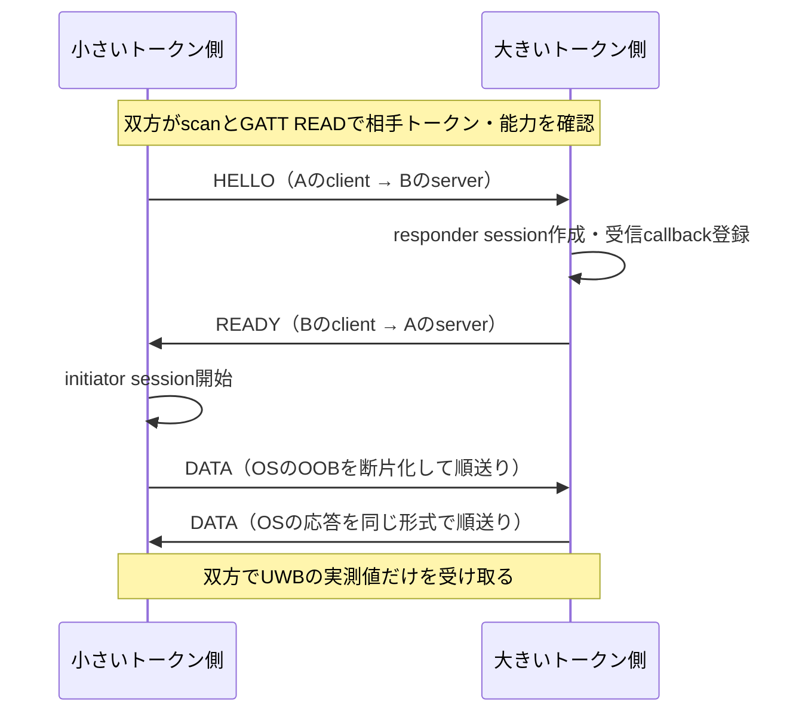

# Phase 5-4：Android近接通信の詳細設計

作成：2026年10月30日（日本時間）。状態：詳細設計。**5-4aのBLE・共通GATTと最新token条件は[ローカル実装済み](PHASE5_ANDROID.md)。5-4bのOOB・UWBも[ローカル実装済み](PHASE5_ANDROID_UWB.md)**。実通信・距離精度の合格を表すものではない。

対象は[仕様原本](PRODUCT_SPEC.md)§9・§10・§19・§22と、[承認記録](IMPLEMENTATION_PLAN.md)D-04・D-09、[Phase 5共通設計](PHASE5_DESIGN.md)。[起動準備](PHASE5_ANDROID_SETUP.md)でAndroid 13実機へのDebugインストール・起動・Mac接続まで確認済み。製品の成立条件、盤面、写真の閲覧権限、サーバーの正本は変更しない。

推奨モデル：Claude Code＝Opus 5.5／Effort High、Codex＝GPT-6.1 Sol／High。通常実装・重点レビューとも同設定。権限・通信・非同期停止とiPhoneとの互換性を扱うため。

## 1. 方式と実装境界

| 組み合わせ                      | 方式                            | 今回決める境界                                                                 |
| ------------------------------- | ------------------------------- | ------------------------------------------------------------------------------ |
| Android 12〜15、UWB非対応・拒否 | BLE広告・探索＋GATTトークン交換 | 位置情報権限なし。双方が広告・探索できることを要求                             |
| Android 16以上同士で互換性あり  | 同じBLE＋Ranging APIの標準OOB   | アプリがGATT転送を提供。OSのOOB内容は解釈・改変しない。UWBだけを開始           |
| iPhone–Android                  | 共通BLE・GATT                   | iOSのNIアーカイブをAndroidで復号しない。混在UWBのRAW方式は既存計画どおり別単位 |

`start(token, serviceUuid, runId)`・`stop(runId)`、イベント`observation`・`unavailable`は既存の`src/fit/native.ts`に合わせる。写真・署名・安全ID・盤面を無線へ載せない。Kotlinは観測と通信制御を担当し、近接しきい値と成立判定は既存TypeScript・サーバーへ残す。回転、再配置、QR、オフラインFIT、対面履歴は追加しない。

## 2. KotlinとExpoの構成

予定する配置は`apps/mobile/modules/proximity/android/`。生成された`apps/mobile/android/`へ実装を残さない。

| ファイル・境界                                 | 責務                                                                      |
| ---------------------------------------------- | ------------------------------------------------------------------------- |
| `build.gradle`・`src/main/AndroidManifest.xml` | Expoローカルモジュール、min SDK 31／compile SDK 36、権限・BLE feature宣言 |
| `ProximityModule.kt`                           | Expoの`Proximity`登録、権限要求、Activity状態、イベント、世代管理         |
| `FitRadio.kt`                                  | 広告・探索、GATT server/client、RSSI、接続ごとの操作キュー、停止          |
| `FitWire.kt`                                   | Android依存のないトークン・オフセット・追加フレームの検証と組立て         |
| `FitRangingPort.kt`                            | API 36の型を外へ出さない測距インターフェース                              |
| `FitRangingApi36.kt`                           | API 36以上のときだけ生成するRanging APIアダプター                         |

`expo-module.config.json`へAndroidモジュールを追加し、`factory.ts`でAndroidも既存アダプターへ接続する。疑似近接のDebug・development・明示設定の条件は維持する。旧OSでも読むクラスのフィールド・公開署名に`android.ranging.*`を置かず、API確認後に専用アダプターを作る。能力なし・サービス取得失敗・API実行失敗はBLEへ戻し、BLE本体の失敗と区別する。

無線状態は一つの専用直列キューで変更する。権限とActivity確認はメインスレッドで行い、結果を直列キューへ戻す。各callbackは`runId`だけでなく、その試行のradio／GATT／測距オブジェクトが現在のものかも照合する。古い`stop`や権限結果で新しい試行を停止・再開させない。

## 3. 権限と前面状態

Manifestに`BLUETOOTH_SCAN`（`usesPermissionFlags="neverForLocation"`）・`BLUETOOTH_ADVERTISE`・`BLUETOOTH_CONNECT`を宣言し、実行時に確認する。API 36以上で測距を使う場合だけ`RANGING`も実行時確認する。位置情報権限、バックグラウンド位置情報、Foreground Service、Bluetoothの自動ON、永続的なペアリングは追加しない。BLE featureは`required=false`とし、非対応ならFITを利用できない理由を返す。

Bluetoothの3権限がなければ電波を出さず、拒否時は`permission`。RANGINGの拒否・非対応だけならBLEを利用できる。両者が同じ「付近のデバイス」グループでも、各権限の実際の付与状態を個別に確認する。[Androidの権限資料](https://developer.android.com/develop/connectivity/bluetooth/bt-permissions)・[Rangingの権限](https://developer.android.com/develop/connectivity/ranging#ranging-permission)

権限要求は広告・探索開始前に行う。権限ダイアログでActivityがpauseしたら、その試行を中断扱いにする。付与結果だけで勝手に再開せず、画面の再試行から新しいサーバートークンで始める。取得済みの場合も開始直前にActivityがresumedかつwindow focusを持つことを確認する。Expoのライフサイクルcallbackに加え、window focus喪失もネイティブで監視し、JSのAppStateだけに停止を任せない。マルチウィンドウや権限ダイアログを含めて実機確認する。

前面離脱・画面ロック・FIT画面を閉じる・モジュール破棄・権限取消・Bluetooth OFFでは、まず試行を無効にしてGATT応答を拒否し、その後広告・探索・接続・測距・タイマー・受信登録を終了する。復帰だけでは再開しない。JSが動く場合の`leaveFit`とサーバーの失効判定は既存処理を使う。

## 4. BLEの開始と観測

1. API 31以上、正しいトークン、packageとサービスUUIDの対応、前面、権限、Bluetooth ONを確認する。local packageはDebug・ローカル印も確認する。production UUIDは予約であり、この作業で本番ビルドを有効にしない。
2. `BluetoothLeScanner`・`BluetoothLeAdvertiser`・GATT serverを取得する。広告非対応やserver作成失敗を無視して探索だけを続けない。
3. GATTサービス登録完了後に、接続可能なlegacy広告を開始する。載せるのは環境別128bitサービスUUID一つだけ。端末名・TX power・トークン・独自の識別情報は載せない。
4. 同じサービスUUIDの`ScanFilter`、前面用のlow latency、遅延レポートなしで探索する。extended advertisingは前提にしない。
5. 広告開始・scan失敗・途中の権限失効も監視する。scan／advertise片方の成功だけでは開始完了と扱わない。

環境別サービスUUIDは[既存のiOS表](PHASE5_IOS.md#androidへ引き継ぐgatt形式)と同一。ネイティブでもpackageとの対応を検証し、JSから任意のUUIDを指定できないようにする。

全scan候補に探索中だけのランダムハンドルを割り当てる。Bluetoothのアドレス・端末名・OS端末IDをJSへ出さず、ディスクにも保存しない。トークン未読・接続できない候補も`token: null`のRSSI観測として送る。候補をGATT接続済みの相手だけに絞らない。

RSSIは実際のscan結果、接続後は`readRemoteRssi`の結果を使う。未知値・範囲外は近い値へ補正せず破棄する。ネイティブの鮮度・経過時間は`elapsedRealtime`系で管理し、`atMs`だけは既存JSの`Date.now`と比較できる壁時計で付ける。端末時計から日付・資格・本当のトークン期限を判定しない。

## 5. 共通GATTと操作順

特性UUIDの共通末尾は`-0E40-4CB6-AF31-8B034F29A718`。

| 特性                    | prefix     | propertyと内容                                                                                          |
| ----------------------- | ---------- | ------------------------------------------------------------------------------------------------------- |
| FITトークン             | `BD1E1001` | READ。16バイトの生データ。base64url 22文字との相互変換はiOSと同じ正規形を要求                           |
| iOS NI                  | `BD1E1002` | READ。Android serverでは空。Android clientは内容を読まず、Appleのアーカイブを復号しない                 |
| Android能力（追加）     | `BD1E1003` | READ。固定18バイト：`version=1:u8 + flags:u8 + 現在のFITトークン:16 bytes`                              |
| Android OOB転送（追加） | `BD1E1004` | WRITE with responseのみ。§7のフレーム。READ・notify・write without response・prepared writeは許可しない |

能力flagsのbit 0は本書v1のOOB転送対応、bit 1は「API 36以上・RANGING許可済み・UWB ENABLED・距離測定対応」を表す。UWB利用条件を満たしたときだけ両bitを立てる。その他のbitは0。未知version・bit・長さ・トークン不一致はUWB不成立としてBLEへ戻る。能力は本人確認として信用しない。Android 12〜15はflags=0。iOSに追加特性がなくても正常で、共通トークンだけでBLEを続ける。

serverはcallback時にも前面・試行・45秒の保守的上限を確認する。READのoffsetは0〜値の長さまで許可し、末尾は空成功、負数・長さ超過は`GATT_INVALID_OFFSET`。応答は交渉済みMTUのread応答上限に収まる部分だけを返す。WRITEはoffset=0、`preparedWrite=false`、応答要求ありを必須とする。未知特性・不正形式には成功を返さない。

clientは接続ごとにservice discovery・MTU要求・read・write・RSSI取得を一つずつ実行する。API 31〜32の旧write APIも同じ直列キューで扱い、API 33以上は値を引数に渡すwrite APIを使う。callbackのvalueはコピーする。MTU要求失敗時は既定値23で続け、Android 14以降の大きなMTUを前提にしない。成功・失敗・timeoutのcallbackで次へ進める。GATTエラーを即時無制限リトライしない。[Android BLE接続](https://developer.android.com/develop/connectivity/bluetooth/ble/connect-gatt-server)・[BluetoothGatt](https://developer.android.com/reference/android/bluetooth/BluetoothGatt)

**接続順（5-5cで追加）**：新しく見つけた相手への自発的な接続は2秒待ち、その間に相手から接続されたらそのリンク上でGATT clientを開始する。サービス探索の期限だけ10秒、ほかの操作は3秒。iPhoneは広告と接続に同じアドレスを使うため、Androidが先に接続するとiPhoneから接続できず、2候補に見えるため。経緯と実機結果は[5-5cの記録](PHASE5_GATT_LINK.md)。

5-5dで、無線の開き直し直後にOSが通知する前回のリンクは再利用しない（サービス登録後のリンクだけ）、前回のリンクが残る相手へは自分からの接続を最大6秒待つ、広告の送信出力をHIGHにする、を追加した。近接しきい値・機種補正は変更していない。[5-5dの記録](PHASE5_MIXED_FIT.md)。5-5eで、トークン特性値の末尾にOS区分1バイト（Androidは2）を足し、読み取った区分と端末の機種（`Build.MODEL`）をRSSI補正の選択だけに使うようにした（[5-5eの記録](PHASE5_GPROX_CALIBRATION.md)）。

## 6. Ranging APIの開始条件と役割

ローカルと相手が§5のUWB条件を満たし、トークンが確認済みで、最近観測した候補が一人のときだけ測距を準備する。別候補が見えたら測距を止める。FIT可否の複数候補・RSSIしきい値は引き続きTypeScriptが決める。遠い別候補による測距停止は保守的な制御で、BLEの候補を隠す理由にはしない。

両FITトークンの16バイトを符号なし辞書順で比較し、小さい側をUWB initiator、大きい側をresponderとする。BLEのcentral／peripheral役割とは別であり、双方の広告・探索・GATT server/clientは継続する。自分と同じトークンは相手トークンとして使わない。候補としての観測は残す。

API 36の実在する型は`RangingManager`、`RangingSession.Callback`、`DeviceHandle`、`TransportHandle`。各相手へ試行中だけの`RangingDevice`を割り当てる。`TransportHandle.sendData`の一回を一メッセージとしてGATT転送し、受信メッセージを`ReceiveCallback.onReceiveData`へ一度だけ渡す。受信callback登録前のデータは上限付きで保持する。[TransportHandle](https://developer.android.com/reference/android/ranging/oob/TransportHandle)

受信通知は`registerReceiveCallback`で渡されたExecutorに従って配送し、配送時にも現在の試行・callbackかを確認する。並列Executorでも一つのdrainでメッセージ順を維持し、SDKへ渡した受信配列はSDKに所有権を渡す。`sendData`の呼出元スレッドから直接radio状態を変更せず、直列キューへ渡す。close後にExecutorへ残った通知でセッションを復活させない。

設定は次のとおり。SDK 36のコンパイルとfake transportの両役割試験は[5-4bで確認](PHASE5_ANDROID_UWB.md)した。実機での動作は未確認。

- initiator：相手一人の`DeviceHandle`、`OobInitiatorRangingConfig`、`RANGING_MODE_HIGH_ACCURACY`、`SECURITY_LEVEL_SECURE`。要求間隔は100〜500 msを開発用の初期値とする。サポートされなければBLEへ戻る。
- responder：対応する`DeviceHandle`と`OobResponderRangingConfig`。
- `RangingPreference`の役割を一致させ、角度取得・カメラ補助・センサー融合は要求しない。
- capabilities callbackを登録し、`getTechnologyAvailability()[UWB] == ENABLED`と距離対応を確認する。利用不可へ変われば測距を閉じる。
- `onStarted`・`onResults`のtechnologyがUWB以外なら測距全体を停止し、その値をFIT判定へ渡さない。UWB以外のRAW設定は作らない。

**UWBだけを選ぶ設計判断**：SDK 36のBuilderには技術filterのsetterがない。Android 16の[AOSP RangingEngine](https://android.googlesource.com/platform/packages/modules/Uwb/+/refs/heads/android16-release/ranging/service/java/com/android/server/ranging/RangingEngine.java)では`HIGH_ACCURACY`の場合にUWBだけを要求・選択しているため、標準OOBを維持できると判断した。AUTO・PREFERRED・FUSEDは使わない。新しいAPIのfilterや廃止予定の扱いは、compile SDK更新時に見直す。手元SDKの署名確認とAOSPの読み取りは、各メーカー実機での動作保証ではない。

## 7. OOBのGATT転送形式（本アプリv1）

両端末が持つ**自分のGATT clientから、相手serverの1004特性へWRITE with response**を行う。往復で別の接続を使うため、CCC・notificationや単一接続の役割反転は不要。OSのOOBバイト列を包むだけで、Androidの標準OOBプロトコルを独自解釈しない。

各writeのヘッダーは10バイト。整数はnetwork byte order（big endian）。

| byte offset | 内容                                                           |
| ----------- | -------------------------------------------------------------- |
| 0           | `version:u8 = 1`                                               |
| 1           | `type:u8`。1=HELLO、2=READY、3=DATA、4=ABORT                   |
| 2〜5        | `messageId:u32`。送信方向ごとに1から増加。試行中に再利用しない |
| 6〜7        | `totalLength:u16`。完成bodyの長さ、32〜4128                    |
| 8〜9        | `offset:u16`。body内の位置                                     |
| 10〜        | body断片。空断片は拒否                                         |

bodyは常に`senderToken:16 + recipientToken:16 + payload`。HELLO・READY・ABORTのpayloadは空、DATAのpayloadはOSが渡した1〜4096バイト。フレームのtype・total・messageIdは全断片で同一とする。最大write長は`min(negotiatedMtu - 3, 512)`、断片長はそこから10を引いた値まで。MTU 23でも10バイトずつ送れる。

HELLOは小さい側から一度だけ送る。responderは現在の相手・能力・役割を確認し、受信callbackを登録してからREADYを返す。initiatorはREADY受信後に開始する。標準OOBの送受信は受信callbackとREADYの準備が整うまで上限付きで待つ。相手準備が間に合わなければ起動timeoutでBLEへ戻る。

受信側はoffset=0から開始し、次のoffsetが受信済み長さと一致する断片だけを追加する。完全に同じ直前断片の再送は再追加せずACKし、異なる重複・飛び・長さ変更・version違い・offset超過はそのOOB転送を失敗させる。メッセージ全体を復元して両トークンを現在の組み合わせと照合するまで、OSへ渡さない。完成済みmessageIdは再配信しない。送信側はwrite成功応答を待って次の断片へ進む。timeout後の同じ接続への自動再送は行わず測距を中止する。

Bluetoothアドレスを本人識別の根拠にしない。incoming writeの相手が名乗るトークンは、outgoing READで確認した現在の候補と一致することを要求するが、これも暗号学的な本人認証ではない。盗聴・改造・高度な中継攻撃を完全に防ぐものとせず、既存のApp Check・相互報告・双方確認・期限・回数制限を維持する。`SECURITY_LEVEL_SECURE`もアプリ利用者の本人確認として説明しない。

## 8. 鮮度と判定への接続

観測形式は既存と同じ`runId / deviceId / token / rssi / distanceMeters / atMs`。トークンはメモリー中だけに保持し、server向け相互報告以外のログ・保存・集計へ使わない。

- 未読・再読失敗・UWB準備中は`token: null`として候補の存在を残す。能力判定前にトークンをJSへ一度出してからUWB準備へ入る順序にしない。
- UWBの最初の有効な結果、または明示的なBLE fallbackが決まるまで近接報告を許可しない。UWB開始失敗で無期限にFITを待たせない。
- UWB値は有限・非負、当該peer／sessionの値、取得から1秒以内、RSSIも新鮮な場合だけ送る。UWBが有効な間に値が古くなったら、再び`token: null`として報告を止める。測距を正式に閉じた後にBLE判定を再開する。
- peerトークンが変わったら、そのpeerの測距・OOB・保留readを破棄し、ハンドルを更新する。古いハンドルとトークンで継続判定しない。一時的に候補が複数に見える場合は安全側に待つ。

**5-4aで追加した既存判定の条件**：設計時の`policy.ts`は窓内の「最後の非nullトークン」を使っていた。最新観測が`token: null`でも古いトークンで報告できたため、**候補の最新観測のトークンが非nullであること**を必須にした。nullでも候補数は減らさない。観測を時刻順・同時刻は受信順で扱い、null→再読・token変更・順序の遅れを試験した。API形状や既存しきい値は変更していない。結果は[実装記録](PHASE5_ANDROID.md)を参照。

45秒のネイティブ停止と30秒のJS更新は既存の開発用仮値を引き継ぐ。サーバーの期限・日付・資格確認を置き換えない。G-PROXの製品用合格値は未確定であり、この文書で確定しない。

## 9. 上限・timeoutと終了

以下は通信・メモリー保護の開発用初期値であり、距離の合格基準ではない。実機で遅延を測って調整する。

| 対象               | 初期値・動作                                                                                            |
| ------------------ | ------------------------------------------------------------------------------------------------------- |
| scan候補           | 最大16。上限を越えて観測を捨てたままFITを許可せず、試行を`interrupted`で終了                            |
| 同時outgoing GATT  | 最大2。未接続候補のRSSI観測は維持。待機キューを無制限に作らない                                         |
| GATT接続・各操作   | 接続5秒、各read/write/MTU/RSSI callback待ち3秒。失敗時は接続を閉じ、最低1秒空ける                       |
| トークン再読・RSSI | 再読約1秒、RSSI取得約250 ms。操作キューが空いたときだけ発行                                             |
| peer保持           | 実RSSIの最後の観測から4秒で解放。解放時に関連測距も終了                                                 |
| UWB起動            | HELLO開始から5秒で有効な測距がなければ閉じてBLEへ。一試行一相手・一回の試行で、失敗後の再交渉ループなし |
| 受信組立て         | 同時4バッファまで・各最大4128 bytes・組立て2秒。全体で上限を超えたらOOBを中止                           |
| 送信保留           | 最大8メッセージ、各payload最大4096 bytes。超過・send失敗はOOBを中止                                     |
| 完成message数      | 方向ごとに最大32。上限超過で測距を閉じる。状態を試行をまたいで保存しない                                |

`stop`は何度呼んでも同じ結果とする。先に世代を無効化し、advertiser／scannerを停止、clientをdisconnect・close、server接続をcancelしてclose、測距sessionとtransportをclose、capabilities callback・BroadcastReceiver・タイマーを解除し、全トークン・距離・アドレス・キューを破棄する。権限取消により停止APIが例外を投げても、残りの終了処理を続ける。キャンセル時にABORT送信の完了を待って電波を残さない。

`unavailable`はBLE権限なし=`permission`、Bluetooth OFF=`bluetooth-off`、必須機能なし=`unsupported`、前面離脱・scan失敗・上限・保守的期限=`interrupted`。UWB単独の失敗では`unavailable`を出さず、BLEへ戻る。`TransportHandle`のdisconnect／close／send失敗はそれぞれのcallbackへ通知し、close後の復活・自動reconnectを行わない。

## 10. 実装順と完了条件

| 単位                     | 対象                                                                | 自動・ビルドで確認すること                                                                                                          |
| ------------------------ | ------------------------------------------------------------------- | ----------------------------------------------------------------------------------------------------------------------------------- |
| 5-4a（ローカル実装済み） | BLE・共通GATT、権限・前面停止、Expo登録、factory接続、最新token条件 | pure Kotlinのwire試験、古い接続のcallback・停止・操作順序試験、既存JS試験、Android Debugビルド。追加能力はflags=0。相互通信は未確認 |
| 5-4b（ローカル実装済み） | 能力交換・§7のOOB、API 36アダプター・UWB、BLE復帰                   | MTU 23／大MTUの断片化・順序・二重受信・偽token・上限・両役割・timeout、API 36のコンパイル、旧OSで型ロードしないこと                 |
| 5-5                      | 実機測定・機種補正・合格判定                                        | G-PROXの合格基準を測定前に確定。疑似近接やビルドの成功を距離精度の証明にしない                                                      |

5-4aと5-4bはPhase 5内の小さな作業単位で、Android UWBをMVPから外す変更ではない。各実装後に記録と次作業を更新し、途中をPhase 5完了と扱わない。

必須の実機確認：Android 12〜15同士、Android 16以上UWB対応同士、片側非対応・権限拒否、iPhone–Android BLE、3台以上・混雑・遮蔽、画面ロック・バックグラウンド・Bluetooth OFF、トークン更新・4時境界・通信断。`neverForLocation`による広告のフィルタリング、両端末でscanとadvertiseが共存すること、停止後にGATTからトークンを読めないことも確認する。

手元のAndroid 13端末は起動確認済みだが、無線・撮影・安全機能は未確認。iPhoneの実通信、Android 16／UWB、混在の実機条件は未充足。実機測定の完了時期は端末の確保に依存し、現時点では見積もり困難。

## 11. 設計作成時の検証（通信本体の実装前）

公式API資料・Android 16 AOSP・手元のSDK 36 `android.jar`の公開署名を照合した。本文の追加UUID・フレーム・上限・役割選択は本アプリの設計値で、Android標準の形式や実機確認済みの数値として扱わない。

検証結果（2026年10月30日）：

- 整形・Lint・TypeScript型検査と依存境界：成功。
- `pnpm test`：共通・サーバー110件、モバイル155件、Nodeスクリプト9件の計274件が成功。
- `pnpm test:emulators`：12スイート115件が成功。
- 設計で使うinitiator／responder設定、DeviceHandle、UWB能力・結果の確認、TransportHandle受信callbackの小さなJavaプローブを、JDK 17とSDK 36の`android.jar`でコンパイルして成功。型・設定メソッドの存在の確認に限り、セッション実行やAndroidモジュールの完成を表さない。プローブとログはGit対象外の`.tools/android-proximity-design-baseline/`に保存。
- ローカル文書リンク24件と保存した文書との差分を確認。`PRODUCT_SPEC.md`・`AGENTS.md`のハッシュ不変を確認。図の通信方向とフレーム長、古い応答・null token・3台以上・停止の条件を手動で照合。

文書だけの変更のため実行コードのテストは追加せず、§10の実装時試験計画を追加した。変更は設計・試験計画・引き継ぎ文書に限定し、通信コード・製品仕様原本・クラウド・端末データは変更していない。新しい実機試験・無線通信・距離測定は実施していない。

5-4bのSDK登録前送信、HELLOの一時保持、恒久切断時のclose、開始期限の具体化と検証結果は[実装記録](PHASE5_ANDROID_UWB.md)を参照。次は5-5の実機試験準備。
