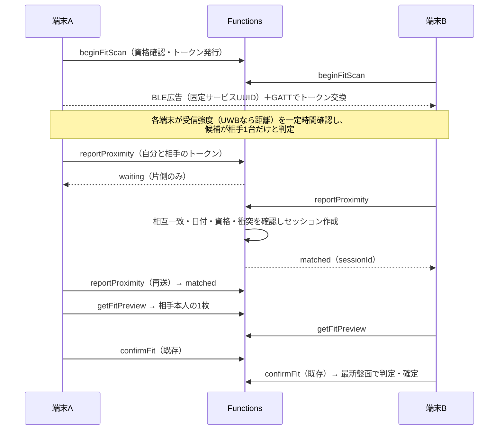

# Phase 5：対面FITの設計案

作成日：2026年10月30日（日本時間）  
状態：設計案。2026年10月30日、ユーザーの「次の実装お願いします」を§8の推奨案どおりに進める指示と解釈し、単位5-1（サーバー）を実装した（§10）。5-2（画面・疑似近接）は§11、5-3（iOSネイティブ）のローカル実装は§12。受け入れ条件に沿った実機相互通信・距離試験は未実施。5-4のAndroidビルド・起動準備は[別記録](PHASE5_ANDROID_SETUP.md)、方式は[Android詳細設計](PHASE5_ANDROID_DESIGN.md)、5-4aのBLE・共通GATTは[ローカル実装済み](PHASE5_ANDROID.md)。Ranging API・OOB本体（5-4b）も[ローカル実装済み](PHASE5_ANDROID_UWB.md)。実機UWBは未確認。5-5aの[実機試験準備](PHASE5_DEVICE_TEST_PLAN.md)は整備し、5-5bの[開発用観測](PHASE5_PROXIMITY_DIAGNOSTICS.md)を追加した。基準決定・距離測定・機種補正・合格判定は未実施。§8の回答が推奨案と異なる場合は設計と5-1を直す。  
推奨モデル：Claude Code＝Opus 5.5・Effort High／Codex＝GPT-6.1 Sol・High（[実装ごとの案内](AI_IMPLEMENTATION_GUIDE.md#task-2)）。

[仕様原本](PRODUCT_SPEC.md)§9・§10・§16.4・§18・§22・§24と、[実装計画](IMPLEMENTATION_PLAN.md)のD-04・D-09・G-PROX・脅威分析を前提にする。製品ルールは変更しない。この文書の数値はすべて**開発中の仮値**であり、G-PROXで実機測定の結果から確定するまで、公開用の値として扱わない。

## 1. 範囲

| 含める                                                                                                                | 含めない                                                                    |
| --------------------------------------------------------------------------------------------------------------------- | --------------------------------------------------------------------------- |
| 短期トークンの発行・失効・使い捨て、相互検知の確認、二者セッション作成、相手本人の1枚表示、離脱、回数制限（サーバー） | QRコード、オフラインFIT、3人以上のFIT、FIT履歴・相手の記録（仕様§25で除外） |
| FIT画面の状態遷移（§16.4の9状態）、近接判定の純粋関数、開発版だけの疑似近接モード                                     | GPS・位置履歴・位置情報権限                                                 |
| Swift（Core Bluetooth＋Nearby Interaction）／Kotlin（BLE Scan・Advertise＋Ranging API）のローカルモジュール           | Gallery・通知・書き出し（Phase 6）、Maestroの本格整備（Phase 7）            |
| G-PROXの測定手順と、合格基準の決定に必要な項目                                                                        | 正確な10cmの保証、疑似近接による距離精度の証明                              |

既存の`confirmFit`（二者確認・最新盤面での再判定・D-09の4時判定）と`createVerifiedSession`（内部処理）は作り直さず、前段の近接確認を接続する。

## 2. 全体の流れ



近接の判定は端末が行い、サーバーは「両端末が互いを近いと報告したこと」「トークンが本人の・当日の・有効な・未使用のものであること」「同じトークンが別の相手と相互一致していないこと」を確認する。サーバーは距離そのものを検証できない。改造クライアントによる虚偽報告はApp Check・相互一致・双方確認・回数制限で困難にするが、完全には防げない（仕様§9.3の残余リスク）。

## 3. サーバー設計

### 3.1 追加する公開API

すべて既存の`callable`と同じく匿名Auth・App Check・環境一致を要求し、余分なフィールドを拒否する。

| Callable          | 入力                           | 処理・返却                                                                                                                                                                                      |
| ----------------- | ------------------------------ | ----------------------------------------------------------------------------------------------------------------------------------------------------------------------------------------------- |
| `beginFitScan`    | `{}`                           | 当日・利用中・承認済みピース・未削除・自盤面が20未満・回数制限内を確認し、128bitの乱数トークンを発行。`{ token, expiresAtMs, serviceUuid }`を返す。不可なら理由（未撮影・完成・削除済み・制限） |
| `reportProximity` | `{ token, peerToken, method }` | 相互検知の登録と確認。`waiting`／`matched(sessionId)`／`already-connected`／`conflict`／`expired`のいずれか。相手の情報は返さない                                                               |
| `getFitPreview`   | `{ sessionId }`                | 参加者本人だけ。相手本人の当日ピースの四辺・署名・キャプション・正規化画像（Base64）を返す。ブロック関係・削除・停止を読み取り時に再確認し、該当すれば無地                                      |
| `leaveFit`        | `{ sessionId }`                | セッションを`cancelled`にする。確定済みなら何もしない                                                                                                                                           |
| `confirmFit`      | `{ sessionId }`（既存）        | 変更は最小限。`cancelled`の拒否と、§3.4の「盤面更新による再判定失敗」の区別を追加                                                                                                               |

`method`は`'ble' | 'uwb'`だけを受け取り、日次の件数集計（Phase 7）以外に使わない。受信強度・距離の生値はサーバーへ送らない。

### 3.2 非公開データ

| 文書                                   | 内容                                                                                                    | 保存                                                       |
| -------------------------------------- | ------------------------------------------------------------------------------------------------------- | ---------------------------------------------------------- |
| `proximityTokens/{tokenHash}`          | 発行者の安全ID、日付キー、期限、検知した相手のトークンハッシュ（1件）、衝突フラグ、使用済みセッションID | 文書IDはSHA-256。トークン原文を保存しない。`expireAt`のTTL |
| `fitSessions/{id}`（既存）             | 既存項目に`status: 'cancelled'`の表現と、作成時の両盤面の版本を追加                                     | 既存のTTL                                                  |
| `fitViews/{uid}`（新規・本人のみ読取） | 現在のsessionId、段階（preview・waiting・merged・not-merged・cancelled・expired）、理由、成功時の盤面ID | 相手の識別子・人数を含めない。セッション終了後に削除       |
| `rateLimits/{uid}`                     | API別の時間枠と回数                                                                                     | 非公開。日をまたいだ分析に使わない                         |

`fitViews`は確認待ちから成功・失敗への切り替えをリアルタイム購読するために置く（`clientState`と同じ本人限定のRules）。セッションの中身や相手のIDをクライアントへ出さない。

### 3.3 相互検知の判定

1. 呼出者の`token`がハッシュで見つかり、本人発行・当日・期限内・未使用であること。`peerToken`も当日・期限内・未使用で、別の安全IDであること。
2. 自分の文書へ「検知した相手」を記録する。すでに別の相手を記録していて、その相手とも相互一致していた場合は衝突として両方を使えなくする。
3. 相手の文書が自分を記録していれば相互一致。トランザクションで両トークンを使用済みにし、セッションIDを両ハッシュの正規順序から決定的に作って`createVerifiedSession`相当を実行する。同時に到着した二つの報告は同じセッションに収束する。
4. **片側だけの報告は衝突に数えない。** 遠くで盗聴したトークンを一方的に報告しても、他人のFITを妨害できないようにするため。3台以上の近接は、まず各端末の判定（§4.2）で開始しない。サーバーは「同じトークンが2人と相互一致した」場合だけを拒否する。
5. 同じ盤面の二人は、セッションを作らず`already-connected`で終える（仕様§24「接続不要として終了」）。`confirmFit`の同じ判定も残す。
6. ブロック関係にある二人でもFITは拒否しない。拒否するとブロックの存在が相手に伝わるため（仕様§17.3）。プレビューは既存規則どおり双方とも無地にする（§8の確認事項）。

### 3.4 状態と失効

- トークンの期限は日付境界（午前4時）を越えない。期限は各APIが判定し、TTL削除の時期に依存しない。
- セッションは作成時の両盤面の版本を保存する。`confirmFit`が不成立になったとき、版本が変わっていれば理由に「盤面更新による再判定」を付け、§16.4の専用画面へ出し分ける。成立・不成立の判定ロジックは変更しない。
- 離脱・期限切れ・4時越えのセッションは`confirmFit`で拒否する。確定済みのセッションに後から`leaveFit`しても結果は変わらない。
- プレビュー画像は`getFitPreview`の応答だけで渡し、Storageの閲覧権限（`mediaAccess`）を広げない。端末はメモリーにだけ保持し、画面を離れたら破棄する（仕様§5.4）。

### 3.5 回数制限

`rateLimits/{uid}`の時間枠カウンターをトランザクションで更新する。対象は`beginFitScan`・`reportProximity`・`getFitPreview`・セッション作成数。超過時は理由を「しばらく待ってから」とだけ返す。値は§7のG-PROXで決める。

## 4. モバイル設計

### 4.1 構成

```text
apps/mobile/
  modules/proximity/          # Expo Modules API（Swift / Kotlin）。観測値の報告だけを行う
  src/fit/policy.ts           # 近接判定の純粋関数（受信強度の窓・継続時間・複数候補・UWB優先）
  src/fit/machine.ts          # FIT画面の状態遷移（純粋関数）
  src/fit/simulated.ts        # 開発版だけの疑似近接（ネイティブと同じ観測値の形）
  src/components/fit.tsx      # §16.4の画面
```

判定のしきい値・継続時間はネイティブではなくTypeScript側に置く。端末ごとの調整値を一か所で管理し、Jestで境界値を試験できるようにする。ネイティブは「どのトークンを・いつ・どの受信強度／距離で観測したか」と権限・無線状態だけを通知する。

### 4.2 近接判定（仮の規則）

- **近い**：直近の窓で相手の受信強度の中央値が近接しきい値以上、かつその状態が継続時間以上続いた。UWBの距離が得られている場合は、UWBの距離がしきい値以内であることを必須にし、UWBが「遠い」と言えばBLEの結果で近いとしない。
- **複数候補**：自分以外のアプリ端末が「存在しきい値」（近接しきい値より緩い）以上で2台以上見えている。この間は報告せず「少し離れてやり直す」案内を出す（仕様§9.1）。
- 端末機種による送信出力の差は、機種別の補正表で吸収する。補正表はアプリに同梱し、測定結果で更新する。

### 4.3 画面の状態（仕様§16.4）

探索中 → 複数端末検出 → 相手本人のピース確認 → 最終確認 → 相手の確認待ち → 接続成功／接続不可／盤面更新による再判定失敗／日付切り替わり。加えて、権限なし・Bluetoothオフ・非対応端末・回数制限・相手の離脱・タイムアウトを表示する。

- アプリが前面でなくなったら、ネイティブの広告・探索を直ちに止める。確認中のセッションは`leaveFit`で離脱扱いにする（§8の確認事項）。
- 復帰時はサーバーの日付状態を再取得し（仕様§10）、日付が変わっていれば「日付切り替わり」を表示する。
- 失敗後に表示した相手のピースは、画面を離れるまでだけ表示する。Galleryや画像キャッシュに保存しない。

### 4.4 疑似近接モード（仕様§22.3）

- 開発版（`APP_ENV=development`かつDebugビルド）でだけ有効。staging・production・Releaseのビルドでは、設定があっても起動時に拒否する。
- ネイティブの代わりに、`policy.ts`へ人工の観測値を流す。サーバーへの要求は本物と同じ経路を使う。
- 1台で画面遷移を試すための「人工の相手」は、ローカル専用のFunctions入口（`index.local.ts`、`demo-`プロジェクト固定）にだけ置く。通常の配備物には含めず、配備物の検査で含まれないことを確認する。
- 疑似近接の成功は、画面遷移とサーバー連携の確認に限る。実距離の精度の証明として扱わない。

## 5. ネイティブ設計

### 5.1 BLE（全端末）

- 両端末が**広告と探索を同時に**行う。受信強度は互いの広告から測るため、双方が広告できない端末ではFITできない（非対応として案内する）。
- 広告するのは環境別の固定サービスUUIDだけ。iOSの広告にはローカル名とサービスUUIDしか載せられないため、トークンは広告に載せず、GATTの読み取り特性で渡す。iOSとAndroidで同じ方式に統一できる。
- トークン（16バイト）は写真・名前・安全IDを含まない乱数。トークンは`beginFitScan`ごとに新しくし、期限前に更新する。
- 前面にあるときだけ動作する。iOSのバックグラウンド広告（オーバーフロー領域）は使わない。
- Android 12以上は`BLUETOOTH_SCAN`（`neverForLocation`）・`BLUETOOTH_ADVERTISE`・`BLUETOOTH_CONNECT`を要求し、位置情報権限を要求しない（仕様§19.1）。`neverForLocation`で自分たちの広告が除外されないかは実機で確認する。iOSは`NSBluetoothAlwaysUsageDescription`を設定する。

### 5.2 UWB（対応端末）

| 組み合わせ             | 方式                                                                                                                                                           | MVPでの扱い（提案）                       |
| ---------------------- | -------------------------------------------------------------------------------------------------------------------------------------------------------------- | ----------------------------------------- |
| iPhone同士             | Nearby Interactionのピア方式。`NIDiscoveryToken`をGATTで交換                                                                                                   | 最初に実装                                |
| Android 16以上同士     | Ranging API（`android.permission.RANGING`）。OOBは標準方式（`RANGING_SESSION_OOB`）。端末の発見と接続はアプリ側のBLEが担う                                     | iPhone同士の次に実装                      |
| iPhone–Android 16以上  | AndroidはRAW方式（`RANGING_SESSION_RAW`）でAppleのNearby Interaction Accessory Protocolに合わせ、iPhoneはアクセサリー構成として扱う。両側に独自のOOB交換が必要 | 実機確認後の追加単位。それまではBLEで判定 |
| Android 12〜15・非対応 | BLEのみ（D-04）                                                                                                                                                | BLEで判定                                 |

- 対応チップの有無だけで利用可能と判断せず、OSの能力検出（iOSの`NISession`の対応確認、Androidの`RangingManager`の能力コールバック）と、相手の能力の交換で決める。
- UWBが一定時間で開始できなければBLEの判定へ戻る。どの方式で成立したかは日次件数の集計にだけ使う。
- iOSは`NSNearbyInteractionUsageDescription`の権限を求める。拒否されてもBLEでFITできる。

Android 16のRanging APIはUWBのほかBluetoothのChannel Sounding・RSSI測距・Wi-Fi NAN RTTにも対応する。仕様§9.2の「BLE＋UWB」を超えるため、MVPではChannel Soundingを使わない。[Android Ranging](https://developer.android.com/develop/connectivity/ranging)・[Nearby Interaction](https://developer.apple.com/documentation/nearbyinteraction)・[Nearby Interaction Accessory Protocol](https://developer.apple.com/download/files/Nearby-Interaction-Accessory-Protocol-Specification-R4.pdf)

## 6. 試験

| 区分             | 内容                                                                                                                                                                                                                                                                |
| ---------------- | ------------------------------------------------------------------------------------------------------------------------------------------------------------------------------------------------------------------------------------------------------------------- |
| 単体（Jest）     | 判定関数の境界値（しきい値・継続時間・窓・複数候補・UWB優先・機種補正）、状態遷移、トークン・セッションIDの生成                                                                                                                                                     |
| Emulator         | 資格のない発行の拒否、期限切れ・使用済み・他人のトークン・前日トークンの拒否、片側報告の待機、相互一致、同時報告の収束、衝突、同じ盤面、プレビューが相手1枚だけ・ブロック時の無地・削除後の拒否、離脱、4時越え、回数制限、盤面更新による再判定の区別、既存の同時FIT |
| 画面（RNTL）     | 疑似近接で§16.4の全状態へ遷移。権限なし・前面離脱・日付変更                                                                                                                                                                                                         |
| 配備物の検査     | 通常の配備物に疑似近接・人工の相手が含まれないこと                                                                                                                                                                                                                  |
| 実機（V-NATIVE） | §7の測定手順。自動試験の成功を実距離の合格として扱わない                                                                                                                                                                                                            |

## 7. G-PROX：実機試験の前に決めること

実機の測定で値を決める。下表の「初期値」は開発中に動かすための仮値で、公開用の値ではない。

| 項目                        | 初期値（仮）                                  | 決め方                               |
| --------------------------- | --------------------------------------------- | ------------------------------------ |
| BLE近接しきい値             | 機種補正後の中央値 −45 dBm 以上               | 10cm・30cm・50cmでの分布から決める   |
| BLE存在しきい値（複数候補） | −70 dBm 以上                                  | 教室程度の混雑で誤検出が出ない値     |
| 継続時間・判定窓            | 2秒継続・1秒窓                                | 成立までの時間と誤接続のバランス     |
| UWB距離しきい値             | 0.15 m 以内を1秒継続                          | iPhone同士・Android同士で測定        |
| トークン有効時間・更新間隔  | 45秒・30秒ごとに更新                          | 相互一致までの所要時間の測定         |
| FITセッション有効時間       | 90秒（試験用の30秒は採用しない）              | プレビューから双方確認までの所要時間 |
| 回数制限                    | 発行10回／分、報告2回／秒、セッション60件／日 | 通常利用を妨げず連続試行を抑える値   |
| 接触演出・触覚              | 未定                                          | G-UIと合わせて決める                 |

5-5eで近接しきい値を−48 dBmとし、受信側の機種×送信側のOS区分による補正表を追加した（iPhone 16がAndroidから受ける場合+17 dB、ほかは0）。GATTのトークン値にOS区分1バイトを足した。根拠と制限は[5-5eの記録](PHASE5_GPROX_CALIBRATION.md)。

**測定手順（案）**：iPhone同士・Android同士・混在、UWBあり／なしで、5・10・20・30・50・100cm、向き（背面同士・横並び）、手で覆う・ポケット、3台以上を30cm〜1mに置く状態を、各条件20回以上試す。記録するのは成立／不成立・所要時間・誤接続（意図しない相手との成立）・複数端末検出の件数とする。測定は開発者の端末と人工のピースで行い、生の受信強度は端末内の開発用ログにだけ残す。

**合格基準（ユーザーが決める項目）**：

- 10cmで、一定時間内に成立する割合の下限
- 50cm以上で成立してしまう割合の上限（誤接続率）
- 3台以上の状態で、二者のFITが始まってしまう割合の上限
- 遮蔽・混雑で成立しない場合を許容するか

結果が基準を満たさない場合は公開を止める（計画のG-PROX）。BLEだけで正確な10cmを保証するとは書かない。

現状の端末一覧、基準の具体案、観測定義、記録・集計手順は[5-5aの試験準備](PHASE5_DEVICE_TEST_PLAN.md)に記録した。基準案は未承認であり、上表の仮値は公開用へ昇格しない。現行コードはBLE・UWB共通hold 2秒で、上表のUWB 1秒は当初案。測定対象のビルドはコードの値で固定し、変更は別の単位で扱う。

## 8. ユーザーに確認したいこと

1. **実装の分け方**：§9の5単位で、サーバー（5-1）から順に進めてよいか。
2. **iPhone–AndroidのUWB**：MVPでは当面BLEで判定し、RAW方式の相互運用は実機確認後の追加単位にする案でよいか（Android 12〜15のBLEのみはD-04で承認済み）。
3. **ブロック関係の二人の直接FIT**：拒否せず、双方無地のプレビューで進める案でよいか（拒否するとブロックが相手に伝わる）。
4. **前面離脱**：確認待ちの途中でアプリが前面から外れたら、離脱としてセッションを終える案でよいか。
5. **同じ盤面の二人**：プレビューを出さず、相互一致の時点で「接続不要」として終える案でよいか。
6. **プレビュー画像**：Storageの権限を広げず、応答に画像を含めて渡す案でよいか。
7. **G-PROXの仮値**：§7の初期値を開発用として使い始めてよいか。合格基準の数値はいつ決めるか。
8. **実機**：手元のiPhone（前回はiPhone 16）以外に、2台目のiPhone・Android 12〜15・Android 16以上（UWB対応）の端末を用意できるか。用意できない組み合わせは未確認として残る。

## 9. 実装単位（案）

| 単位 | 内容                                                                         | 推奨モデル（通常／重点レビュー）                                            | 確認方法                    |
| ---- | ---------------------------------------------------------------------------- | --------------------------------------------------------------------------- | --------------------------- |
| 5-1  | サーバー：トークン・相互検知・プレビュー・離脱・`fitViews`・回数制限・契約型 | Sonnet 5.5・Medium／GPT-6.1 Sol・Medium。設計の重点レビューはOpus 5.5・High | Emulator試験                |
| 5-2  | 画面：状態遷移・判定関数・疑似近接・ローカルの人工の相手                     | Sonnet 5.5・Medium／GPT-6.1 Sol・Medium                                     | Jest・RNTL、iPhone 1台      |
| 5-3  | iOSネイティブ：Core Bluetooth（広告・探索・GATT）とNearby Interaction        | Opus 5.5・High／GPT-6.1 Sol・High                                           | iPhone 2台の実機            |
| 5-4  | Androidネイティブ：BLE Scan・Advertise・GATTとRanging API（16以上）          | Opus 5.5・High／GPT-6.1 Sol・High                                           | Android実機・iPhoneとの混在 |
| 5-5  | G-PROXの測定・機種補正・合格判定                                             | Opus 5.5・High／GPT-6.1 Sol・High                                           | §7の測定手順                |

iPhone–AndroidのUWB（RAW方式）は、5-5の後に必要性と実機を確認してから追加単位とする。

## 10. 単位5-1の実装記録（2026年10月30日）

実装：`apps/functions/src/services/fit.ts`・`fit-views.ts`、契約型（`packages/contracts/src/backend.ts`）、Callable 4つ（`beginFitScan`・`reportProximity`・`getFitPreview`・`leaveFit`）、`confirmFit`への接続、`fitViews`のRules・TTL、`proximityTokens`・`rateLimits`のTTL。画面・ネイティブ・疑似近接は未実装。

設計案からの差分：

- `beginFitScan`は`serviceUuid`を返さない。BLEのサービスUUIDは環境別のビルド定数として5-3で決める。
- 発行できない理由は専用のコードではなく既存の`failed-precondition`・`permission-denied`で返す。詳しい状態は`getDayState`で取得する。
- 回数制限は`resource-exhausted`で拒否する。回数は失敗した要求も数える。
- 三台目の扱い：すでに成立したペアは乱さず、三台目に`conflict`を返す。一つのトークンで別々の相手を二つ主張した端末も`conflict`にし、そのトークンは使えない。端末は新しいトークンを発行して少し離れてやり直す。設計案の「両方を使えなくする」より、第三者の一方的な報告で成立済みのFITを壊されにくい。
- 相手が停止中・削除済みでも`waiting`を返し、相手の状態を知らせない。
- ブロック関係の二人はセッションを作り、プレビューを双方とも無地にする（確認事項3の推奨案）。
- 「盤面更新による再判定失敗」は`fitViews.boardChanged`で区別し、`FitOutcome`の型は変えていない。
- `method`（ble／uwb）は検証だけで保存しない。方式別の日次件数はPhase 7の集計で扱う。

検証：整形・Lint・型検査、単体試験（11スイート110件・13スイート107件）、Emulator統合試験12スイート115件（新規のFIT試験とFitViewsのRules試験を含む）、配備物検査（Callable 4つの追加と認可拒否）が成功。

未確認：実機・実クラウド・画面。回数制限・有効時間は開発用の仮値。Storage Emulatorの制約により、プレビュー画像の読み出しは試験では代替実装を使った（実Storageでの読み出しはstaging確認に残す）。

## 11. 単位5-2の実装記録（2026年10月30日）

実装（`apps/mobile/src/fit/`・`components/fit.tsx`）：

- `policy.ts`：近接判定の純粋関数。窓ごとの受信強度の中央値、継続時間、複数候補、UWB優先、機種補正値の引数。値は開発用の仮値。
- `machine.ts`：FIT画面の状態遷移（§16.4の状態に、成立後の競合・権限なし・Bluetoothオフ・回数制限・準備未完了を追加）。終了状態は遅れて届いた通知で復活しない。
- `controller.ts`：サーバーAPI（5-1）との接続。トークン発行、判定、報告、プレビュー、確認、離脱、`fitViews`の購読、日付変更の再確認。
- `source.ts`・`simulated.ts`・`factory.ts`：電波の入力元。疑似近接はDebugビルドかつ`APP_ENV=development`かつローカル開発版の設定（`simulatedProximity`）のときだけ使え、それ以外は「この端末では近くの端末を探せません」と表示する。ネイティブ（5-3・5-4）の入力元は未実装。
- 画面：Todayの「FITする」から開く。ピースが作成済みで盤面が20未満のときだけ表示。アプリが前面から外れると未確認の試行を終了する。
- ローカルサーバー：FIT用の経路と、人工の相手（`simulatePeer`）をローカル専用の入口にだけ追加。通常の配備物には含まれない（バンドル内の検索と配備物検査で確認）。

設計案からの差分：

- 競合（`conflict`）は専用の状態にして電波を止め、利用者が「もう一度試す」で新しいトークンからやり直す。同じトークンで再報告を繰り返さないため。
- トークンの期限切れは端末時計で判断せず、サーバーの`expired`応答で再発行する。
- 確認待ちの時間切れ表示（90秒）は画面の目安で、実際の失効はサーバーが判定する。
- 確認の失敗後は、サーバーの日付状態で「日付切り替わり」と「時間切れ」を区別する。

検証：整形・Lint・型検査、通常試験（11スイート110件、モバイル18スイート140件。FIT関連は新規5スイート33件）、Emulator統合試験12スイート115件、配備物検査、`pnpm test:local`（実ローカルサーバーで、人工の相手との成立・相手1枚のプレビュー・他人の拒否・離脱・離脱後の確認拒否・盤面不変を確認）が成功。

未確認：iPhone実機での画面表示と操作、実BLE・UWB、疑似近接の見た目の確認。疑似近接の成功は画面遷移とサーバー連携の確認に限り、距離精度の証明ではない。人工の相手は盤面の形がランダムなため、確認後の「つながる」「つながらない」はどちらも起こり得る。

## 12. 単位5-3の実装記録（2026年10月30日）

実装：`apps/mobile/modules/proximity/ios/`のCore Bluetooth広告・探索・GATTとNearby Interaction、`src/fit/native.ts`のExpoイベント接続、`factory.ts`のネイティブ選択、権限説明、30秒のトークン更新、前面離脱・古い応答の破棄。詳細・GATT形式・起動方法は[iOS記録](PHASE5_IOS.md)。Android・Gallery・通知は対象外。

疑似近接はローカルDebugで明示した場合のみ維持し、`PROXIMITY_MODE=native`で実通信へ切り替えられる。通常版はネイティブを選択する。しきい値は設計案の開発用仮値で、製品ルール・サーバーの正本・画像の閲覧権限は変更していない。

検証：整形・Lint・型検査、通常試験（共通・サーバー110件、モバイル155件、スクリプト5件）、Emulator 115件、iOS 16.4向けSDK型検査とGATT形式試験、通常版バンドルのローカル専用コード非混入検査が成功。Xcode 27で署名・JS同梱を省略した実機向けDebugネイティブビルドも成功。インストールと起動は未実施。

実機未確認：ユーザーから今はiPhone 2台を用意できないとの回答あり。BLE／UWBの相互通信・権限ダイアログ・距離・混雑・3台以上・遮蔽は未確認。G-PROXは未通過であり、単位5-3全体の受け入れやPhase 5の完了とは扱わない。
